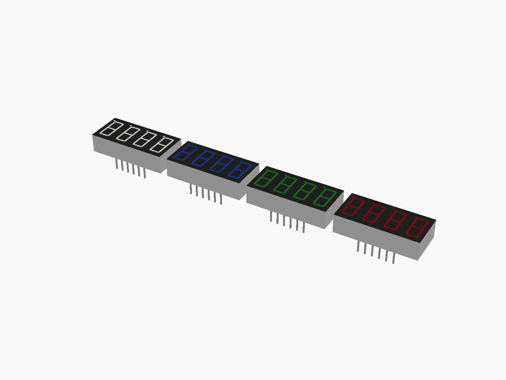
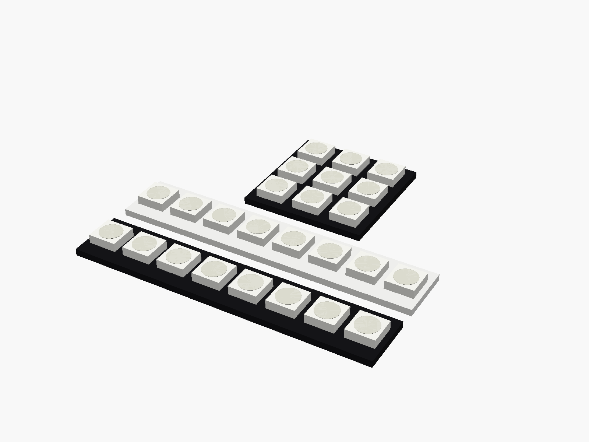

# partbin

3D models of the electronics modules in my drawer (dev boards, displays, sensors, chargers, switches), made in [OpenSCAD](https://openscad.org) for designing 3D-printed cases around them.


- 41 files covering the boards, displays, sensors, power modules, batteries and panel parts I own
- Each board looks like the real one: chips, resistors, capacitors, LEDs, connectors and pin labels
- Fast mode (`detail = false`) shows only what matters for fit, for quick previews of big cases
- A holder for every board: posts for its holes, or a ledge with low walls, or a press-fit tray
- Ready-made cutouts for the case: USB sockets, screen windows, LED slots, button holes, air vents, card slots
- Size and position functions (`_size()`, `_pin()`, `_height()`...) to place other things around a board
- The sizes that decide fit are at the top of each file, so they're easy to correct with calipers

## Use it in a project

Add it as a git submodule, so a fix here reaches every project:

```sh
cd your-project
git submodule add https://github.com/vahid-anari/partbin.git partbin
```

Then in the case file:

```openscad
use <partbin/dev-boards/esp32_c3_supermini/esp32_c3_supermini.scad>

difference() {
    my_case();
    translate([40, 20, 2]) esp32c3_supermini_usb_cutout(wall = 2);
}
translate([40, 20, 2]) esp32c3_supermini_holder();
%translate([40, 20, 2]) esp32c3_supermini(detail = false);  // only to look at
```

Every module lies flat with its parts facing up, centred on x/y, with the underside of its PCB at z = 0. Put the board, its cutout and its holder through the same `translate`/`rotate` and they line up. Anyone cloning the project needs `git clone --recursive`, or `git submodule update --init` afterwards.

Modules are sorted into category folders (`dev-boards/`, `displays/`, `sensors/`...). Each module has its own folder there with its pictures, a README listing what it gives you and the sizes to check, and an `.stl` that GitHub shows in 3D: open the folder and click **View it in 3D**. Opened in OpenSCAD on its own, each file shows the board in its holder, usually behind a piece of wall with the cutout; set `show` near the end of the file to `"board"` or `"holder"` to see one part alone.

## Modules

**✓** measured with calipers, **◐** from a published drawing or the listing's sizes, **○** typical sizes from photos (to be measured). Click a category for its page, or a module for its pictures, sizes and 3D view.

### [Dev boards](dev-boards/)

Microcontroller boards: ESP32, RP2040, ATmega32U4.

[ESP32-C3 Super Mini](dev-boards/esp32_c3_supermini/) ✓, [ESP32-DevKitC 38-pin](dev-boards/esp32_devkitc_38/) ◐, [RP2040 Pico clone](dev-boards/pico_rp2040_typec/) ◐, [Pro Micro (ATmega32U4 / RP2040)](dev-boards/pro_micro/) ○.

<details>
<summary>Pictures</summary>

| | | |
|---|---|---|
|  |  |  |
|  |  |  |

</details>

### [Displays](displays/)

LED matrices, TFTs, OLEDs, a character LCD and 7-segment displays.

[MAX7219 FC-16 4-in-1](displays/max7219_fc16/) ○, [MAX7219 8×8](displays/max7219_8x8/) ○, [0.96" TFT ST7735S](displays/st7735_096/) ○, [0.91" OLED](displays/ssd1306_091/) ○, [1.3" OLED SH1106](displays/sh1106_13/) ○, [LCD1602 + I2C](displays/lcd1602/) ◐, [4-digit 7-segment](displays/seg7_4digit_036/) ○. Also here, for boards I don't have: [1.8" TFT ST7735](displays/st7735_18/), [1.3" TFT ST7789](displays/st7789_13/), [TM1637 display](displays/tm1637_4digit/).

<details>
<summary>Pictures</summary>

| | | |
|---|---|---|
|  |  |  |
|  |  |  |
|  |  |  |
|  |  |  |

</details>

### [Sensors](sensors/)

Small I2C sensor boards: climate, light, current, ADC, distance, hall.

[BME280](sensors/gy_bme280/) ○, [BH1750](sensors/gy302_bh1750/) ○, [VEML7700](sensors/veml7700/) ◐, [INA226](sensors/ina226_cjmcu226/) ○, [ADS1115](sensors/ads1115/) ○, [VL53L0X](sensors/vl53l0x_gy530/) ○, [KY-024 hall](sensors/ky024_hall/) ○.

<details>
<summary>Pictures</summary>

| | | |
|---|---|---|
|  |  |  |
|  |  |  |
|  |  |  |

</details>

### [Inputs](inputs/)

Things you press, touch or turn.

[KY-040 encoder](inputs/ky040_encoder/) ○, [TTP223 touch](inputs/ttp223_touch/) ○, [5-way button](inputs/nav5_button/) ○.

<details>
<summary>Pictures</summary>

| | | |
|---|---|---|
|  |  |  |

</details>

### [Other boards](boards/)

Bluetooth, an MP3 player, LED boards, a stepper driver, USB-C breakouts.

[HC-05](boards/hc05/) ○, [DFPlayer Mini](boards/dfplayer_mini/) ○, [WS2812 bar and 3×3](boards/ws2812_boards/) ○, [TMC2209](boards/tmc2209_stepstick/) ◐, [USB-C breakouts](boards/usbc_breakouts/) ◐.

<details>
<summary>Pictures</summary>

| | | |
|---|---|---|
|  |  |  |
|  |  |  |

</details>

### [Power](power/)

Chargers, power bank boards, DC-DC converters and a voltmeter.

[TP4056](power/tp4056/) ○, [Type-C 5V 2A power bank board](power/powerbank_5v2a_typec/) ◐, [2S 8.4 V charger](power/charger_2s_typec/) ◐, [mini charger + boost](power/charger_mini_typec_boost/) ◐, [mini 5V 3A boost](power/boost_mini_5v3a/) ○, [LM2596S, MT3608, tiny step-up, mini step-down, S09](power/converters/) ○, [XY-UP USB stick](power/usb_stepupdown_xyup/) ○, [ZK-SJVA-4X with LCD](power/buckboost_lcd_zksjva/) ○, [0.28" voltmeter](power/voltmeter_028/) ○. Also here, for boards I don't have: [IP5306 MH-CD42](power/ip5306_mhcd42/).

<details>
<summary>Pictures</summary>

| | | |
|---|---|---|
|  |  |  |
|  |  |  |
|  |  |  |
|  |  |  |

</details>

### [Hardware](hardware/)

Batteries and holders, and parts that go in a panel.

[18650 holders, CR2032, LiPo](hardware/batteries/) ○, [rockers, slides, buttons, DC jack, speaker](hardware/panel_parts/) ○.

<details>
<summary>Pictures</summary>

| | | |
|---|---|---|
|  |  |  |

</details>

## In this repository

| Folder | Contents |
|---|---|
| [`dev-boards/`](dev-boards/), [`displays/`](displays/), [`sensors/`](sensors/), [`inputs/`](inputs/), [`boards/`](boards/), [`power/`](power/), [`hardware/`](hardware/) | A folder per category with a README listing its modules, and in it a folder per module (or a small family of parts): the `.scad` file with its sizes at the top, its pictures, a 3D `.stl` and a README |
| [`lib/`](lib/) | Shared shapes: [`parts.scad`](lib/parts.scad) (chips, passives, connectors, headers...), [`breakout.scad`](lib/breakout.scad) (breakout boards, posts, USB cutouts, vents), [`display.scad`](lib/display.scad) (glass, LED matrices, 7-segment digits, windows, edge holder) |
| [`tools/`](tools/) | `render.sh` makes the pictures and the 3D files (needs OpenSCAD), `make_readmes.py` writes the module and category READMEs |

## Planned

Measuring every board with calipers (only the ESP32-C3 so far), and new modules as I buy them.

## Support

This is a free project I work on in my spare time. If you like it, you can [buy me a coffee](https://buymeacoffee.com/vahidanarim) ☕

## License

MIT, see [LICENSE](LICENSE). The VEML7700 sizes come from [Adafruit's design files](https://github.com/adafruit/Adafruit-VEML7700-PCB); the Pico footprint from Raspberry Pi's drawing.
