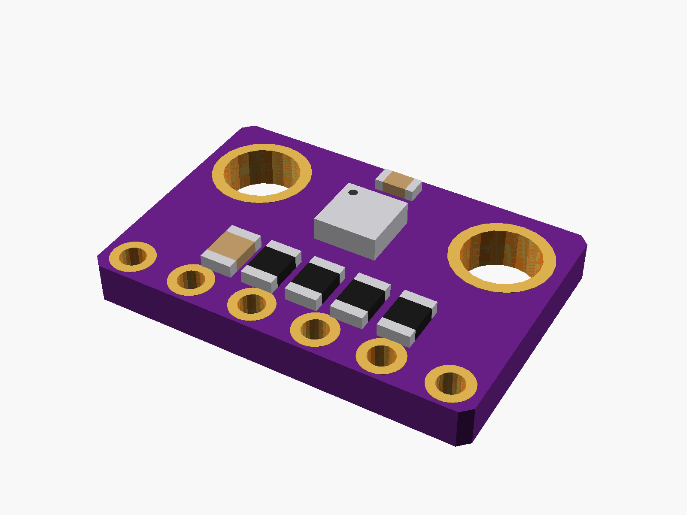
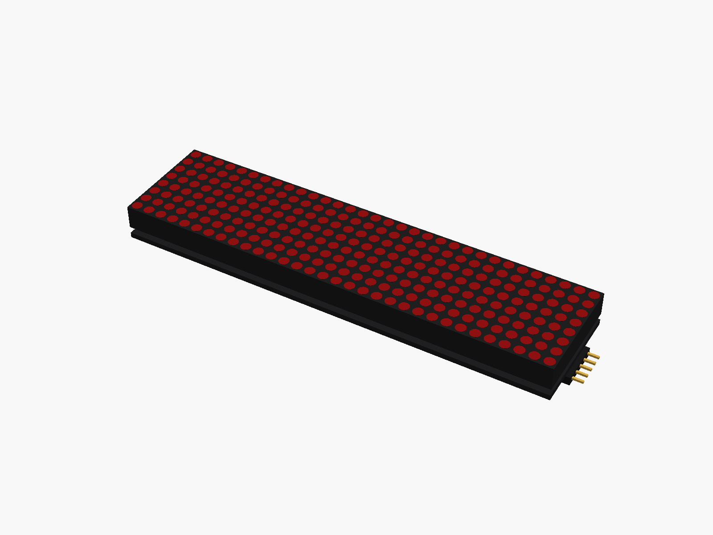
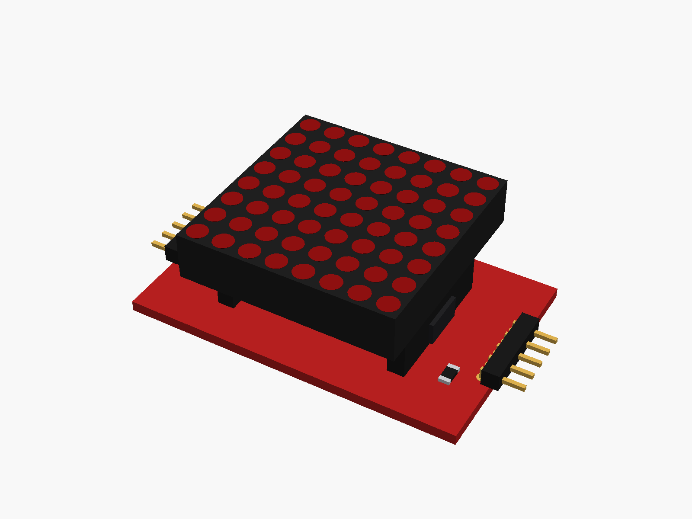
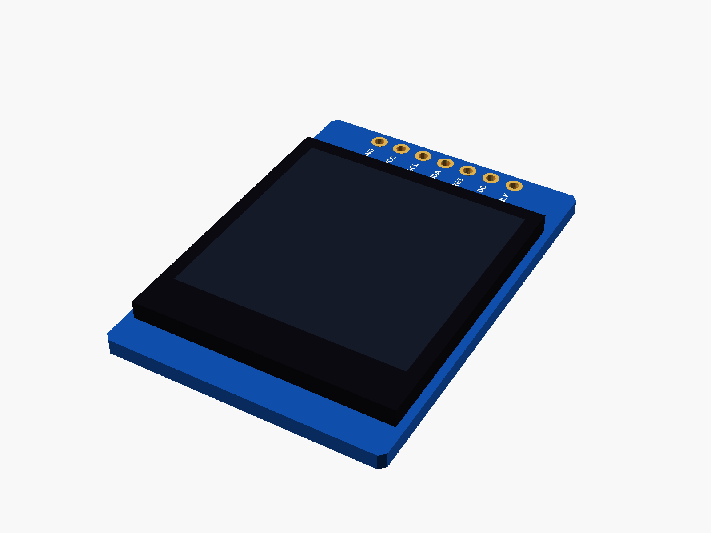
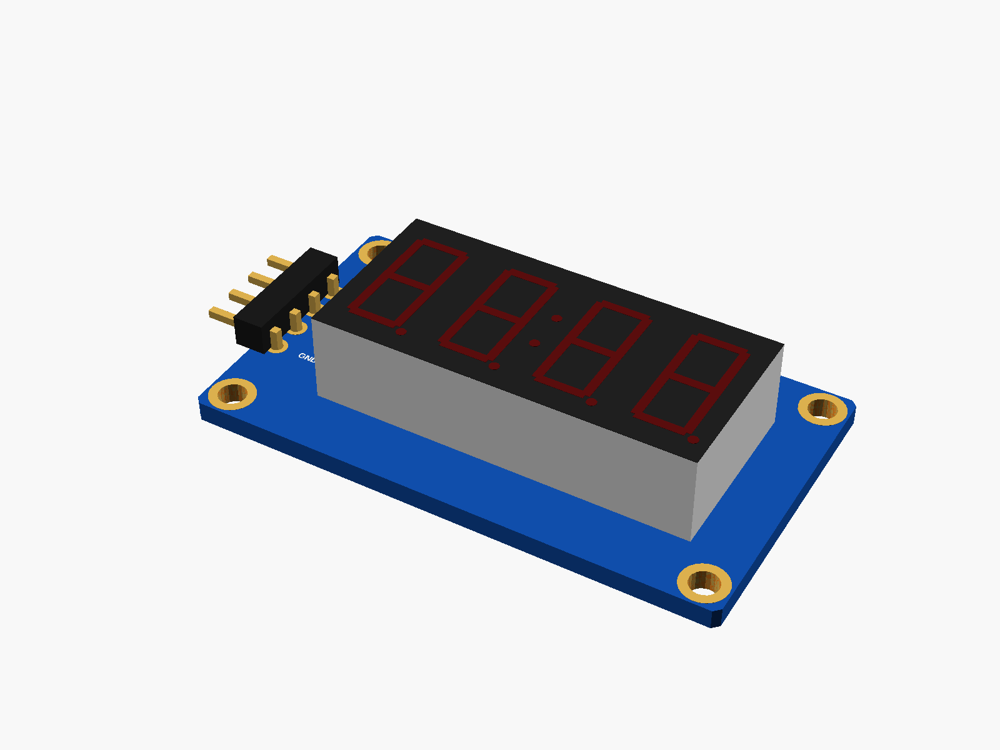
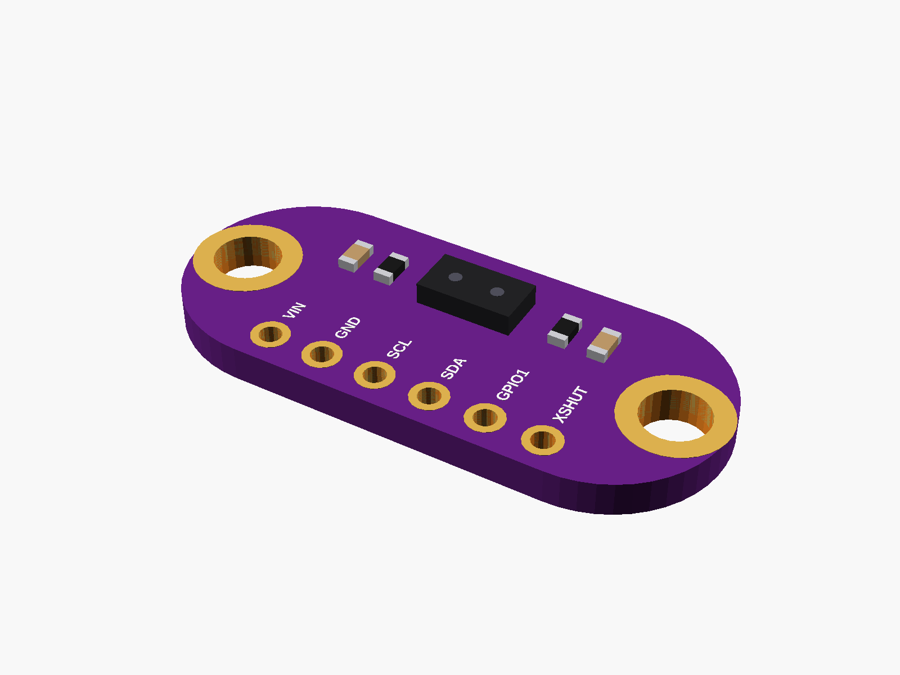
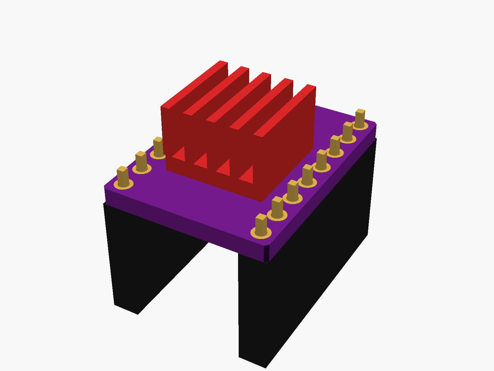
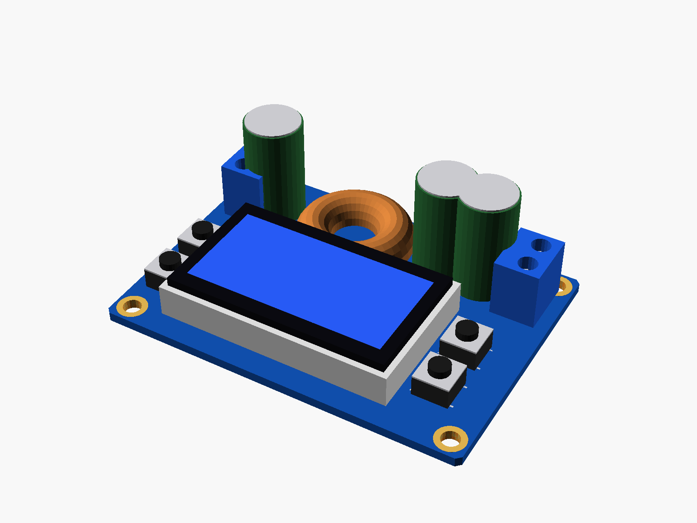

# partbin

Parametric [OpenSCAD](https://openscad.org) models of the small electronics modules I use (dev boards, chargers, sensors, displays), for designing 3D-printed cases around them.

Each module is drawn from my own boards: the sizes that decide whether a case fits (outline, thickness, holes, connectors, the tallest part) are measured with calipers, while the small parts (chips, resistors, capacitors, LEDs) are placed from photos and only roughly sized.


## What each module gives you

| | What | Use it for |
|---|---|---|
| `<name>()` | the board with its parts; `detail = false` shows only what matters for fit and renders fast | seeing it inside the case, checking fit |
| `<name>_..._cutout()` | holes for its connectors | subtract from the case wall |
| `<name>_holder()` | a tray, standoffs or rails to mount it | add to the case |
| `<name>_size()` and friends | its sizes and positions | placing other things around it |

Every module lies flat with its parts facing up, centred on x/y, with the underside of the PCB at z = 0. Put the board, its cutout and its holder through the same `translate`/`rotate` and they line up.

## Use it in a project

As a git submodule, so a fix here reaches every project:

```sh
cd ~/Desktop/"Git projects"/<project>
git submodule add https://github.com/vahid-anari/partbin.git partbin
```

Then in the case file:

```openscad
use <partbin/modules/esp32_c3_supermini.scad>

difference() {
    my_case();
    translate([40, 20, 2]) esp32c3_supermini_usb_cutout(wall = 2);
}
translate([40, 20, 2]) esp32c3_supermini_holder();
%translate([40, 20, 2]) esp32c3_supermini(detail = false);  // only to look at
```

Anyone cloning the project then needs `git clone --recursive`, or `git submodule update --init` afterwards.

Opened on its own, each module file shows the board in its holder behind a piece of wall with the cutout. Set `show` near the end of the file to `"board"` or `"holder"` to see one part alone.

## Modules

| Module | File | Measured |
|---|---|---|
| ESP32-C3 Super Mini | [`modules/esp32_c3_supermini.scad`](modules/esp32_c3_supermini.scad) | yes |
| ESP32-DevKitC V4, 38 pins, USB-C (WROOM-32D or -32U) | [`modules/esp32_devkitc_38.scad`](modules/esp32_devkitc_38.scad) | from the seller's drawing |
| RP2040 Pico clone, black, USB-C, 16 MB (Pico footprint) | [`modules/pico_rp2040_typec.scad`](modules/pico_rp2040_typec.scad) | Pico drawing; USB-C typical |
| Pro Micro, USB-C: ATmega32U4 or RP2040 | [`modules/pro_micro.scad`](modules/pro_micro.scad) | not yet: typical |
| GY-BME280 / GY-BMP280 (purple, 6 pins) | [`modules/gy_bme280.scad`](modules/gy_bme280.scad) | not yet: typical, from a photo |
| GY-302 BH1750 light sensor | [`modules/gy302_bh1750.scad`](modules/gy302_bh1750.scad) | not yet: typical, from a photo |
| VEML7700 light sensor (Adafruit layout) | [`modules/veml7700.scad`](modules/veml7700.scad) | from Adafruit's design files; thickness typical |
| INA226 current/power monitor (CJMCU-226) | [`modules/ina226_cjmcu226.scad`](modules/ina226_cjmcu226.scad) | not yet: from a photo |
| ADS1115 16-bit ADC (Adafruit layout) | [`modules/ads1115.scad`](modules/ads1115.scad) | not yet: typical |
| VL53L0X ToF distance sensor (GY-530, purple) | [`modules/vl53l0x_gy530.scad`](modules/vl53l0x_gy530.scad) | not yet: typical |
| KY-024 linear hall sensor | [`modules/ky024_hall.scad`](modules/ky024_hall.scad) | not yet: from a photo |
| TTP223 touch button | [`modules/ttp223_touch.scad`](modules/ttp223_touch.scad) | not yet: typical |
| KY-040 rotary encoder (EC11), with the knob | [`modules/ky040_encoder.scad`](modules/ky040_encoder.scad) | not yet: typical |
| Five-direction navigation button module | [`modules/nav5_button.scad`](modules/nav5_button.scad) | not yet: from a photo |
| HC-05 Bluetooth module on its backplane | [`modules/hc05.scad`](modules/hc05.scad) | not yet: typical |
| DFPlayer Mini MP3 player | [`modules/dfplayer_mini.scad`](modules/dfplayer_mini.scad) | not yet: typical |
| WS2812B 8-LED bar and 3x3 panel | [`modules/ws2812_boards.scad`](modules/ws2812_boards.scad) | not yet: typical |
| TMC2209 stepper driver (StepStick) | [`modules/tmc2209_stepstick.scad`](modules/tmc2209_stepstick.scad) | StepStick standard; heatsink typical |
| MAX7219 FC-16 4-in-1 LED matrix, green (one or more end to end) | [`modules/max7219_fc16.scad`](modules/max7219_fc16.scad) | not yet: typical |
| MAX7219 single 8x8 LED matrix (DIP kit), green | [`modules/max7219_8x8.scad`](modules/max7219_8x8.scad) | not yet: typical |
| 1.8" TFT 128x160 ST7735 (red, microSD) *(not one of mine)* | [`modules/st7735_18.scad`](modules/st7735_18.scad) | not yet: typical |
| 1.3" IPS TFT 240x240 ST7789 (GMT130) *(not one of mine)* | [`modules/st7789_13.scad`](modules/st7789_13.scad) | not yet: typical |
| 0.91" OLED 128x32 SSD1306 | [`modules/ssd1306_091.scad`](modules/ssd1306_091.scad) | not yet: typical |
| LCD1602 green, with the I2C backpack (or without) | [`modules/lcd1602.scad`](modules/lcd1602.scad) | not yet: from a manufacturer's drawing |
| TM1637 4-digit 7-segment module *(not one of mine)* | [`modules/tm1637_4digit.scad`](modules/tm1637_4digit.scad) | not yet: typical |
| 0.96" IPS TFT 80x160 ST7735S (8 pins) | [`modules/st7735_096.scad`](modules/st7735_096.scad) | not yet: from a seller photo |
| 1.3" OLED 128x64 SH1106 (I2C) | [`modules/sh1106_13.scad`](modules/sh1106_13.scad) | not yet: typical |
| Bare 4-digit 7-segment display, 0.36" (red, green, blue, white) | [`modules/seg7_4digit_036.scad`](modules/seg7_4digit_036.scad) | not yet: typical |
| TP4056 charger, USB-C (mine) or micro-USB, with or without protection | [`modules/tp4056.scad`](modules/tp4056.scad) | not yet: typical |
| Type-C 5V 2A charge/boost (power bank) board, 25 x 20, USB-A on the back | [`modules/powerbank_5v2a_typec.scad`](modules/powerbank_5v2a_typec.scad) | from the listing |
| Type-C to 8.4 V boost charger for 2S packs, 39 x 18 | [`modules/charger_2s_typec.scad`](modules/charger_2s_typec.scad) | from the listing |
| Mini Li-ion charger + 5 V boost, one USB-C, 15.8 x 12 | [`modules/charger_mini_typec_boost.scad`](modules/charger_mini_typec_boost.scad) | from the listing |
| Mini 3.7 V to 5 V 3 A boost board | [`modules/boost_mini_5v3a.scad`](modules/boost_mini_5v3a.scad) | not yet: from a photo |
| DC-DC converters: LM2596S (HW-411), MT3608, tiny 0.9-5 V step-up, 12-24 V mini step-down, S09 buck-boost | [`modules/converters.scad`](modules/converters.scad) | not yet: typical, layouts from photos |
| XY-UP USB step-up/down stick with display | [`modules/usb_stepupdown_xyup.scad`](modules/usb_stepupdown_xyup.scad) | not yet: from a photo |
| ZK-SJVA-4X buck-boost with LCD | [`modules/buckboost_lcd_zksjva.scad`](modules/buckboost_lcd_zksjva.scad) | not yet: typical |
| 0.28" 3-wire voltmeter | [`modules/voltmeter_028.scad`](modules/voltmeter_028.scad) | not yet: typical |
| 18650 cell and box holders (1-4 slots), CR2032 holder, LiPo pouch | [`modules/batteries.scad`](modules/batteries.scad) | not yet: typical |
| Panel parts: KCD11 / KCD1 rockers, SS12D00 / MSS22D18 slides, 6x6 tact, 8.5 mm self-locking, DC jack, 2831 speaker | [`modules/panel_parts.scad`](modules/panel_parts.scad) | not yet: typical |
| USB-C breakouts: red 6-pin, green 4-pin | [`modules/usbc_breakouts.scad`](modules/usbc_breakouts.scad) | from the listings |
| IP5306 charge/discharge board (MH-CD42) *(not one of mine)* | [`modules/ip5306_mhcd42.scad`](modules/ip5306_mhcd42.scad) | not yet: typical |

Some files hold a family of small parts (converters, batteries, panel parts): each part has its own modules inside.

Displays face up like everything else, so a case with a front panel turns them to face it. Each comes with a `_window` for the front (the lit area, widening outwards) and a holder: posts for boards with holes, or `edge_holder` (a ledge under the edges and low walls) for boards without.

Sensor boards come with posts for their holes (`_holder`, pegs or screws) and a cutout for the lid above them: a window over a light sensor (`_window`), air slots over the BME280 (`_vents`).

| | | |
|---|---|---|
|  |  |  |
|  |  |  |
|  |  |  |
|  |  |  |
|  |  |  |
|  |  |  |
|  |  |  |
|  |  |  |
|  |  |  |
|  |  |  |
|  |  |  |
|  |  |  |
|  |  |  |
|  |  |  |

## Files

- `modules/`: one file per module, its measured numbers at the top.
- `lib/parts.scad`: the shared part shapes (PCB, SMD resistors and capacitors, chips, crystal, buttons, USB-C, pin headers).
- `lib/display.scad`: shared pieces for displays (glass panels, LED matrices, 7-segment digits, window cutout, edge holder).
- `lib/breakout.scad`: shared pieces for small breakout boards (board with holes and a pin row, mounts, light window, air vents).
- `images/`: pictures, made by `tools/render.sh` (needs OpenSCAD).

## Support

If this is useful to you: [buy me a coffee](https://buymeacoffee.com/vahidanarim).

## License

MIT
