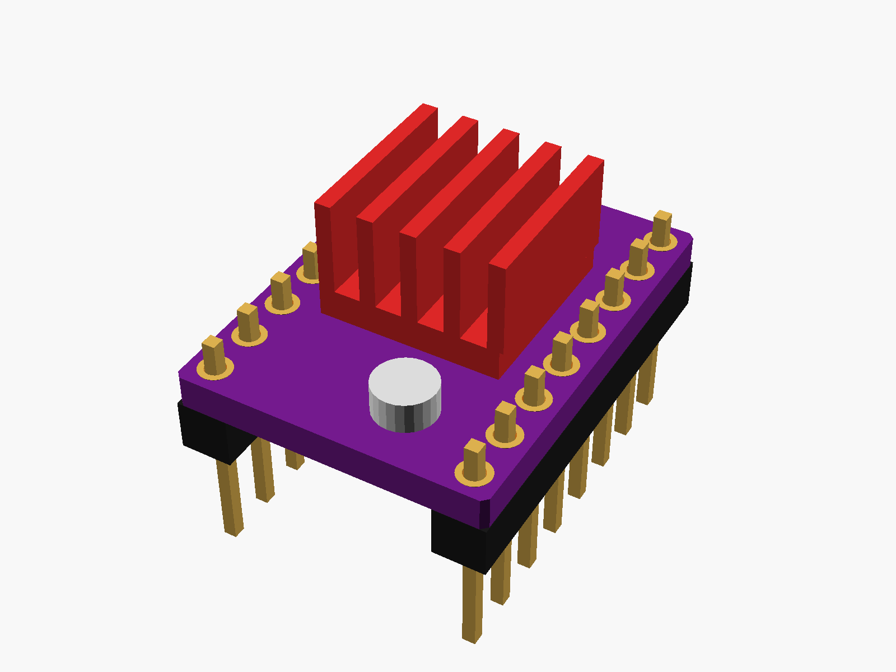
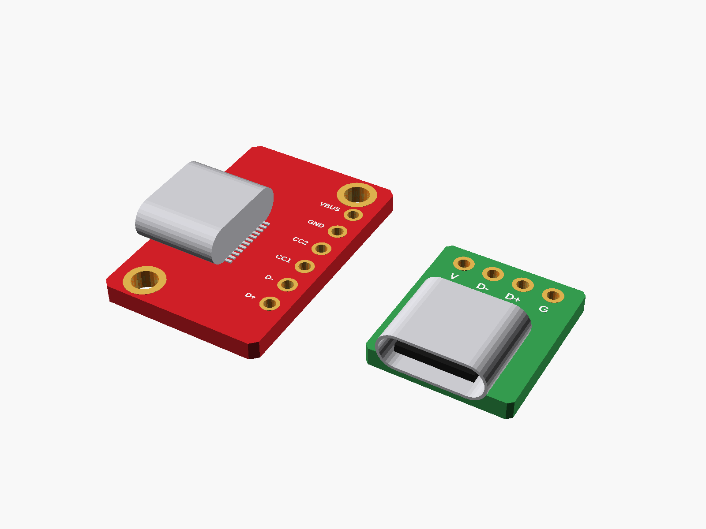

# Other boards

Bluetooth, an MP3 player, LED boards, a stepper driver, USB-C breakouts.

✓ measured · ◐ from a drawing or the listing · ○ typical, from photos

| | Module | Picture |
|---|---|---|
| ○ | [DFPlayer Mini](dfplayer_mini/) |  |
| ○ | [HC-05 Bluetooth module](hc05/) |  |
| ◐ | [TMC2209 stepper driver](tmc2209_stepstick/) |  |
| ◐ | [USB-C breakout boards](usbc_breakouts/) |  |
| ○ | [WS2812B LED boards](ws2812_boards/) |  |

---

Part of [partbin](../README.md).
