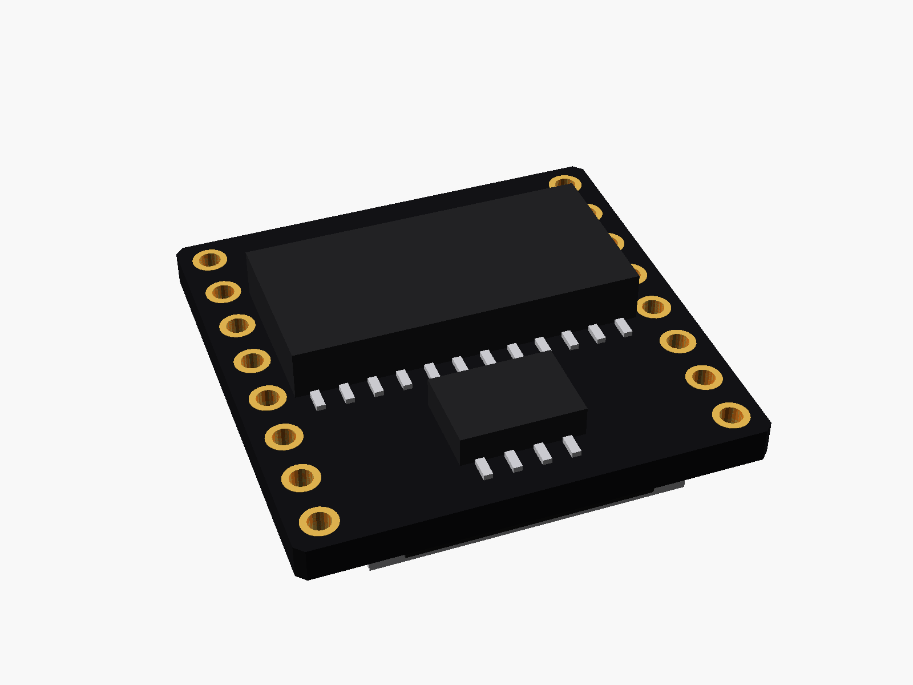
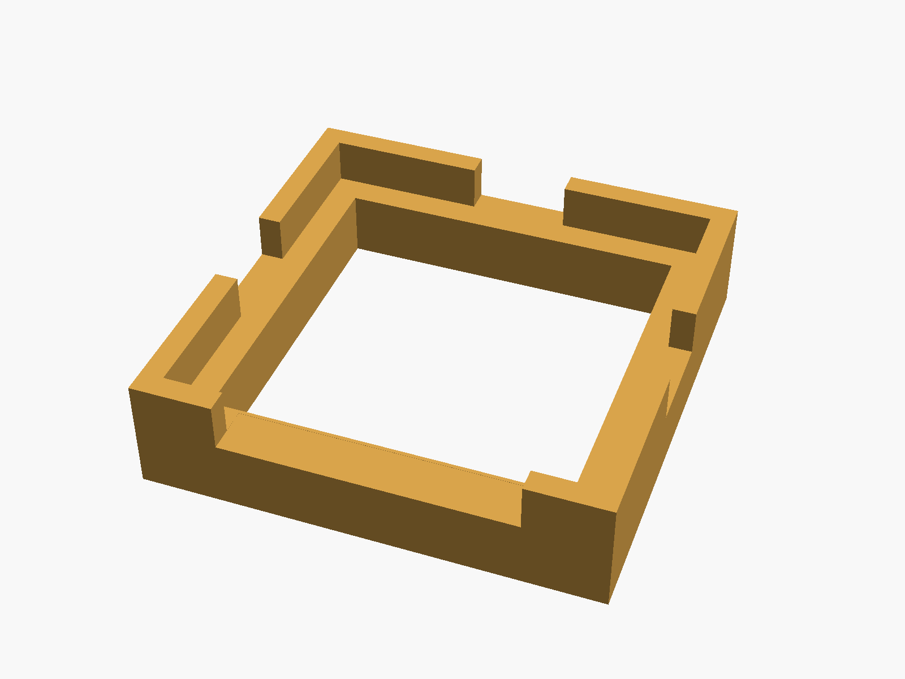
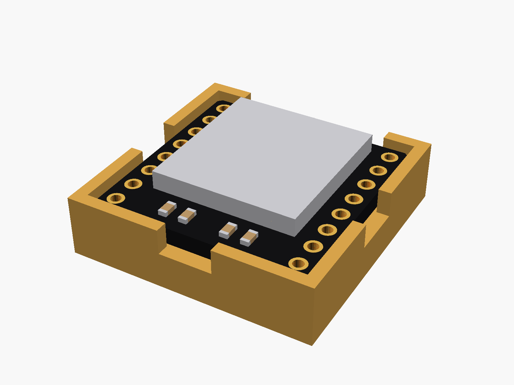

# DFPlayer Mini

DFPlayer Mini MP3 player (black, 20.5 x 20.5 mm, 8 pins down each side, microSD socket on top, the decoder chip and amplifier underneath).


**[View it in 3D](dfplayer_mini.stl)** (turn it with the mouse; GitHub shows it in one colour)

| Underneath | Holder | In its holder / case |
|---|---|---|
|  |  |  |

## Use it

```openscad
use <partbin/boards/dfplayer_mini/dfplayer_mini.scad>
```

| Call | What it gives |
|---|---|
| `dfplayer_mini()` | the module, with its parts |
| `dfplayer_mini(headers = "down")` | with pin headers (the usual way: into sockets) |
| `dfplayer_mini_sd_cutout(wall, gap)` | a slot in the wall for the microSD card |
| `dfplayer_mini_holder()` | ledge and low walls |
| `dfplayer_mini_size()` | [width, length, pcb thickness] |
| `dfplayer_mini_pin(n)` | [x, y] of pin n (1 ... 16) |

Where it sits: parts up, the board centred on x = y = 0, its underside at z = 0, the card slot opening at the bottom end (-y). Pin 1 (VCC) is top left; 1-8 run down the left side, 9-16 up the right (pin 16 BUSY top right).

## Sizes

At the top of [`dfplayer_mini.scad`](dfplayer_mini.scad), in mm: typical, from photos; measure yours and change them.

| Setting | Value | What |
|---|---|---|
| `rows` | 17.78 | between the two pin rows |
| `pin1_y` | 8.89 | first pin |

---

Part of [partbin](../../README.md), in [Other boards](../README.md).
