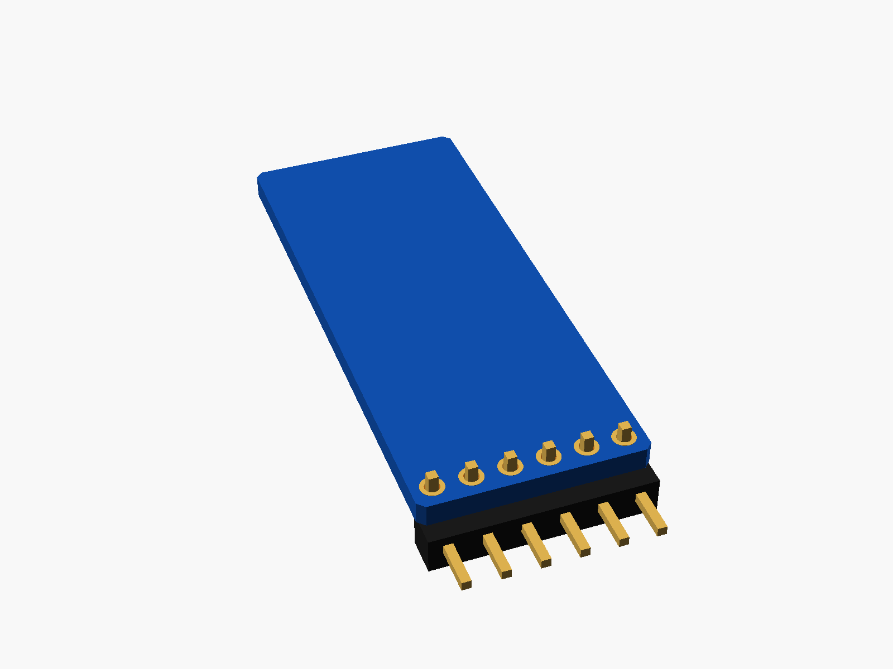
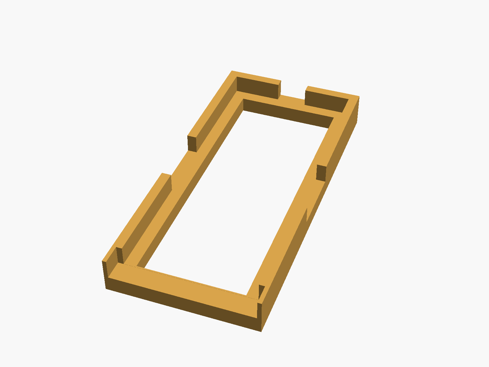
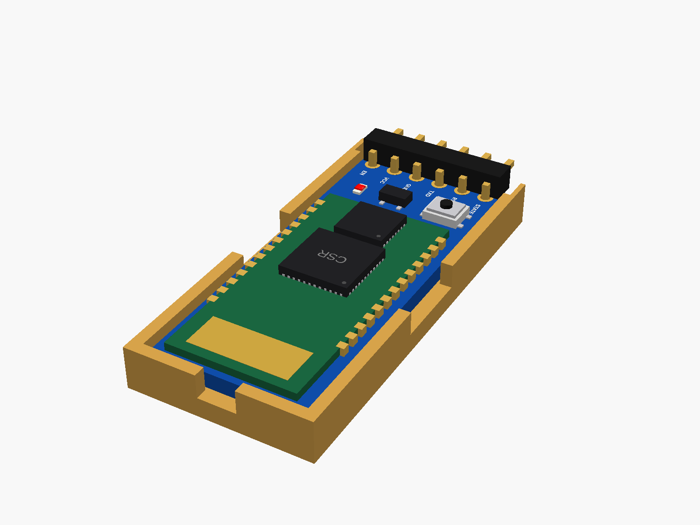

# HC-05 Bluetooth module

HC-05 Bluetooth serial module on its blue backplane (6 pins at one end: STATE RXD TXD GND VCC EN, a small button, the green HC-05 board on top).


**[View it in 3D](hc05.stl)** (turn it with the mouse; GitHub shows it in one colour)

| Underneath | Holder | In its holder / case |
|---|---|---|
|  |  |  |

## Use it

```openscad
use <partbin/boards/hc05/hc05.scad>
```

| Call | What it gives |
|---|---|
| `hc05()` | the module, with its parts |
| `hc05(headers = "none")` | without the header ("angle" = default; pins point -y) |
| `hc05_holder()` | ledge and low walls, open at the pin end |
| `hc05_size()` | [width, length, pcb thickness] |

Where it sits: parts up, the board centred on x = y = 0, its underside at z = 0, the pins at the bottom end (-y), the antenna at the top. Keep the antenna end away from metal.

## Sizes

At the top of [`hc05.scad`](hc05.scad), in mm: typical, from photos; measure yours and change them.

| Setting | Value | What |
|---|---|---|
| `b_w` | 15.5 | backplane width (x) |
| `b_l` | 37.3 | backplane length (y) |
| `m_w` | 13.0 | the green HC-05 board on it |

---

Part of [partbin](../../README.md), in [Other boards](../README.md).
