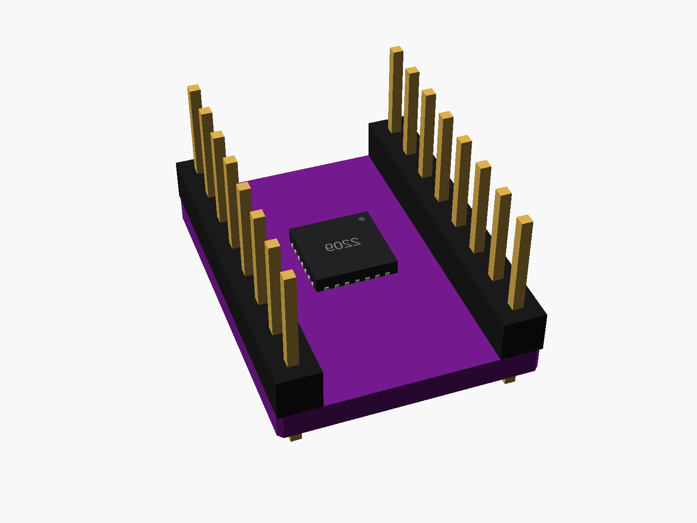
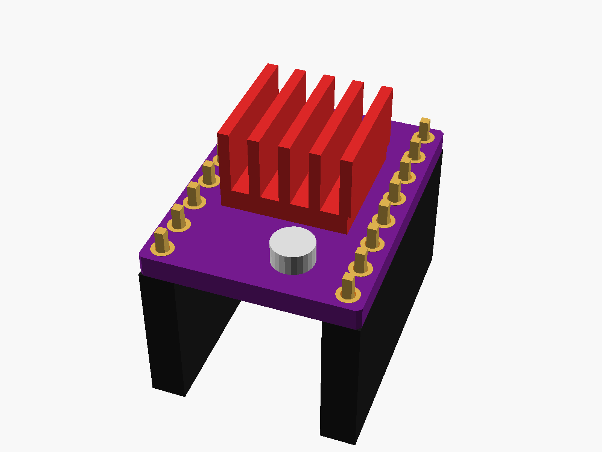

# TMC2209 stepper driver

TMC2209 stepper driver, StepStick format (15.2 x 20.3 mm, two rows of 8 pins 12.7 mm apart, the chip underneath, a heatsink stuck on top, a trimmer for the current).


**[View it in 3D](tmc2209_stepstick.stl)** (turn it with the mouse; GitHub shows it in one colour)

| Underneath | Holder | In its holder / case |
|---|---|---|
|  |  |  |

## Use it

```openscad
use <partbin/boards/tmc2209_stepstick/tmc2209_stepstick.scad>
```

| Call | What it gives |
|---|---|
| `tmc2209_stepstick()` | with its pins and the heatsink |
| `tmc2209_stepstick(heatsink = false)` |  |
| `tmc2209_stepstick_socket()` | two 8-pin female headers it plugs into |
| `tmc2209_stepstick_size()` | [width, length, pcb thickness] |

Where it sits: the heatsink up, the board centred on x = y = 0, its underside at z = 0, the pin rows along y. Leave air above the heatsink.

---

Part of [partbin](../../README.md), in [Other boards](../README.md).
