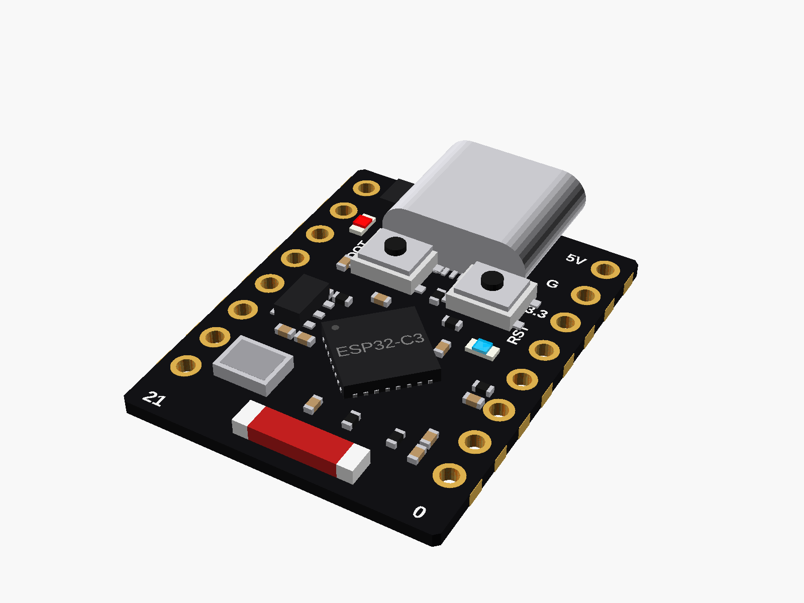

# Dev boards

Microcontroller boards: ESP32, RP2040, ATmega32U4.

✓ measured with calipers · ◐ from a published drawing or the listing's sizes · ○ typical, from photos (to be measured)

| Module | Picture |
|---|---|
| ✓ [ESP32-C3 Super Mini](esp32_c3_supermini/) |  |
| ◐ [ESP32-DevKitC V4, 38 pins](esp32_devkitc_38/) |  |
| ◐ [RP2040 Pico clone (USB-C, 16 MB)](pico_rp2040_typec/) |  |
| ○ [Pro Micro (ATmega32U4 / RP2040)](pro_micro/) |  |

---

Part of [partbin](../README.md).
