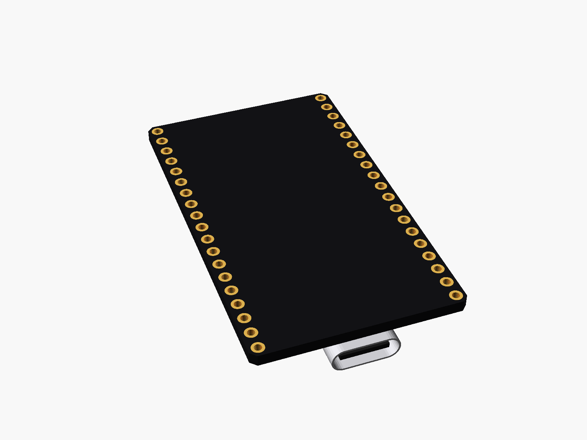
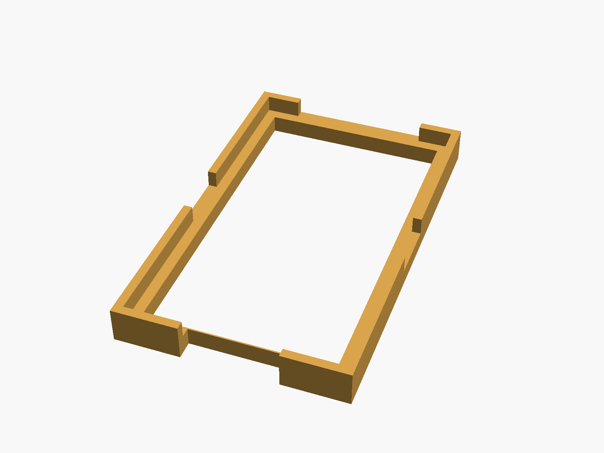
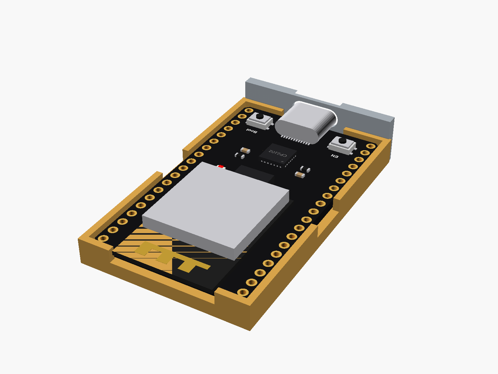

# ESP32-DevKitC V4, 38 pins

ESP32-DevKitC V4, 38 pins (ESP32-WROOM-32D or -32U module, CP2102, USB-C), 19 pins down each side, rows 25.4 mm apart (too wide for one breadboard).


**[View it in 3D](esp32_devkitc_38.stl)** (turn it with the mouse; GitHub shows it in one colour)

| Underneath | Holder | In its holder / case |
|---|---|---|
|  |  |  |

## Use it

```openscad
use <partbin/dev-boards/esp32_devkitc_38/esp32_devkitc_38.scad>
```

| Call | What it gives |
|---|---|
| `esp32_devkitc_38()` | the board, with its parts |
| `esp32_devkitc_38(wroom = "32U")` | the -32U module (antenna socket, no PCB antenna) |
| `esp32_devkitc_38(detail = false)` | only what matters for fit (fast) |
| `esp32_devkitc_38(headers = "down")` | with pin headers soldered on esp32_devkitc_38_usb_cutout(wall, gap) the USB-C opening, subtract it |
| `esp32_devkitc_38_holder()` | rails along the long edges, add to the case |
| `esp32_devkitc_38_size()` | [width, length, pcb thickness] |
| `esp32_devkitc_38_pin(side, i)` | [x, y] of pin i (0 = top) on "left"/"right" |

Where it sits: parts up, the board centred on x = y = 0, its underside at z = 0, the module (antenna) at the top (+y), the USB socket at the bottom pointing -y. Keep the antenna end clear of metal and away from the case wall.

## Sizes

At the top of [`esp32_devkitc_38.scad`](esp32_devkitc_38.scad), in mm: from a published drawing or the seller's sizes.

| Setting | Value | What |
|---|---|---|
| `b_w` | 27.94 | board width (x) |
| `b_l` | 48.26 | board length (y) |
| `b_t` | 1.6 | PCB |
| `rows` | 25.40 | between the two pin rows |
| `mod_w` | 18.0 | WROOM module |
| `mod_out` | 1.30 | the module sticks out past the top edge |
| `c_size` | [8.94, 3.26, 7.35] | USB-C |
| `usb_out` | 1.29 | the socket sticks out past the bottom edge |

---

Part of [partbin](../../README.md), in [Dev boards](../README.md).
