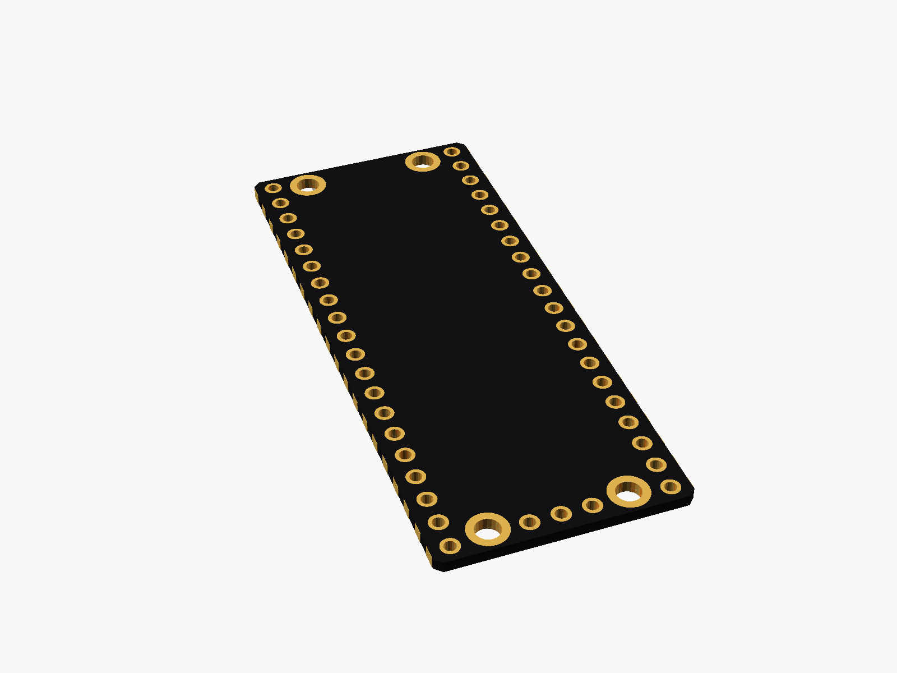
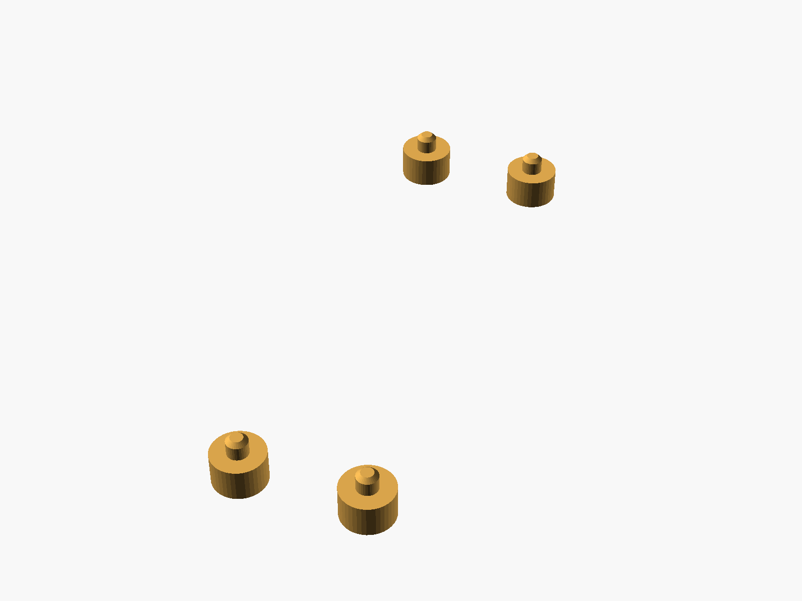
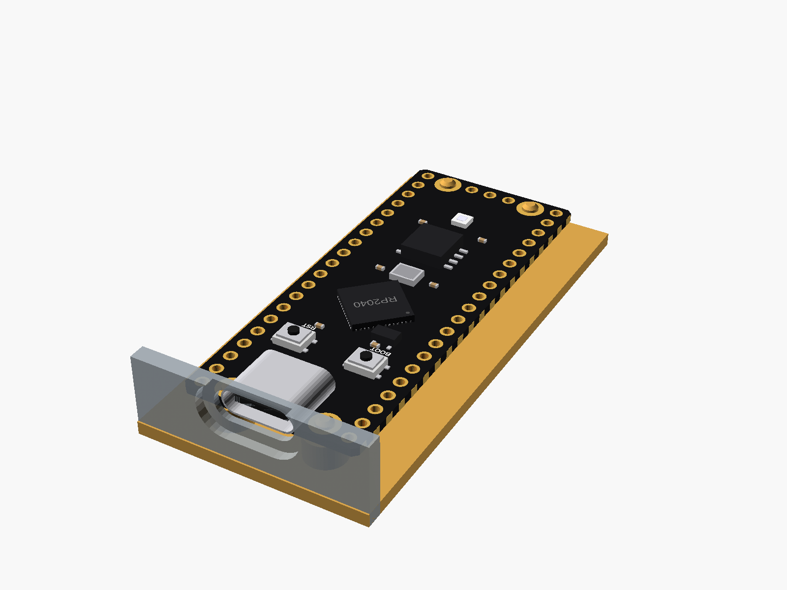

# RP2040 Pico clone (USB-C, 16 MB)

Raspberry Pi Pico-style RP2040 board, the black USB-C clone with 16 MB flash, BOOT and RST buttons and an RGB LED. Same footprint as the Pico: 21 x 51 mm, 20 half-holes down each side (rows 17.78 mm apart), 3 SWD pads at the far end, four mounting holes.


**[View it in 3D](pico_rp2040_typec.stl)** (turn it with the mouse; GitHub shows it in one colour)

| Underneath | Holder | In its holder / case |
|---|---|---|
|  |  |  |

## Use it

```openscad
use <partbin/dev-boards/pico_rp2040_typec/pico_rp2040_typec.scad>
```

| Call | What it gives |
|---|---|
| `pico_rp2040_typec()` | the board, with its parts |
| `pico_rp2040_typec(detail = false)` | only what matters for fit (fast) |
| `pico_rp2040_typec(headers = "down")` | with pin headers soldered on pico_rp2040_typec_usb_cutout(wall, gap) the USB-C opening, subtract it |
| `pico_rp2040_typec_holder(h = 3)` | posts under its four holes |
| `pico_rp2040_typec_size()` | [width, length, pcb thickness] |
| `pico_rp2040_typec_pin(n)` | [x, y] of Pico pin n (1 ... 40) |

Where it sits: parts up, the board centred on x = y = 0, its underside at z = 0, the USB socket at the top (+y). Pin 1 is top left, pins 1-20 run down the left side and 21-40 back up the right, like the Pico.

## Sizes

At the top of [`pico_rp2040_typec.scad`](pico_rp2040_typec.scad), in mm: from a published drawing or the seller's sizes.

| Setting | Value | What |
|---|---|---|
| `b_w` | 21.0 | board width (x) |
| `b_l` | 51.0 | board length (y) |
| `b_t` | 1.0 | PCB |
| `rows` | 17.78 | between the two pin rows |
| `holes_at` | [11.4, 47.0] | hole centres, x and y apart |
| `c_size` | [8.94, 3.26, 7.35] | USB-C |

---

Part of [partbin](../../README.md), in [Dev boards](../README.md).
