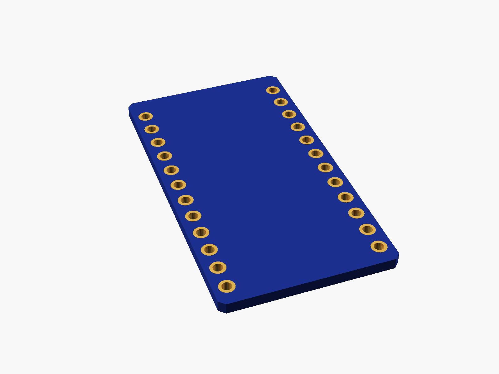
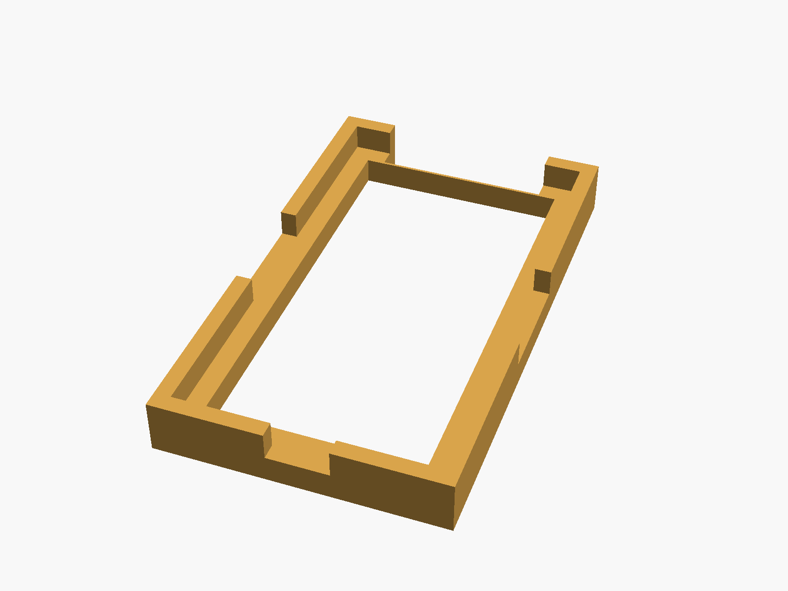
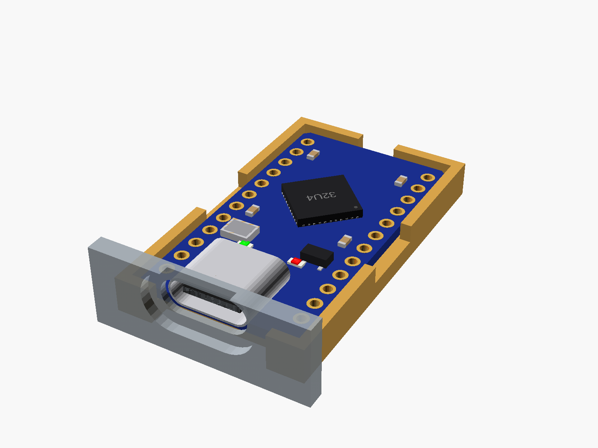

# Pro Micro (ATmega32U4 / RP2040)

Pro Micro boards with USB-C: the ATmega32U4 (Arduino Leonardo compatible) and the TENSTAR RP2040 Pro Micro (16 MB, BOOT and RST buttons, RGB LED). Same footprint: 33 x 18 mm, 12 pins down each side, rows 15.24 mm apart.


**[View it in 3D](pro_micro.stl)** (turn it with the mouse; GitHub shows it in one colour)

| Underneath | Holder | In its holder / case | Rp2040 |
|---|---|---|---|
|  |  |  |  |

## Use it

```openscad
use <partbin/dev-boards/pro_micro/pro_micro.scad>
```

| Call | What it gives |
|---|---|
| `pro_micro()` | the ATmega32U4 board |
| `pro_micro(chip = "rp2040")` | the RP2040 one |
| `pro_micro(detail = false)` | only what matters for fit (fast) |
| `pro_micro(headers = "down")` | with pin headers soldered on |
| `pro_micro_usb_cutout(wall, gap)` | the USB-C opening, subtract it |
| `pro_micro_holder()` | ledge and low walls, open at the USB end |
| `pro_micro_size()` | [width, length, pcb thickness] |
| `pro_micro_pin(side, i)` | [x, y] of pin i (0 = USB end) on "left"/"right" |

Where it sits: parts up, the board centred on x = y = 0, its underside at z = 0, the USB socket at the top (+y).

## Sizes

At the top of [`pro_micro.scad`](pro_micro.scad), in mm: typical, from photos; measure yours and change them.

| Setting | Value | What |
|---|---|---|
| `b_w` | 18.0 | board width (x) |
| `b_l` | 33.0 | board length (y) |
| `b_t` | 1.2 | PCB |

---

Part of [partbin](../../README.md), in [Dev boards](../README.md).
