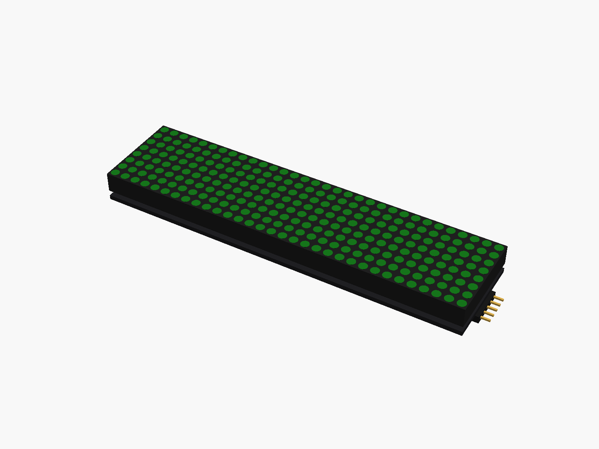
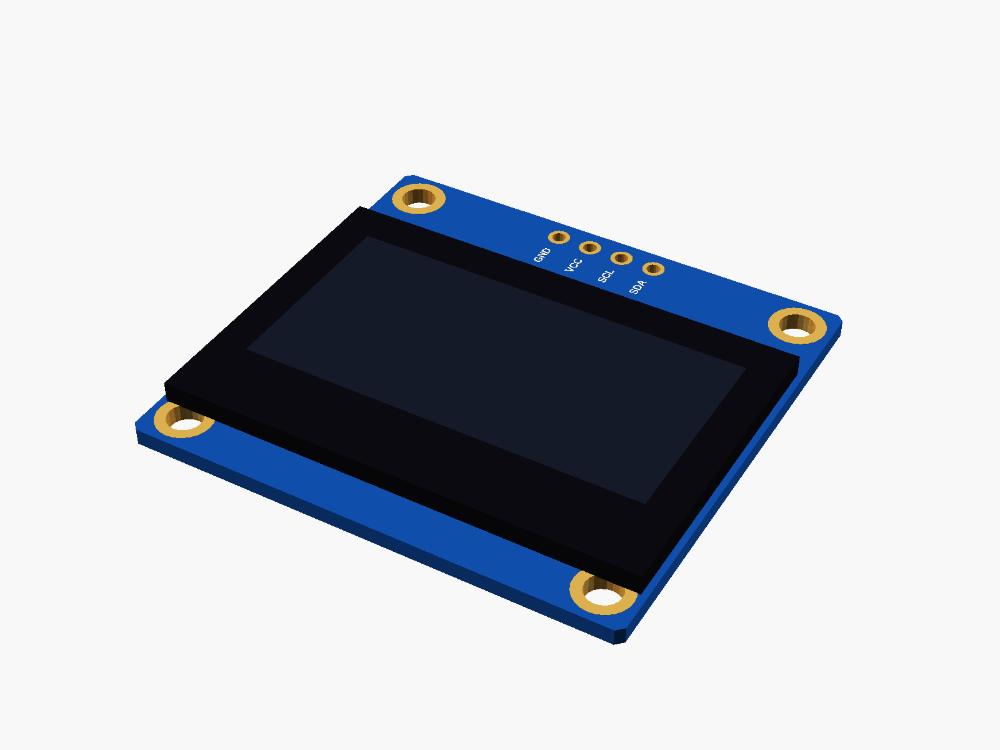
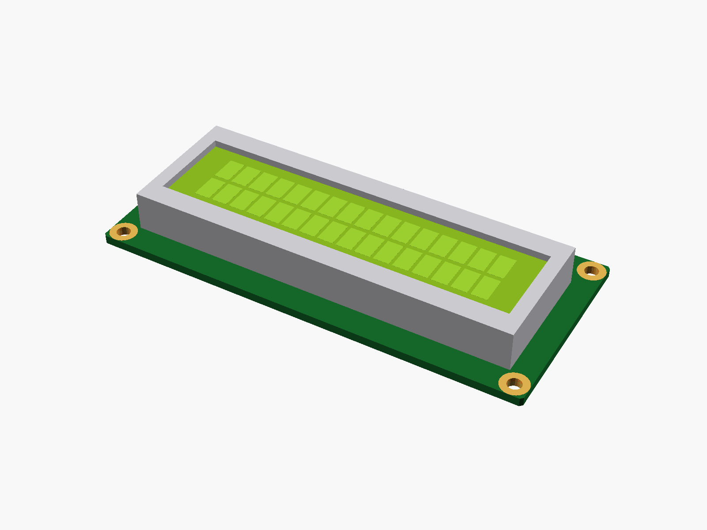
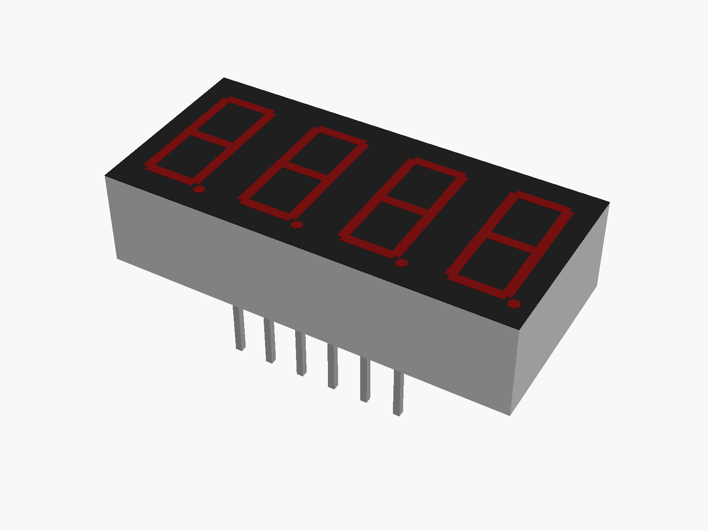
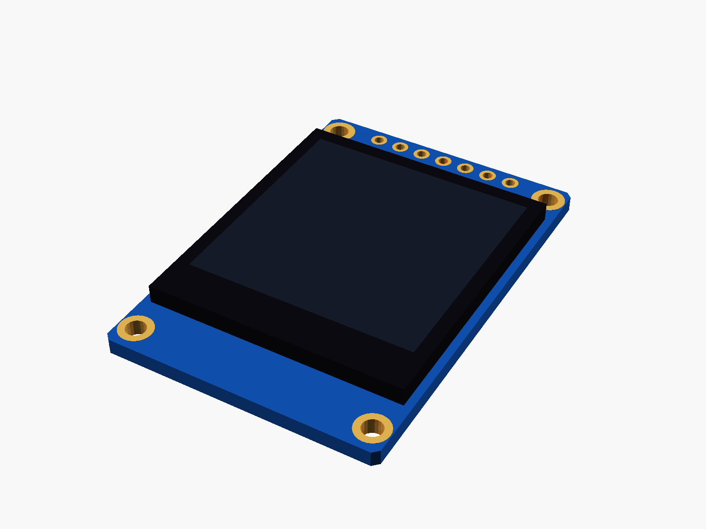

# Displays

LED matrices, TFTs, OLEDs, a character LCD and 7-segment displays.

✓ measured with calipers · ◐ from a published drawing or the listing's sizes · ○ typical, from photos (to be measured)

| Module | Picture |
|---|---|
| ○ [MAX7219 FC-16 4-in-1 LED matrix](max7219_fc16/) |  |
| ○ [MAX7219 8x8 LED matrix](max7219_8x8/) |  |
| ○ [0.96" IPS TFT (ST7735S)](st7735_096/) |  |
| ○ [0.91" OLED (SSD1306)](ssd1306_091/) |  |
| ○ [1.3" OLED (SH1106)](sh1106_13/) |  |
| ◐ [LCD1602 with I2C backpack](lcd1602/) |  |
| ○ [4-digit 7-segment display, 0.36"](seg7_4digit_036/) |  |
| ○ [1.8" TFT (ST7735)](st7735_18/) (not one I have) |  |
| ○ [1.3" IPS TFT (ST7789)](st7789_13/) (not one I have) |  |
| ○ [TM1637 4-digit display module](tm1637_4digit/) (not one I have) |  |

---

Part of [partbin](../README.md).
