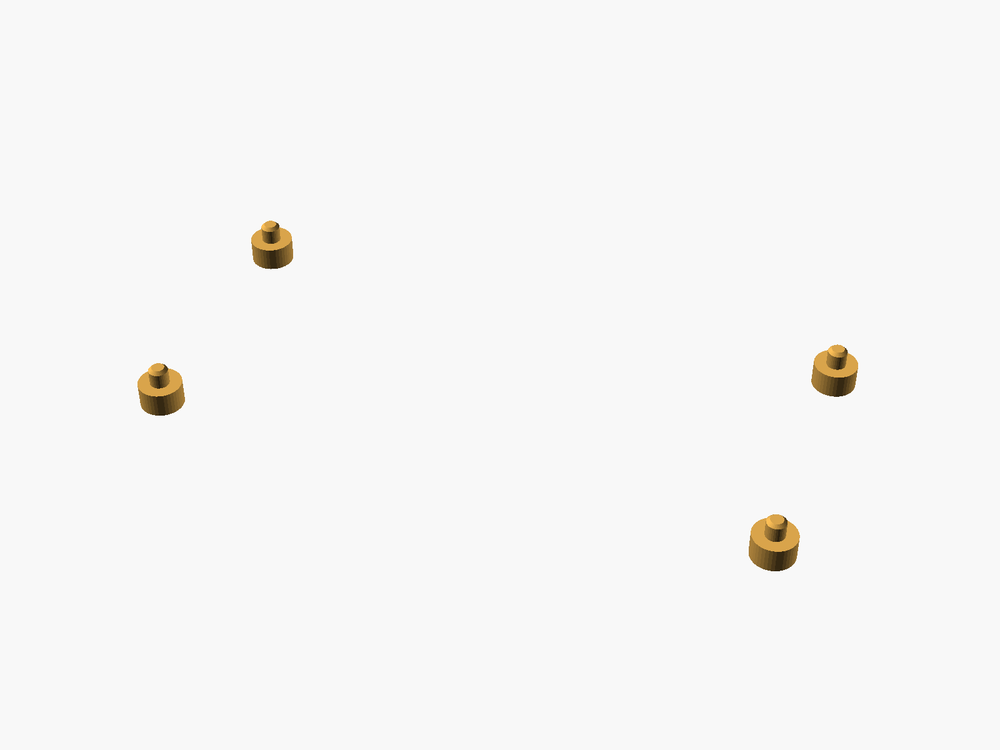
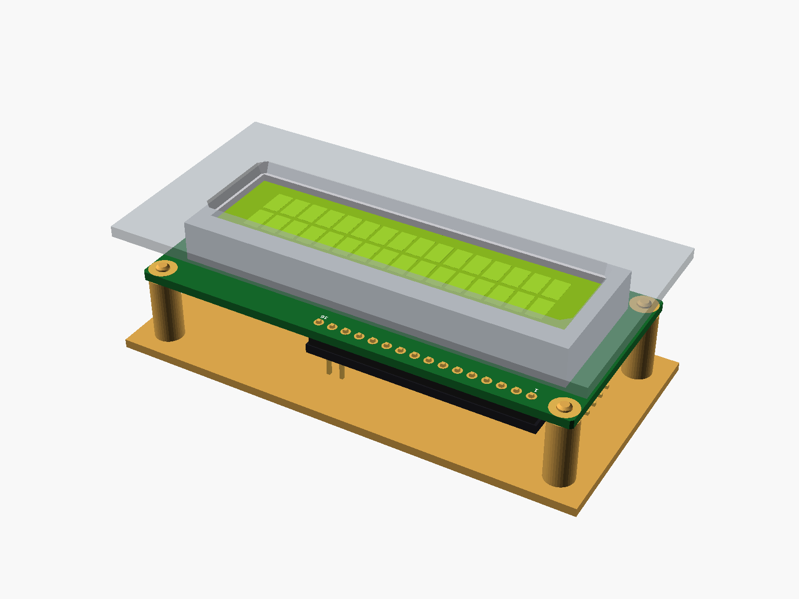
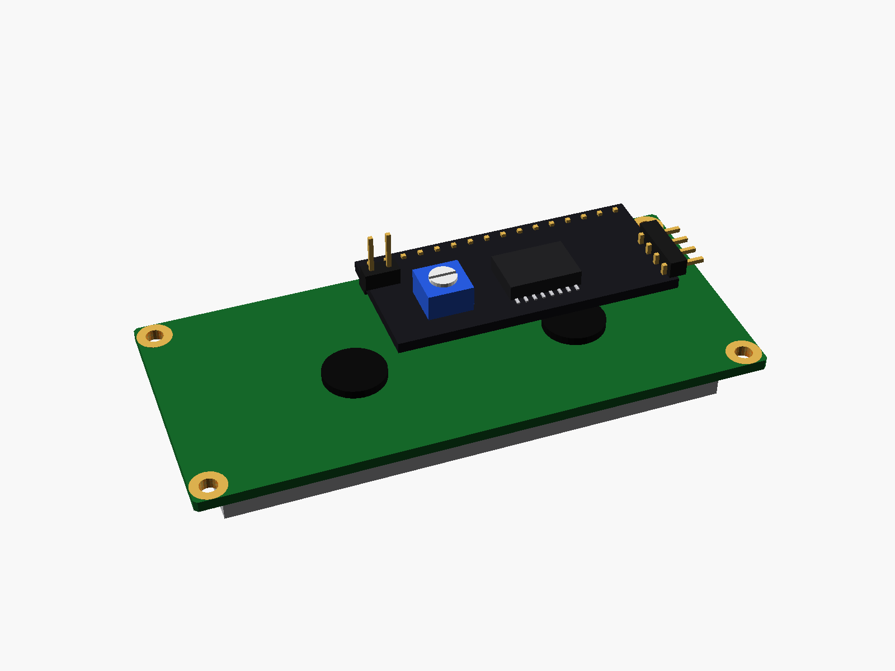

# LCD1602 with I2C backpack

LCD1602 character display (16 x 2, HD44780), optionally with the I2C "backpack" (PCF8574) soldered on the back.


**[View it in 3D](lcd1602.stl)** (turn it with the mouse; GitHub shows it in one colour)

| Underneath | Holder | In its holder / case | Backpack |
|---|---|---|---|
|  |  |  |  |

## Use it

```openscad
use <partbin/displays/lcd1602/lcd1602.scad>
```

| Call | What it gives |
|---|---|
| `lcd1602()` | the display with the I2C backpack, green screen (default) |
| `lcd1602(backpack = false)` | without the backpack |
| `lcd1602(screen = "blue")` | the blue version |
| `lcd1602(detail = false)` | only what matters for fit (fast) |
| `lcd1602_holder(h)` | posts under its four holes, add to the case |
| `lcd1602_window(gap, wall)` | the opening in the front, subtract it |
| `lcd1602_size()` | [width, height, pcb thickness] |
| `lcd1602_height()` | PCB underside to the front of the frame |
| `lcd1602_behind(backpack)` | how far it reaches behind the PCB |

Where it sits: screen up, the board centred on x = y = 0, its underside at z = 0, the 16 pins at the top (+y). For the window, the front's inside face is `gap` mm above the metal frame.

## Sizes

At the top of [`lcd1602.scad`](lcd1602.scad), in mm: from a published drawing or the seller's sizes.

| Setting | Value | What |
|---|---|---|
| `b_w` | 80.0 | board width (x) |
| `b_l` | 36.0 | board height (y) |
| `b_t` | 1.6 | PCB |
| `holes_at` | [75.0, 31.0] | hole centres, x and y apart |
| `frame` | [71.2, 24.2] | metal frame outline |
| `frame_h` | 7.4 | frame height above the PCB |
| `frame_y` | -1.0 | frame centre (y) |
| `view` | [66.0, 16.0] | viewing area (the window in the frame) |
| `active` | [56.2, 11.0] | where the characters are |
| `pin1_x` | 8.0 | board's left edge to pin 1 |
| `pin_top` | 2.5 | pin centre to the top edge |
| `bp` | [41.6, 19.3] | its PCB |
| `bp_gap` | 2.5 | between the two PCBs (the header's plastic) |

---

Part of [partbin](../../README.md), in [Displays](../README.md).
