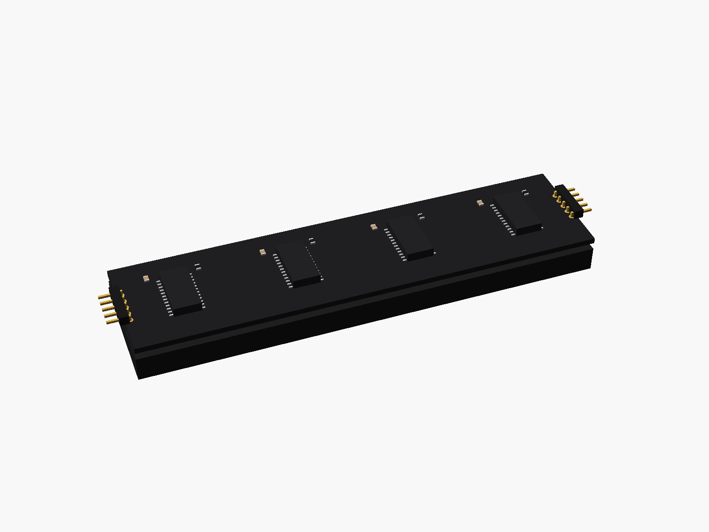
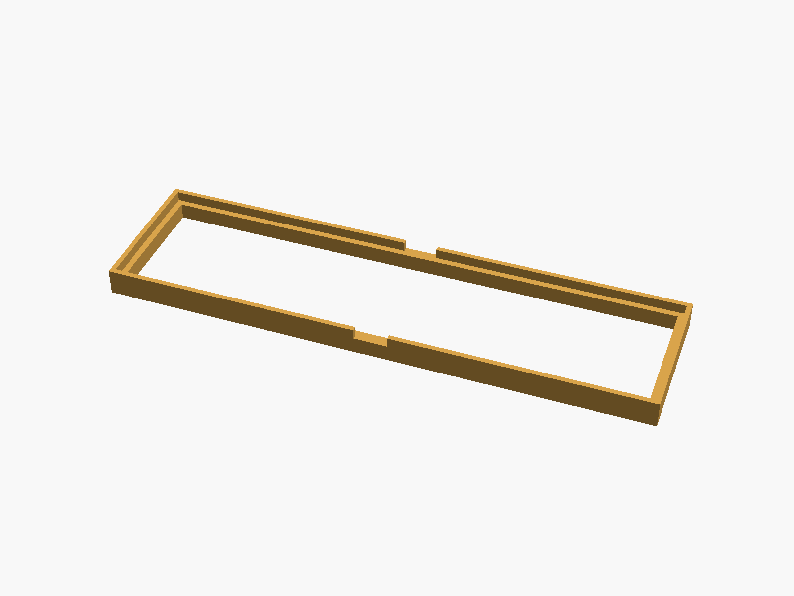
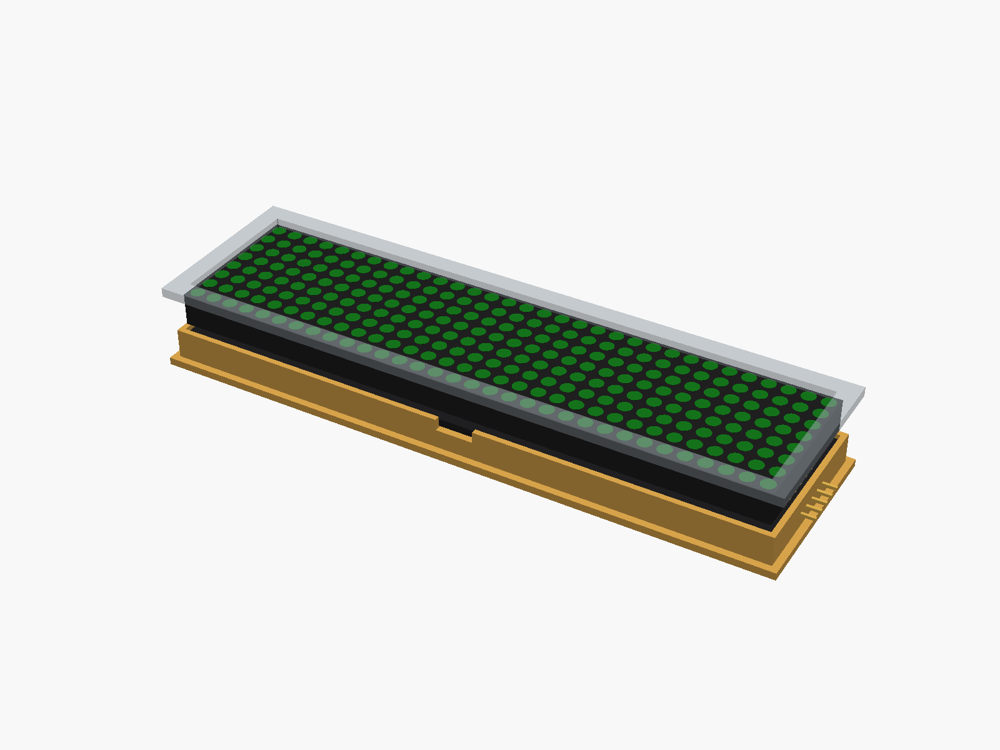

# MAX7219 FC-16 4-in-1 LED matrix

MAX7219 "FC-16" 4-in-1 LED matrix board: four 8 x 8 matrices (32 x 8 LEDs) on a 128 x 32 mm board, a MAX7219 under each matrix on the back, a 5-pin header at each end (IN and OUT). Several boards can sit end to end.


**[View it in 3D](max7219_fc16.stl)** (turn it with the mouse; GitHub shows it in one colour)

| Underneath | Holder | In its holder / case |
|---|---|---|
|  |  |  |

## Use it

```openscad
use <partbin/displays/max7219_fc16/max7219_fc16.scad>
```

| Call | What it gives |
|---|---|
| `max7219_fc16()` | one board, with its parts |
| `max7219_fc16(boards = 2)` | two boards end to end (64 x 8 LEDs) |
| `max7219_fc16(leds = "red")` | LED colour: green (default), red, blue, white, yellow |
| `max7219_fc16(detail = false)` | only what matters for fit (fast) |
| `max7219_fc16(headers = "none")` | without the end headers ("angle" = default) |
| `max7219_fc16_holder(boards = 2)` | ledge and low walls around the boards |
| `max7219_fc16_window(gap, wall)` | the window in the front, subtract it |
| `max7219_fc16_size(boards)` | [length, height, pcb thickness] |
| `max7219_fc16_height()` | PCB underside to the front of the LEDs |

Where it sits: LEDs up, the boards centred on x = y = 0, their underside at z = 0, the long side along x, the IN end at +x. The board has no mounting holes: the holder locates it and the case presses it against the front. For the window, the front's inside face is `gap` mm above the LEDs.

## Sizes

At the top of [`max7219_fc16.scad`](max7219_fc16.scad), in mm: typical, from photos; measure yours and change them.

| Setting | Value | What |
|---|---|---|
| `b_w` | 128.0 | one board (x) |
| `b_l` | 32.0 | its height (y) |
| `b_t` | 1.6 | PCB |
| `led_h` | 9.0 | front of the LEDs to the front of the PCB |
| `matrix_h` | 7.0 | the matrix block itself (it stands on its legs) |
| `behind` | 2.7 | chips on the back |
| `pin_in` | 1.5 | header pads, from the board's end |

---

Part of [partbin](../../README.md), in [Displays](../README.md).
