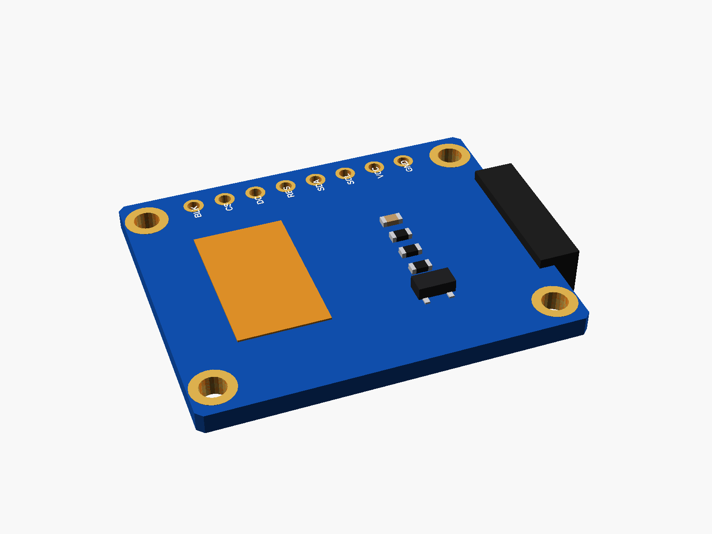
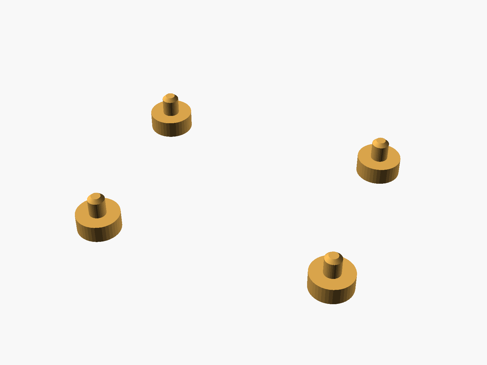
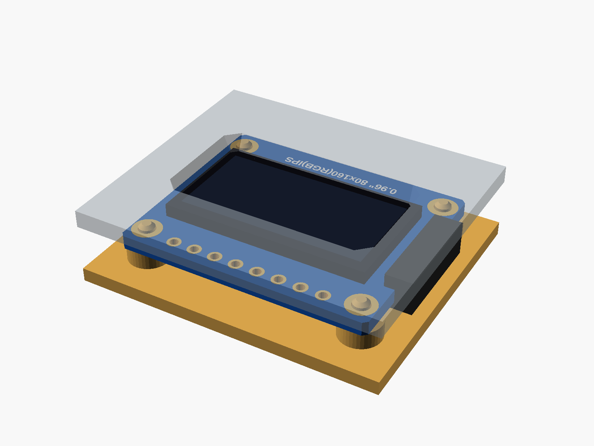

# 0.96" IPS TFT (ST7735S)

0.96" IPS TFT, 80 x 160, ST7735S (blue board, screen in landscape, 8 pins at the top: GND VCC SCL SDA RES DC CS BLK, four corner holes, the flex cable folded round the left edge).


**[View it in 3D](st7735_096.stl)** (turn it with the mouse; GitHub shows it in one colour)

| Underneath | Holder | In its holder / case |
|---|---|---|
|  |  |  |

## Use it

```openscad
use <partbin/displays/st7735_096/st7735_096.scad>
```

| Call | What it gives |
|---|---|
| `st7735_096()` | the board, with its parts |
| `st7735_096(detail = false)` | only what matters for fit (fast) |
| `st7735_096(headers = "down")` | with the 8-pin header soldered on |
| `st7735_096_holder(h = 2)` | posts under its holes, add to the case |
| `st7735_096_window(gap, wall)` | the screen opening in the front, subtract it |
| `st7735_096_size()` | [width, height, pcb thickness] |
| `st7735_096_height()` | PCB underside to the front of the glass |

Where it sits: screen up, the board centred on x = y = 0, its underside at z = 0, the long side along x, the pins at the top (+y). For the window, the front's inside face is `gap` mm above the glass.

## Sizes

At the top of [`st7735_096.scad`](st7735_096.scad), in mm: typical, from photos; measure yours and change them.

| Setting | Value | What |
|---|---|---|
| `b_w` | 29.2 | board width (x) |
| `b_l` | 24.2 | board height (y) |
| `b_t` | 1.6 | PCB |
| `hole_x` | 1.8 | hole centre to the side edges |
| `hole_y` | 2.4 | hole centre to the top and bottom edges |
| `pin_top` | 1.8 | pin centre to the top edge |
| `glass` | [24.0, 13.5] | glass outline (landscape) |
| `glass_t` | 1.5 | glass and its tape |
| `glass_x` | 0.4 | glass centre (x) |
| `active` | [21.7, 10.8] | the lit area |
| `fold` | 2.0 | the folded flex sticks out this far past the left edge |

---

Part of [partbin](../../README.md), in [Displays](../README.md).
