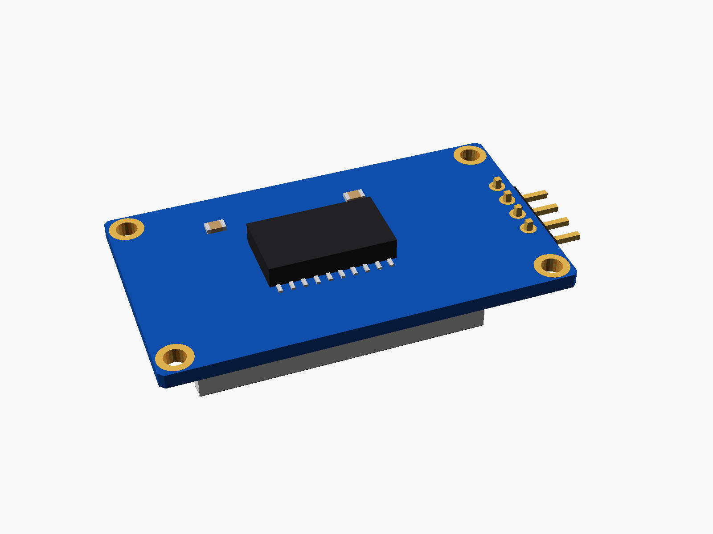
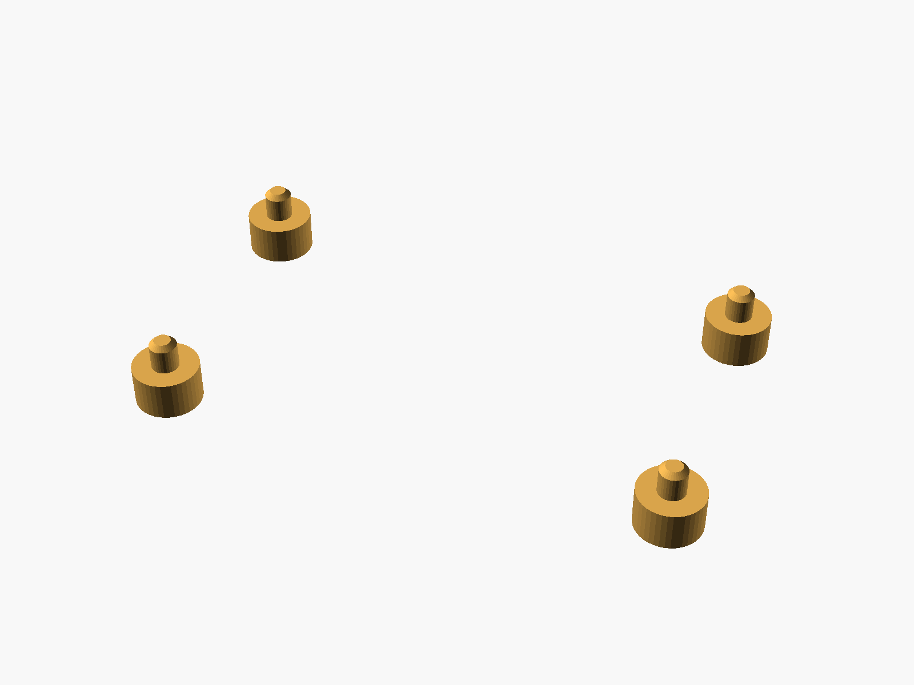
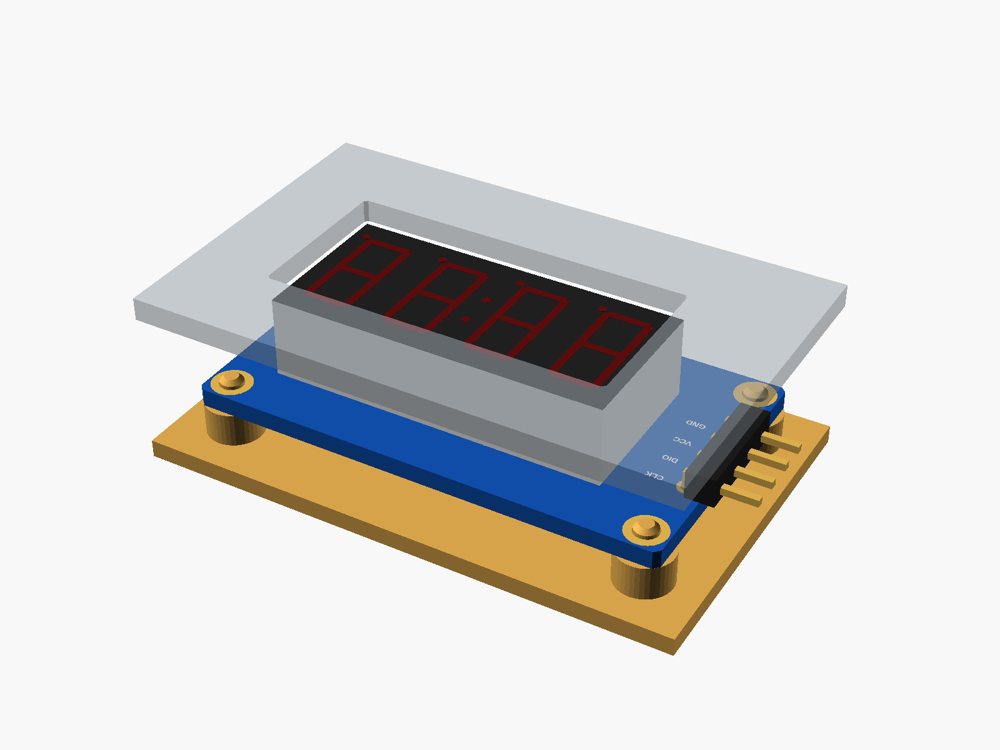

# TM1637 4-digit display module

TM1637 4-digit 7-segment display module (0.36" digits with a clock colon, 4-pin right-angle header at the left end: CLK DIO VCC GND, four holes).


**[View it in 3D](tm1637_4digit.stl)** (turn it with the mouse; GitHub shows it in one colour)

| Underneath | Holder | In its holder / case |
|---|---|---|
|  |  |  |

## Use it

```openscad
use <partbin/displays/tm1637_4digit/tm1637_4digit.scad>
```

| Call | What it gives |
|---|---|
| `tm1637_4digit()` | the module, with its parts |
| `tm1637_4digit(detail = false)` | only what matters for fit (fast) |
| `tm1637_4digit(headers = "none")` | without the header ("angle" = default) |
| `tm1637_4digit_holder(h = 3)` | posts under its holes, add to the case |
| `tm1637_4digit_window(gap, wall)` | the opening in the front, subtract it |
| `tm1637_4digit_size()` | [length, height, pcb thickness] |
| `tm1637_4digit_height()` | PCB underside to the front of the digits |

Where it sits: digits up, the board centred on x = y = 0, its underside at z = 0, the long side along x, the header at the left end (-x). For the window, the front's inside face is `gap` mm above the digits.

## Sizes

At the top of [`tm1637_4digit.scad`](tm1637_4digit.scad), in mm: typical, from photos; measure yours and change them.

| Setting | Value | What |
|---|---|---|
| `b_w` | 42.0 | board length (x) |
| `b_l` | 24.0 | board height (y) |
| `b_t` | 1.6 | PCB |
| `hole_in` | 2.0 | hole centre to the two nearest edges |
| `digits` | [30.1, 14.0] | the display block |
| `digits_h` | 7.2 | its height above the PCB |
| `digits_x` | 1.5 | its centre (x) |
| `pin_end` | 1.6 | pin centre to the left end |

---

Part of [partbin](../../README.md), in [Displays](../README.md).
