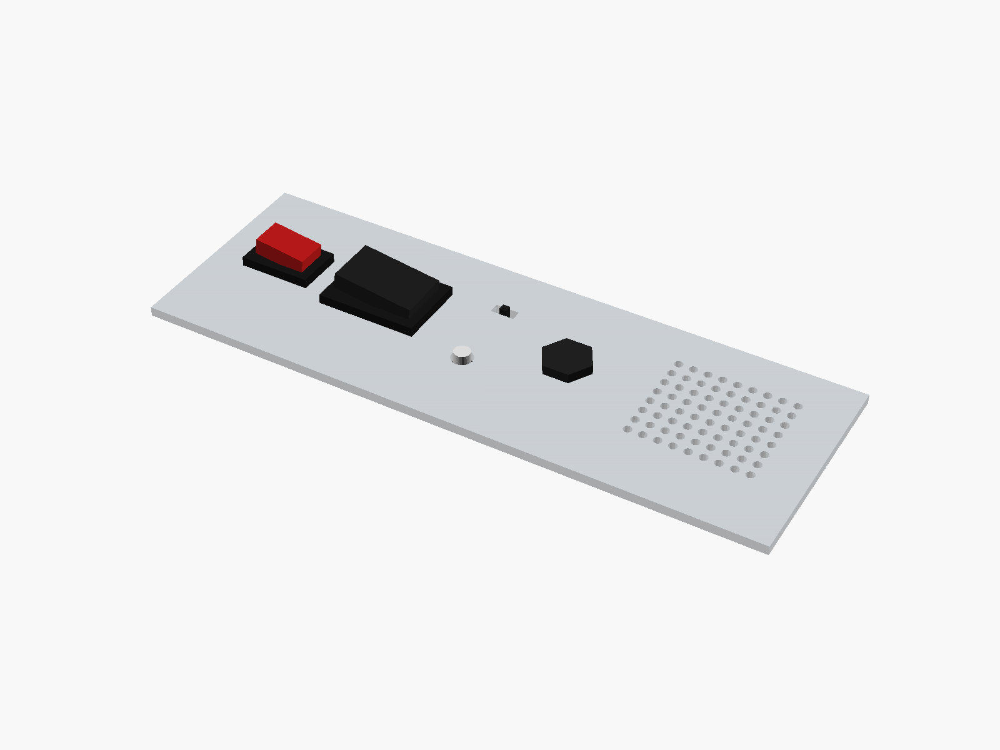

# Hardware

Batteries and holders, and parts that go in a panel.

✓ measured · ◐ from a drawing or the listing · ○ typical, from photos

| | Module | Picture |
|---|---|---|
| ○ | [Batteries and holders](batteries/) |  |
| ○ | [Panel parts](panel_parts/) |  |

---

Part of [partbin](../README.md).
