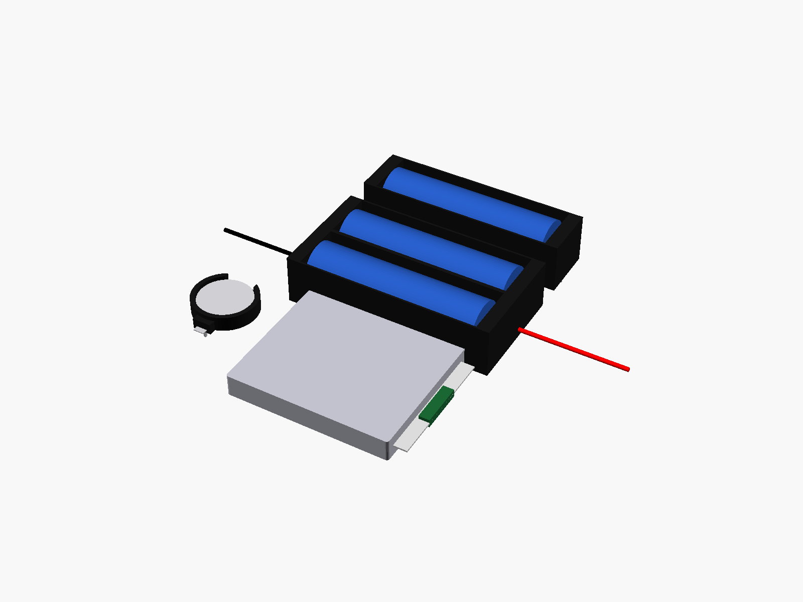

# Batteries and holders

Batteries and battery holders:



**[View it in 3D](batteries.stl)** (turn it with the mouse; GitHub shows it in one colour)

## Use it

```openscad
use <partbin/hardware/batteries/batteries.scad>
```

| Call | What it gives |
|---|---|
| `cell_18650()` | an 18650 cell (65 x 18.5 mm) |
| `holder_18650(slots = 1)` | the black box holder, 1-4 slots; pins = "pcb" or "wire" |
| `holder_18650_cutout(slots)` | a pocket for the holder in the case floor, subtract it |
| `holder_cr2032()` | the round black CR2032 holder (with the cell) |
| `lipo_pouch(size = [8, 50, 60])` | a LiPo pouch cell, [thickness, width, length] |
| `(2500 mAh is usually 8 x 50 x 60, "805060")` |  |

Where they sit: lying flat, centred on x = y = 0, the bottom at z = 0, the long side along x, + at +x.

## Sizes

At the top of [`batteries.scad`](batteries.scad), in mm: typical, from photos; measure yours and change them.

| Setting | Value | What |
|---|---|---|
| `c_d` | 18.5 | 18650 |
| `h_len` | 77.0 | holder outside length |
| `h_slot` | 20.7 | per slot |
| `h_h` | 18.6 | holder height |
| `h_holes` | 3.0 | two holes in the floor of each slot |

---

Part of [partbin](../../README.md), in [Hardware](../README.md).
