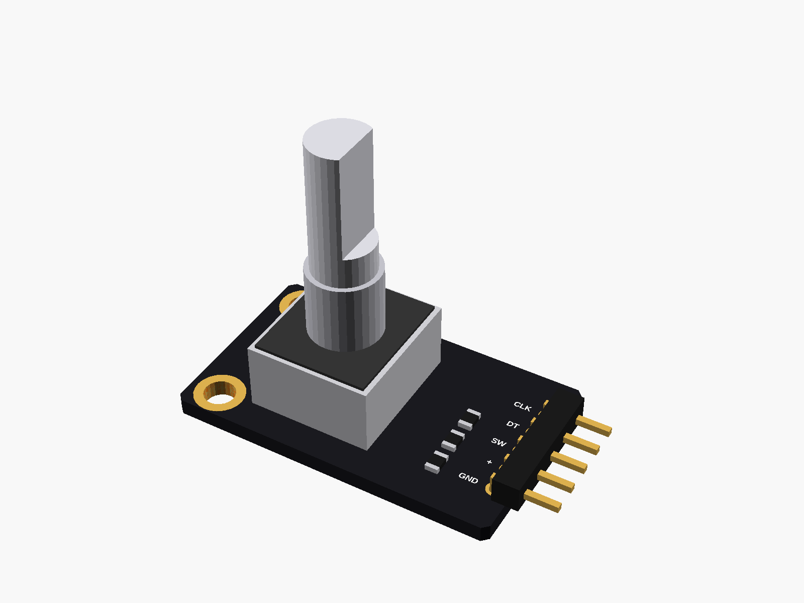
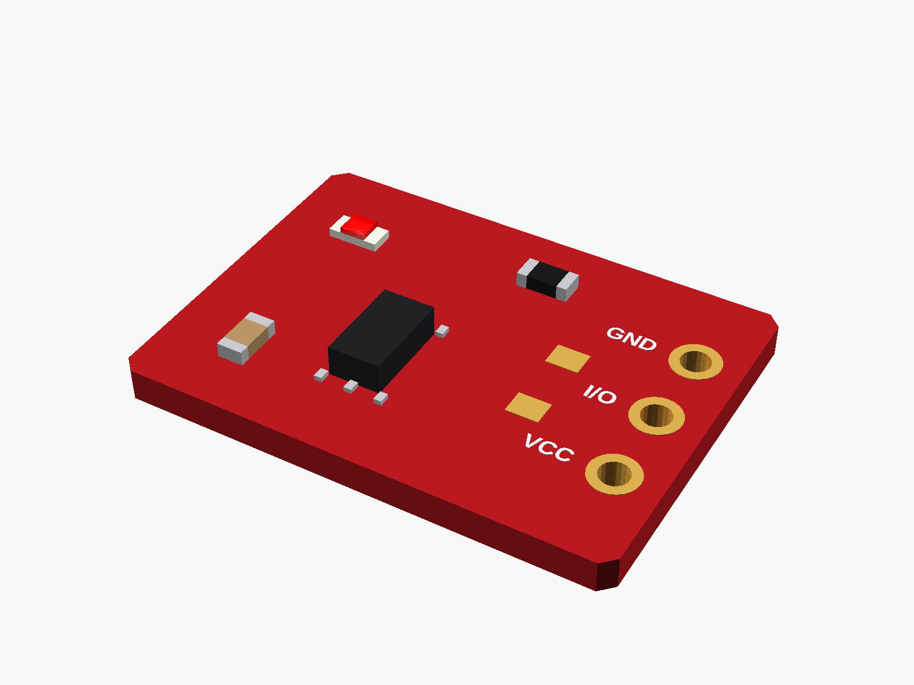

# Inputs

Things you press, touch or turn.

✓ measured · ◐ from a drawing or the listing · ○ typical, from photos

| | Module | Picture |
|---|---|---|
| ○ | [KY-040 rotary encoder](ky040_encoder/) |  |
| ○ | [5-way navigation button](nav5_button/) |  |
| ○ | [TTP223 touch button](ttp223_touch/) |  |

---

Part of [partbin](../README.md).
