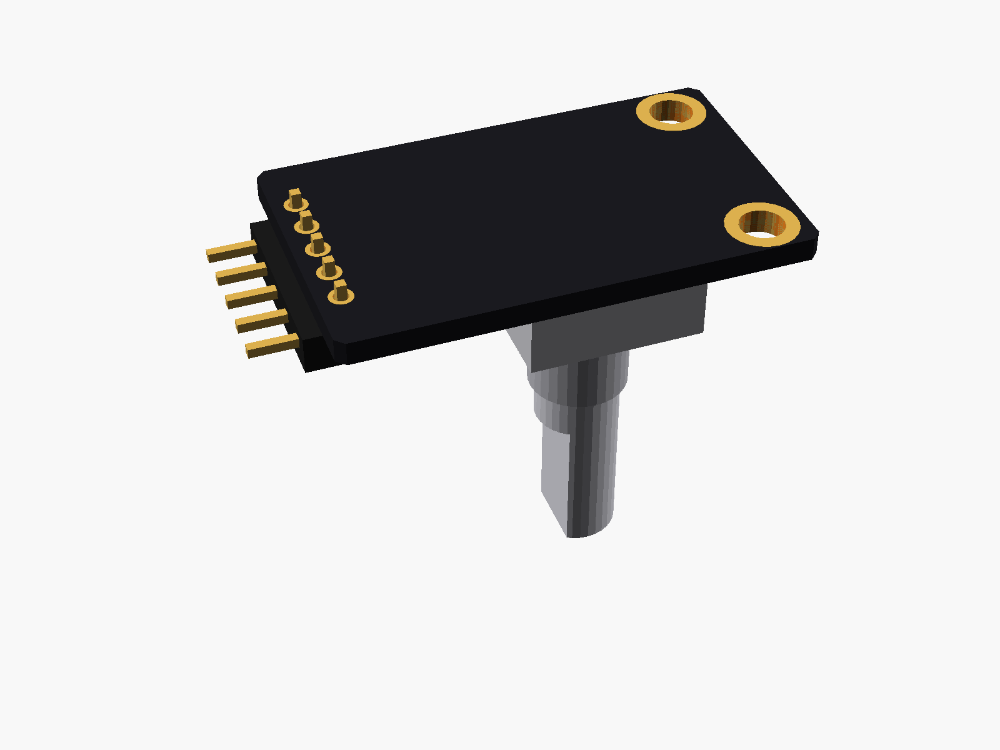
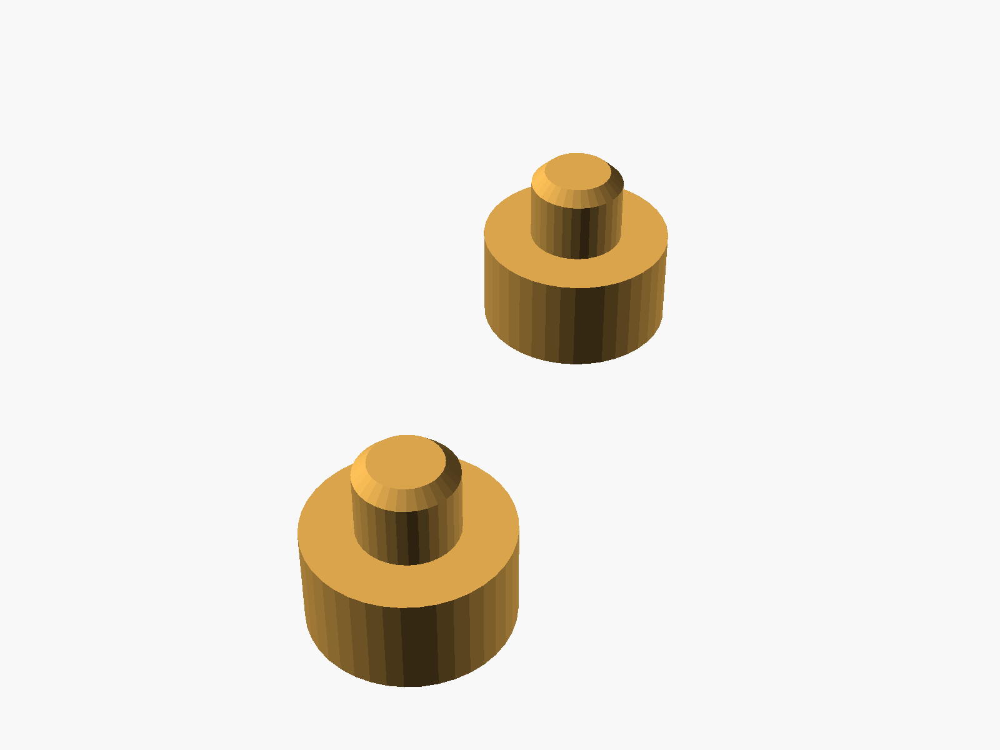

# KY-040 rotary encoder

KY-040 rotary encoder module (EC11 encoder with push switch, 5-pin right-angle header: CLK DT SW + GND, two mounting holes).


**[View it in 3D](ky040_encoder.stl)** (turn it with the mouse; GitHub shows it in one colour)

| Underneath | Holder | In its holder / case |
|---|---|---|
|  |  |  |

## Use it

```openscad
use <partbin/inputs/ky040_encoder/ky040_encoder.scad>
```

| Call | What it gives |
|---|---|
| `ky040_encoder()` | the module, with its parts |
| `ky040_encoder(knob = true)` | with the knob from the kit |
| `ky040_encoder(headers = "none")` | without the header ("angle" = default) ky040_encoder_panel_cutout(gap, wall) the hole for the shaft in the front panel |
| `ky040_encoder_holder(h = 3)` | posts under its holes |
| `ky040_encoder_size()` | [length, width, pcb thickness] |

Where it sits: the shaft up, the board centred on x = y = 0, its underside at z = 0, the long side along x, the header at the right end (pins point +x). The encoder's threaded bushing (7 mm) can go through a panel up to ~5 mm thick and be held with its nut, or the board can sit on posts behind it.

## Sizes

At the top of [`ky040_encoder.scad`](ky040_encoder.scad), in mm: typical, from photos; measure yours and change them.

| Setting | Value | What |
|---|---|---|
| `b_l` | 31.5 | length (x) |
| `b_w` | 19.0 | width (y) |
| `enc_x` | -3.5 | encoder centre (x) |
| `shaft` | 20 | shaft length above the encoder body |

---

Part of [partbin](../../README.md), in [Inputs](../README.md).
