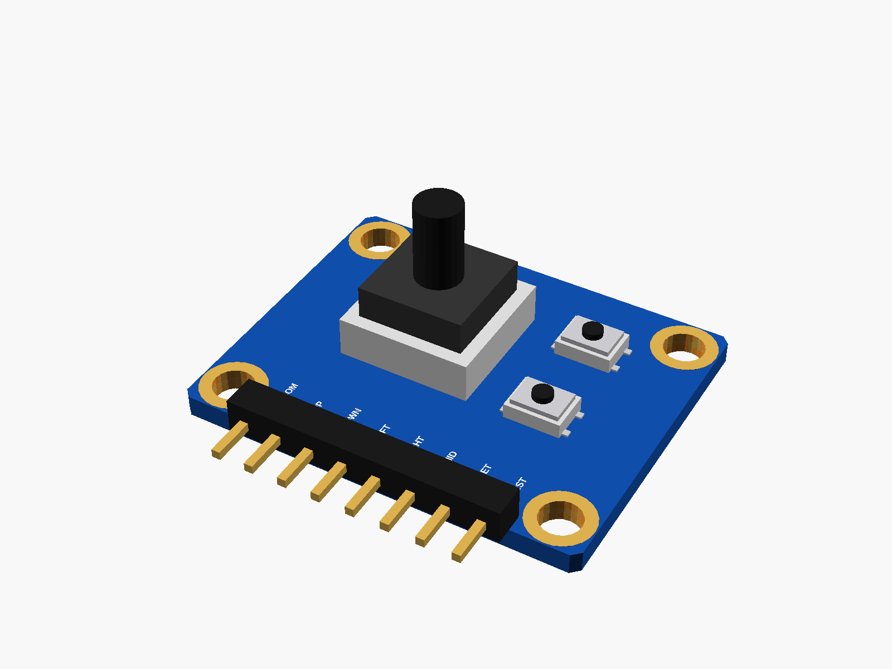
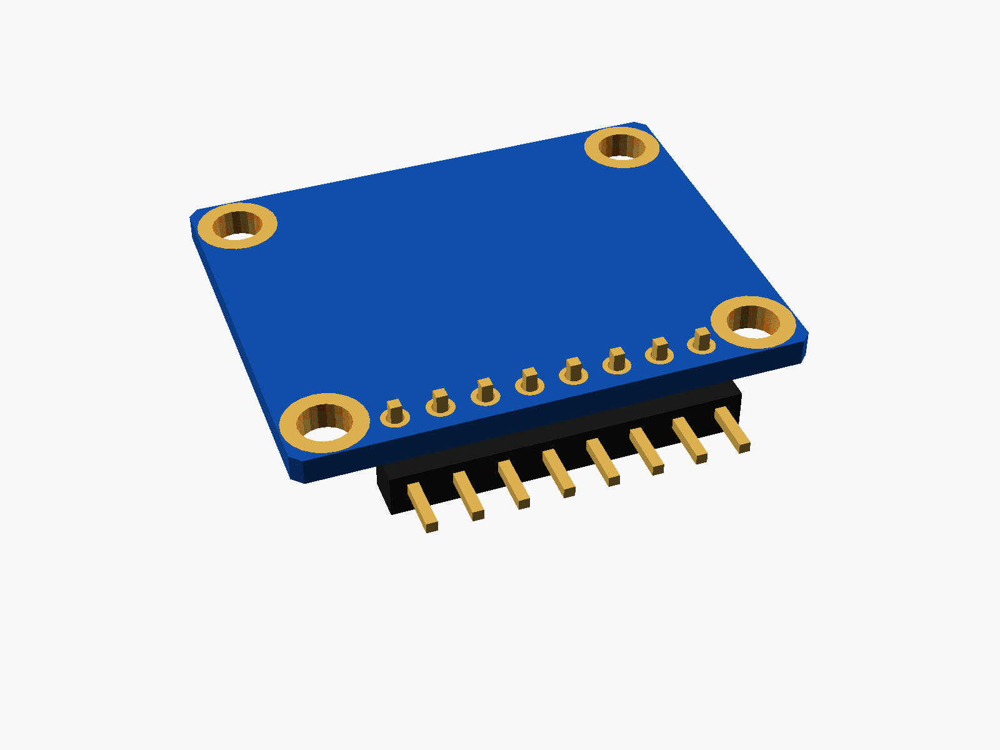
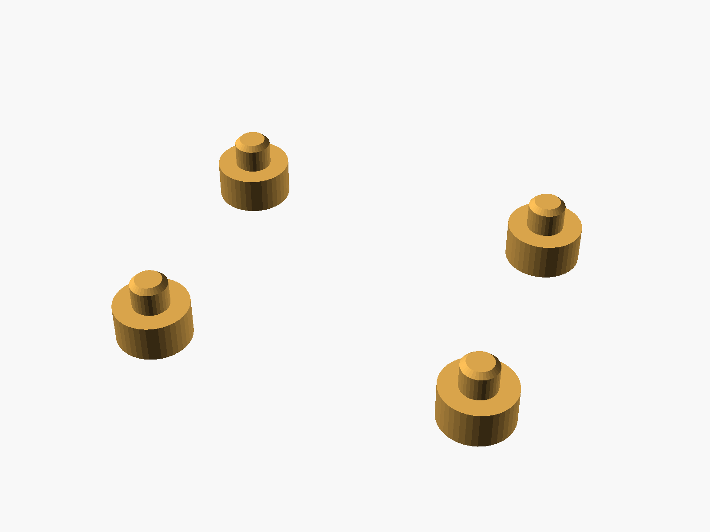

# 5-way navigation button

Five-direction navigation button module (blue: a 5-way switch, SET and RST tact buttons, 8-pin right-angle header COM UP DWN LFT RHT MID SET RST, four corner holes).



**[View it in 3D](nav5_button.stl)** (turn it with the mouse; GitHub shows it in one colour)

| Underneath | Holder | In its holder / case |
|---|---|---|
|  |  |  |

## Use it

```openscad
use <partbin/inputs/nav5_button/nav5_button.scad>
```

| Call | What it gives |
|---|---|
| `nav5_button()` | the module, with its parts |
| `nav5_button(headers = "none")` | without the header ("angle" = default) nav5_button_panel_cutout(gap, wall) holes for the stick and the two buttons |
| `nav5_button_holder(h = 3)` | posts under its holes |
| `nav5_button_size()` | [length, width, pcb thickness] |

Where it sits: the switch up, the board centred on x = y = 0, its underside at z = 0, the header along the bottom edge (pins point -y).

## Sizes

At the top of [`nav5_button.scad`](nav5_button.scad), in mm: typical, from photos; measure yours and change them.

| Setting | Value | What |
|---|---|---|
| `b_l` | 30.0 | length (x) |
| `b_w` | 24.0 | width (y) |
| `nav` | [-3.0, 2.0] | the 5-way switch |

---

Part of [partbin](../../README.md), in [Inputs](../README.md).
