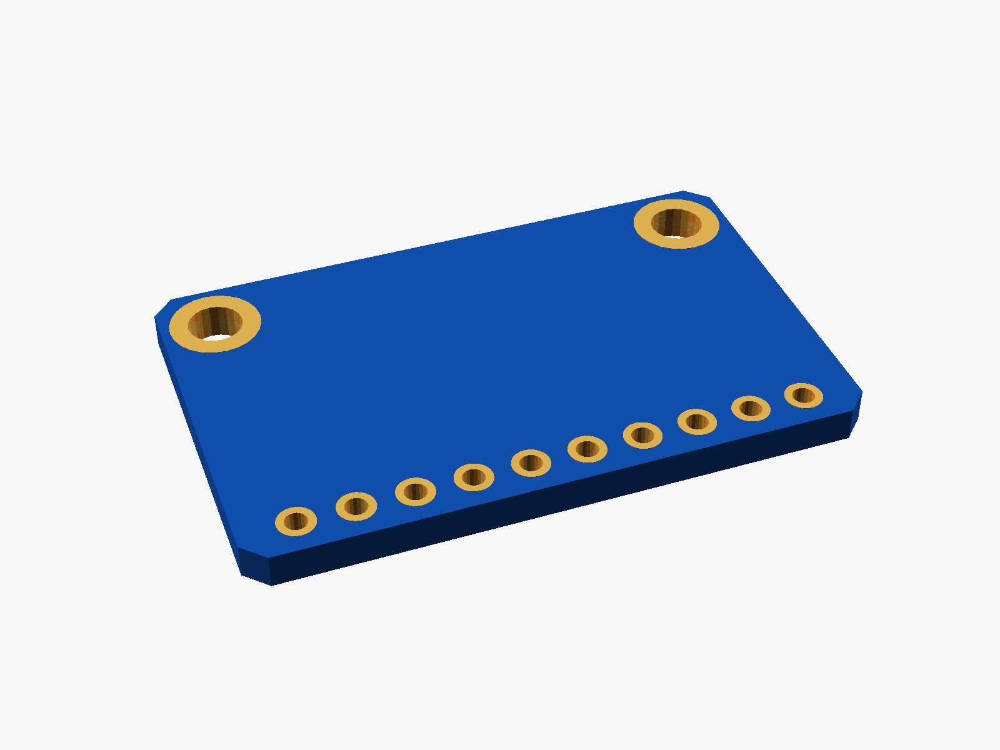
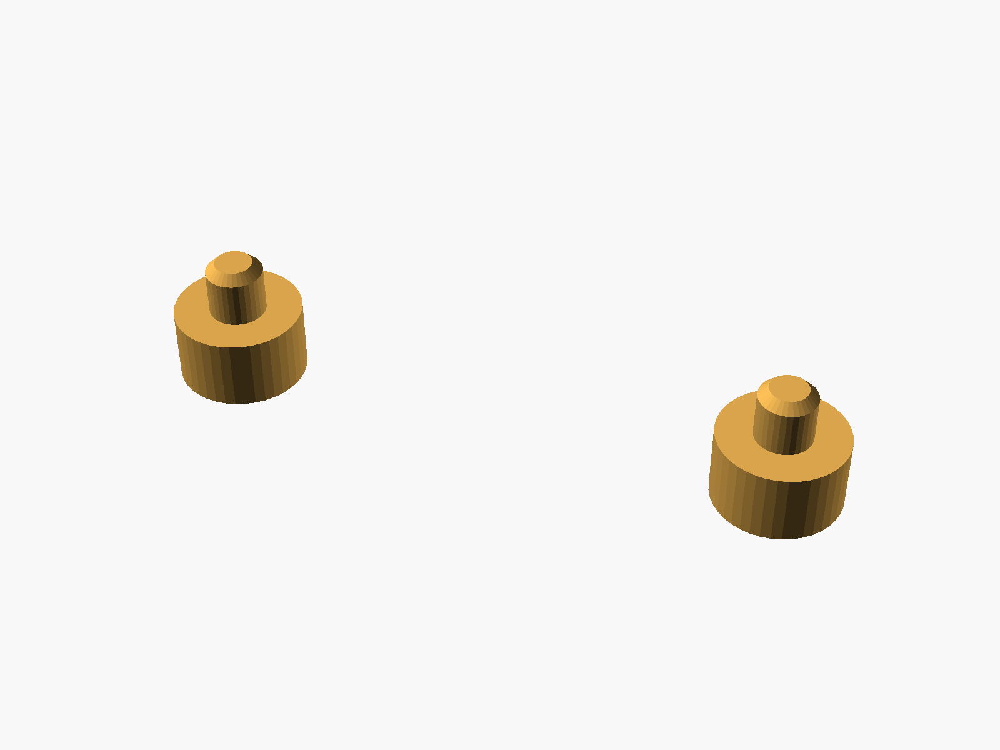
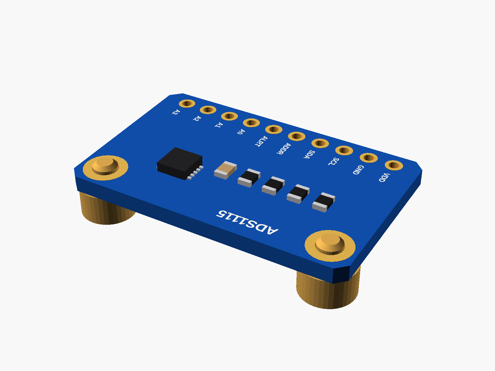

# ADS1115 ADC

ADS1115 16-bit ADC breakout (blue, Adafruit-style: 10 pins along the bottom: VDD GND SCL SDA ADDR ALRT A0 A1 A2 A3, two holes at the top).


**[View it in 3D](ads1115.stl)** (turn it with the mouse; GitHub shows it in one colour)

| Underneath | Holder | In its holder / case |
|---|---|---|
|  |  |  |

## Use it

```openscad
use <partbin/modules/ads1115/ads1115.scad>
```

| Call | What it gives |
|---|---|
| `ads1115()` | the board, with its parts |
| `ads1115(headers = "down")` | with the 10-pin header soldered on |
| `ads1115_holder(h = 3)` | posts under its two holes |
| `ads1115_size()` | [width, length, pcb thickness] |
| `ads1115_pin(i)` | [x, y] of pin i (0 = VDD ... 9 = A3) |

Where it sits: parts up, the board centred on x = y = 0, its underside at z = 0, the pins along the bottom edge (-y), the holes at the top.

## Sizes

At the top of [`ads1115.scad`](ads1115.scad), in mm: typical, from photos; measure yours and change them.

| Setting | Value | What |
|---|---|---|
| `hole_in` | 2.5 | hole centre to the top and side edges |

---

Part of [partbin](../../README.md).
