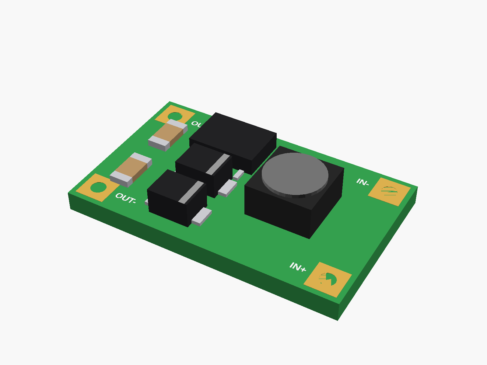
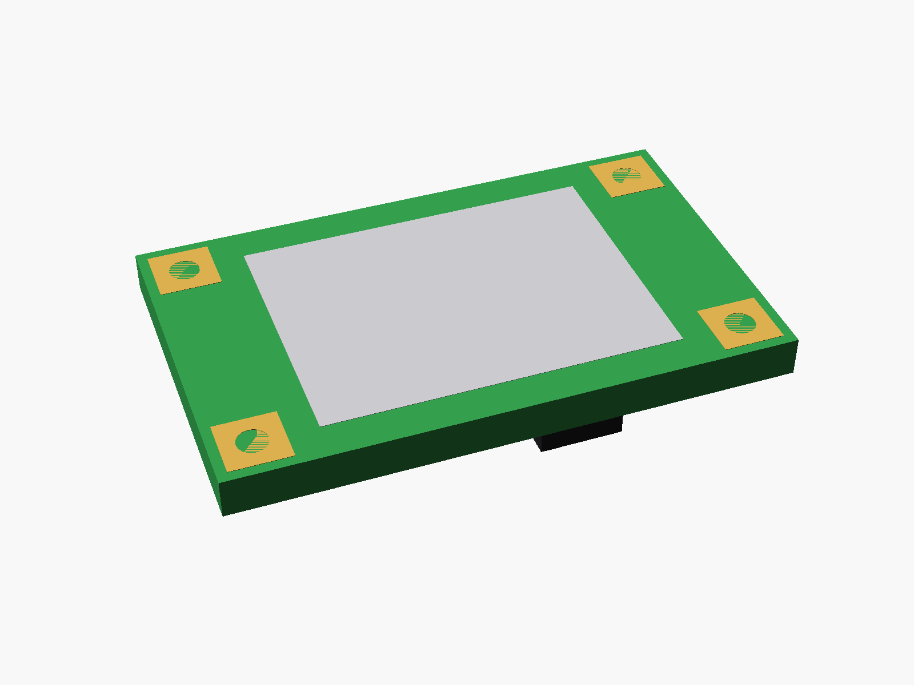
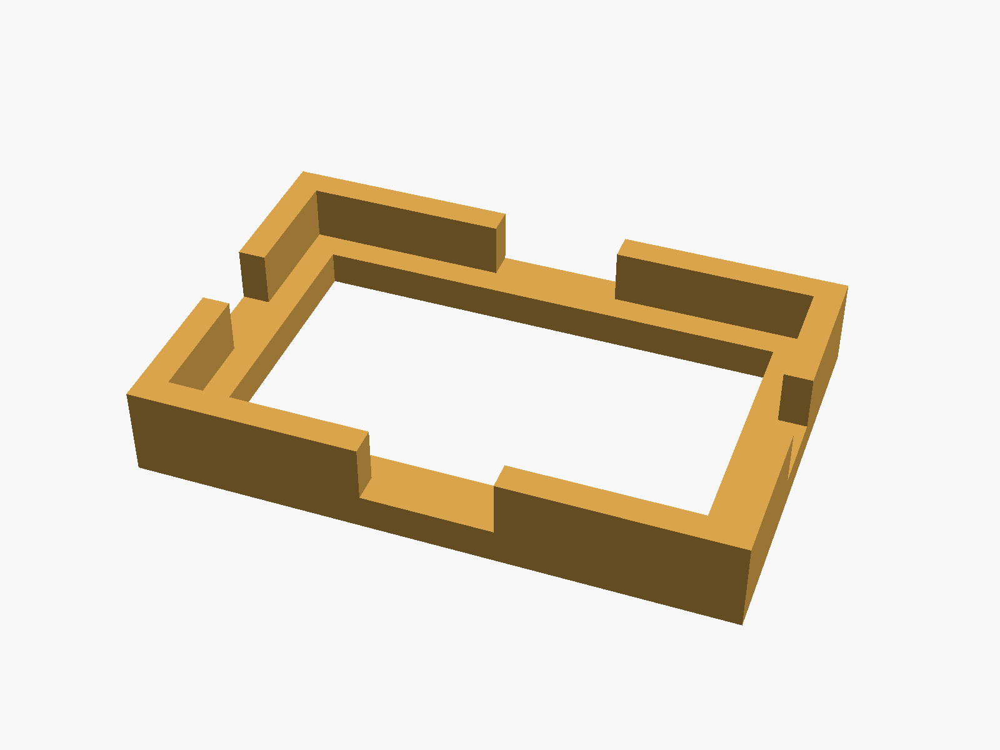
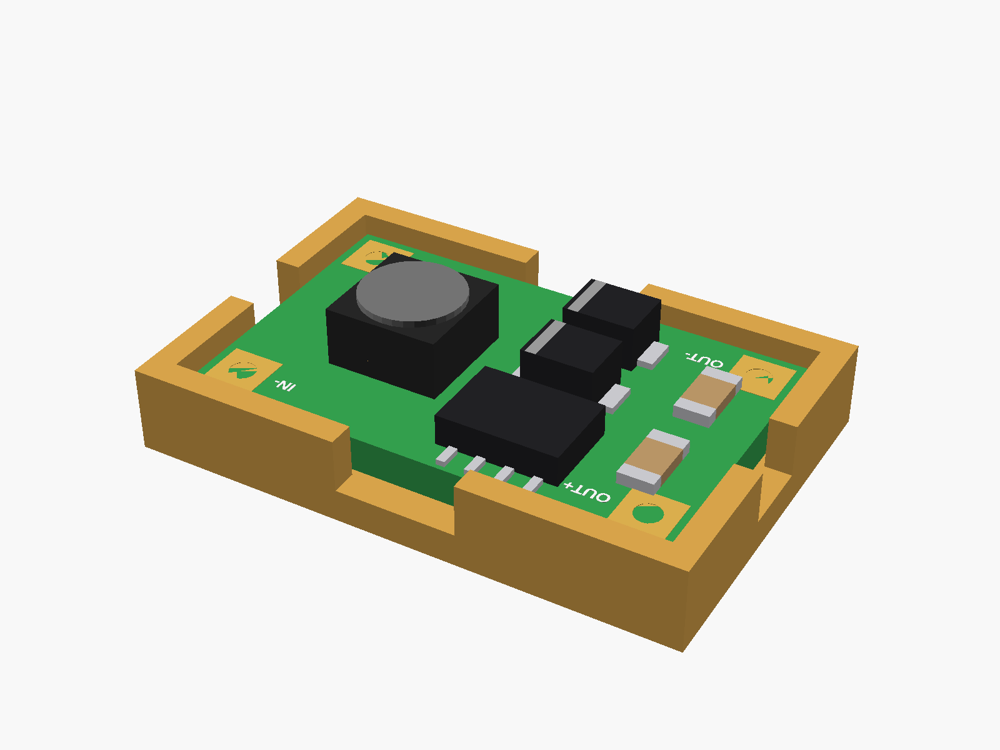

# Mini 5V 3A boost board

Mini DC-DC boost board, 3.7 V to 5 V 3 A (green, a pad with a hole in each corner: IN+ IN- at one end, OUT+ OUT- at the other; SOP-8 chip, two diodes, a 2.2 uH inductor). Sold as "3.7V lithium battery boost charging board 5V3A / 9V1.3A / 12V1A".



**[View it in 3D](boost_mini_5v3a.stl)** (turn it with the mouse; GitHub shows it in one colour)

| Underneath | Holder | In its holder / case |
|---|---|---|
|  |  |  |

## Use it

```openscad
use <partbin/modules/boost_mini_5v3a/boost_mini_5v3a.scad>
```

| Call | What it gives |
|---|---|
| `boost_mini_5v3a()` | the board, with its parts |
| `boost_mini_5v3a(detail = false)` | only what matters for fit (fast) |
| `boost_mini_5v3a_holder()` | ledge and low walls, add to the case |
| `boost_mini_5v3a_size()` | [length, width, pcb thickness] |
| `boost_mini_5v3a_pad(name)` | [x, y] of "IN+", "IN-", "OUT+", "OUT-" |

Where it sits: parts up, the board centred on x = y = 0, its underside at z = 0, the long side along x, IN at the right end (+x), OUT at the left.

## Sizes

At the top of [`boost_mini_5v3a.scad`](boost_mini_5v3a.scad), in mm: typical, from photos; measure yours and change them.

| Setting | Value | What |
|---|---|---|
| `b_l` | 22.0 | board length (x) |
| `b_w` | 13.5 | board width (y) |
| `b_t` | 1.6 | PCB |
| `pad_in` | 1.6 | corner pads, centre to the edges |
| `tall_h` | 3.0 | the inductor |

---

Part of [partbin](../../README.md).
