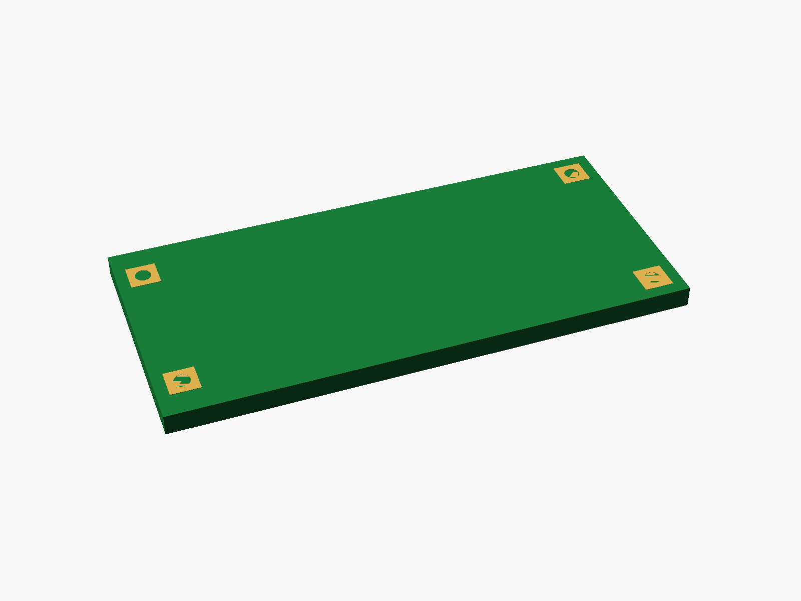
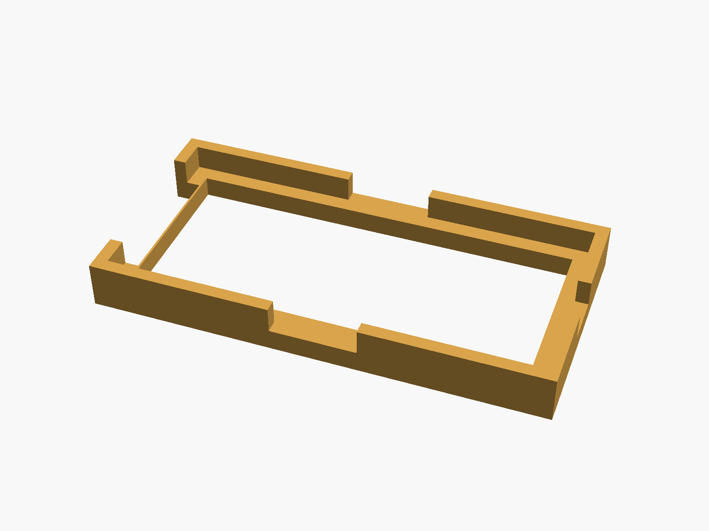
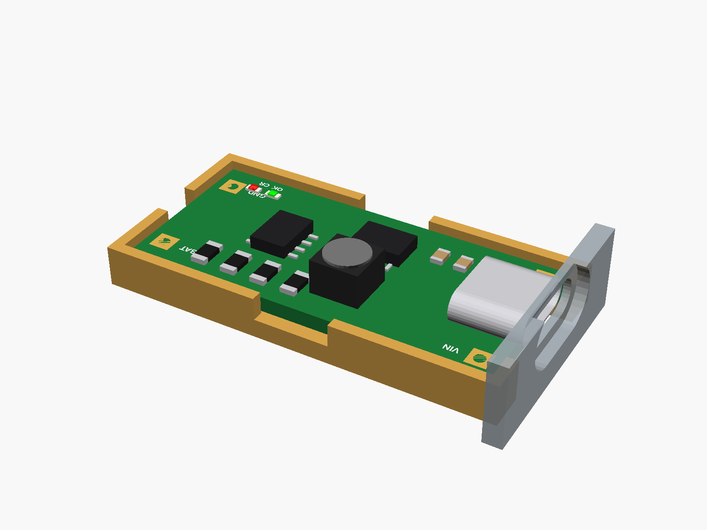

# 2S Type-C boost charger

Type-C to 8.4 V boost charger for 2S Li-ion packs ("DDTCCRUB", green, 39 x 18 mm; also sold as 3S/4S and 1A/2A/4A by jumpers on the back). USB-C input with VIN/GND pads beside it; BAT and GND pads at the far end; red CR (charging) and green OK (full) LEDs.


**[View it in 3D](charger_2s_typec.stl)** (turn it with the mouse; GitHub shows it in one colour)

| Underneath | Holder | In its holder / case |
|---|---|---|
|  |  |  |

## Use it

```openscad
use <partbin/modules/charger_2s_typec/charger_2s_typec.scad>
```

| Call | What it gives |
|---|---|
| `charger_2s_typec()` | the board, with its parts |
| `charger_2s_typec(detail = false)` | only what matters for fit (fast) charger_2s_typec_usb_cutout(wall, gap) the USB-C opening, subtract it charger_2s_typec_led_window(gap, wall) a slot over the two LEDs in the lid |
| `charger_2s_typec_holder()` | ledge and low walls, open at the USB end |
| `charger_2s_typec_size()` | [length, width, pcb thickness] |

Where it sits: parts up, the board centred on x = y = 0, its underside at z = 0, the long side along x, the USB socket at the left end pointing -x.

## Sizes

At the top of [`charger_2s_typec.scad`](charger_2s_typec.scad), in mm: from a published drawing or the seller's sizes.

| Setting | Value | What |
|---|---|---|
| `b_l` | 39.0 | board length (x) |
| `b_w` | 18.0 | board width (y) |
| `b_t` | 1.6 | PCB |
| `c_size` | [8.94, 3.26, 7.35] | USB-C |
| `tall_h` | 4.0 | the inductor (6 mm overall with the PCB and the socket's legs) |
| `leds_at` | [14.0, -6.5] | OK and CR LEDs, between them |

---

Part of [partbin](../../README.md).
