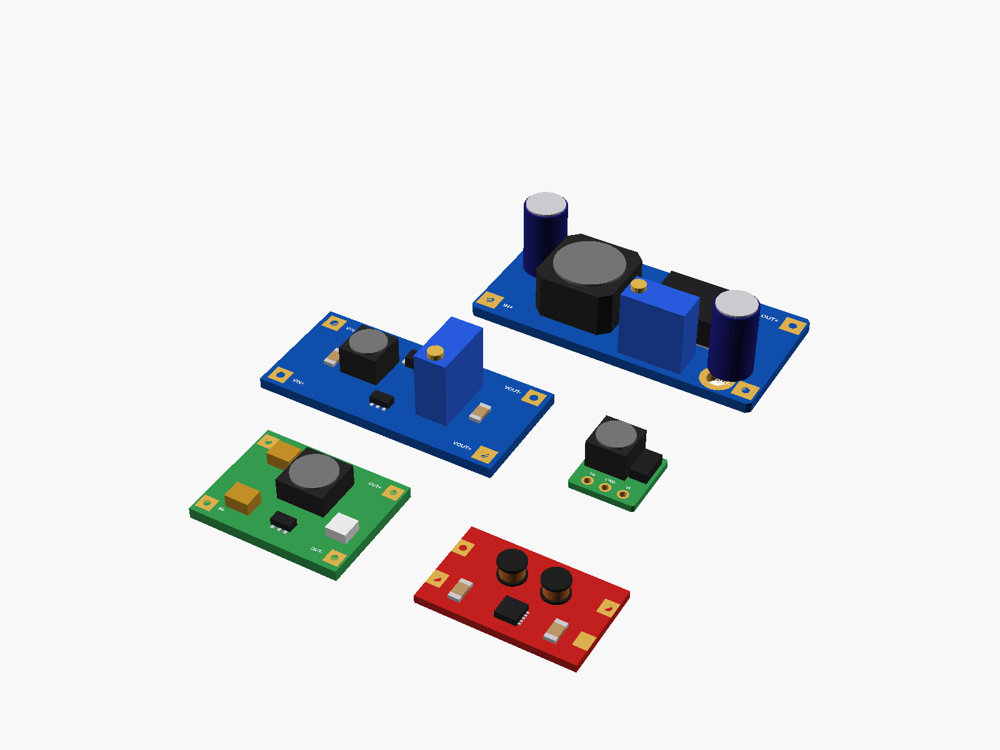

# DC-DC converter boards

Small DC-DC converter boards, all in one file:



**[View it in 3D](converters.stl)** (turn it with the mouse; GitHub shows it in one colour)

## Use it

```openscad
use <partbin/modules/converters/converters.scad>
```

| Call | What it gives |
|---|---|
| `lm2596_hw411()` | LM2596S step-down, "HW-411" (blue, 43 x 21, trimmer) |
| `mt3608()` | MT3608 step-up (blue, 36 x 17, trimmer) |
| `stepup_tiny()` | 0.9-5 V -> 5 V (or 3.3 V) step-up, 3 pins: Vo GND Vi |
| `stepdown_mini()` | 12-24 V -> 5 V 3 A mini step-down (green, "100" inductor) |
| `s09_buckboost()` | S09 automatic buck-boost to 3.3 / 5 V (red) |

and for each: &lt;name&gt;_size(), &lt;name&gt;_holder(h) (posts or a ledge), and &lt;name&gt;_pad(name) giving [x, y] of a pad ("IN+", "OUT-", ...).

Where they sit: parts up, the board centred on x = y = 0, its underside at z = 0, the long side along x, the input at the left (-x). Typical sizes; layouts from the order listings' photos.

---

Part of [partbin](../../README.md).
