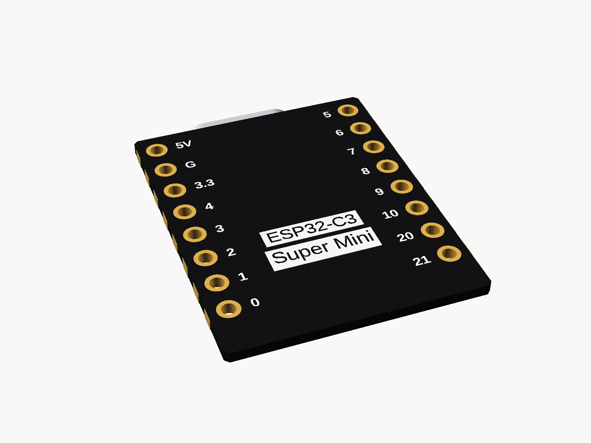
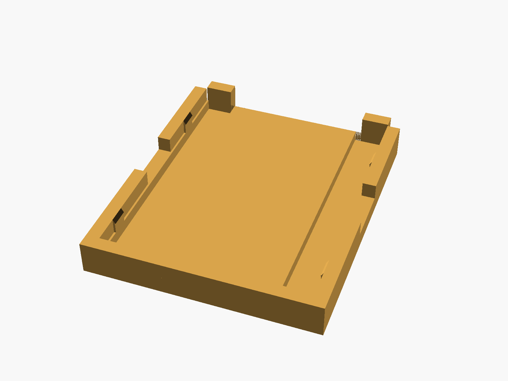
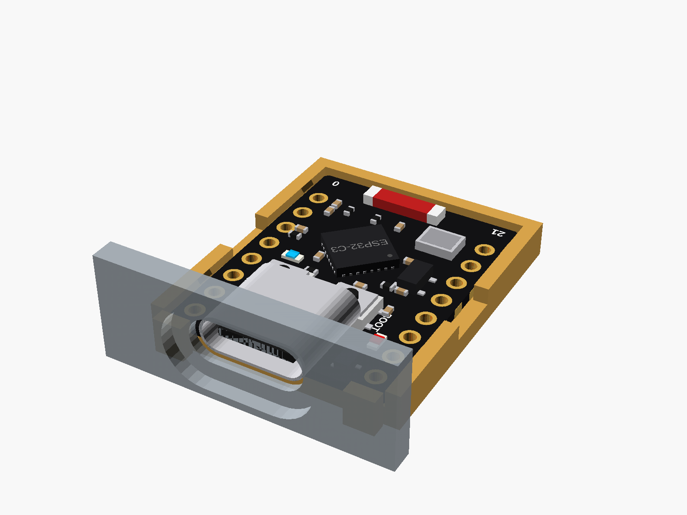

# ESP32-C3 Super Mini

ESP32-C3 Super Mini (the black "Nologo" board, ceramic chip antenna, BOOT and RST buttons under the USB-C socket).


**[View it in 3D](esp32_c3_supermini.stl)** (turn it with the mouse; GitHub shows it in one colour)

| Underneath | Holder | In its holder / case |
|---|---|---|
|  |  |  |

## Use it

```openscad
use <partbin/modules/esp32_c3_supermini/esp32_c3_supermini.scad>
```

| Call | What it gives |
|---|---|
| `esp32c3_supermini()` | the board, with all its parts |
| `esp32c3_supermini(detail = false)` | only what matters for fit (fast) |
| `esp32c3_supermini(headers = "down")` | with pin headers soldered on |
| `esp32c3_supermini_usb_cutout(wall=2)` | subtract from the case wall |
| `esp32c3_supermini_holder()` | a tray the board presses into, add to the case |
| `esp32c3_supermini_size()` | [width, length, pcb thickness] |

Where it sits: the board lies flat, parts up. The centre of the board is at x = y = 0, its underside at z = 0, and the USB-C socket points to +y. Put the board, its cutout and its holder through the same translate/rotate and they line up.

Opened on its own, this file shows the board, the holder and a wall piece (set show = "board" or "holder" for one of them alone).

## Sizes

At the top of [`esp32_c3_supermini.scad`](esp32_c3_supermini.scad), in mm: measured with calipers.

| Setting | Value | What |
|---|---|---|
| `sm_w` | 18.0 | board width (x) |
| `sm_l` | 23.0 | board length (y), without the USB socket |
| `sm_t` | 0.8 | PCB |
| `usb_w` | 8.8 | USB-C shell width |
| `usb_h` | 3.1 | USB-C height above the board (the tallest part) |
| `usb_out` | 1.7 | how far the socket sticks out past the board's edge |
| `usb_left` | 5.0 | board's left edge to the socket's left side (parts up, USB away from you) |
| `pin_span` | 17.78 | first to last hole in a row (8 pins, 2.54 mm) |
| `row_x` | 7.62 | each pin row from the centre (rows 15.24 mm apart, measured) |
| `pin_y0` | 1.0 | the pin rows' middle sits this far towards the USB |
| `usb_len` | 7.6 | socket depth |

---

Part of [partbin](../../README.md).
