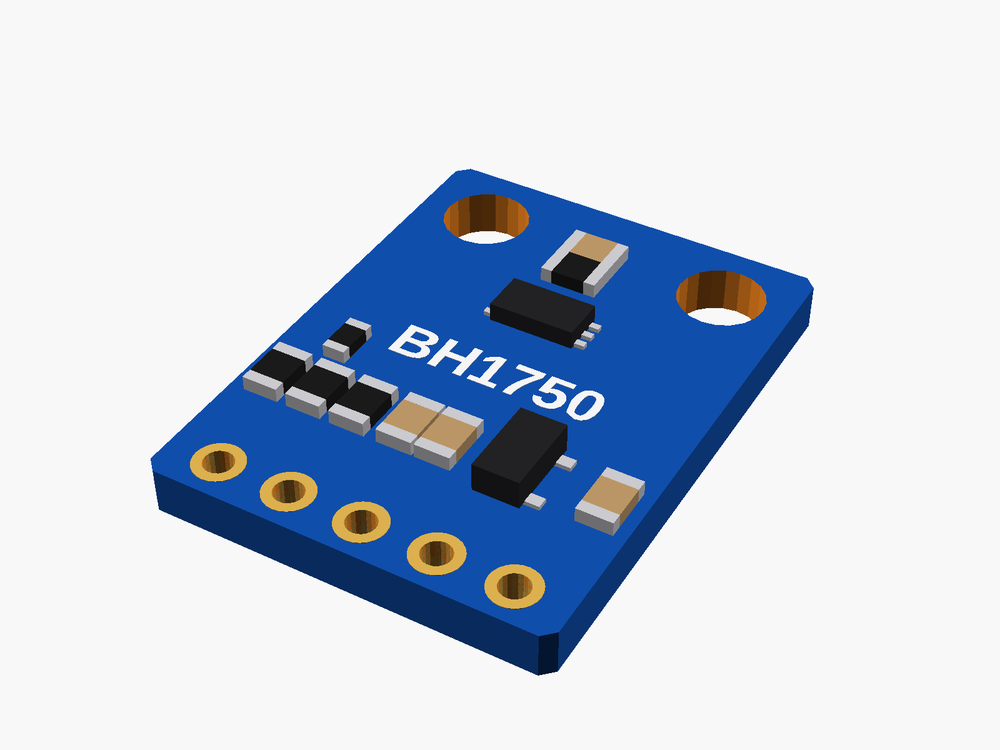
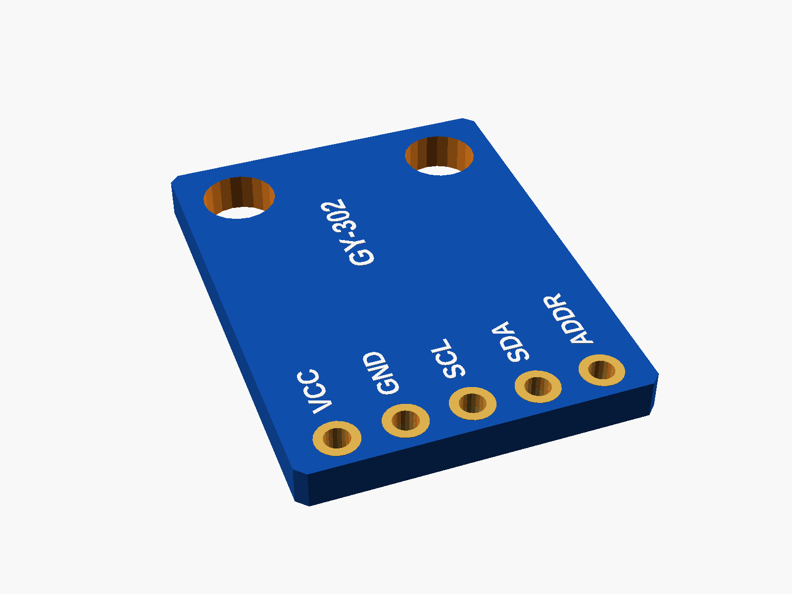
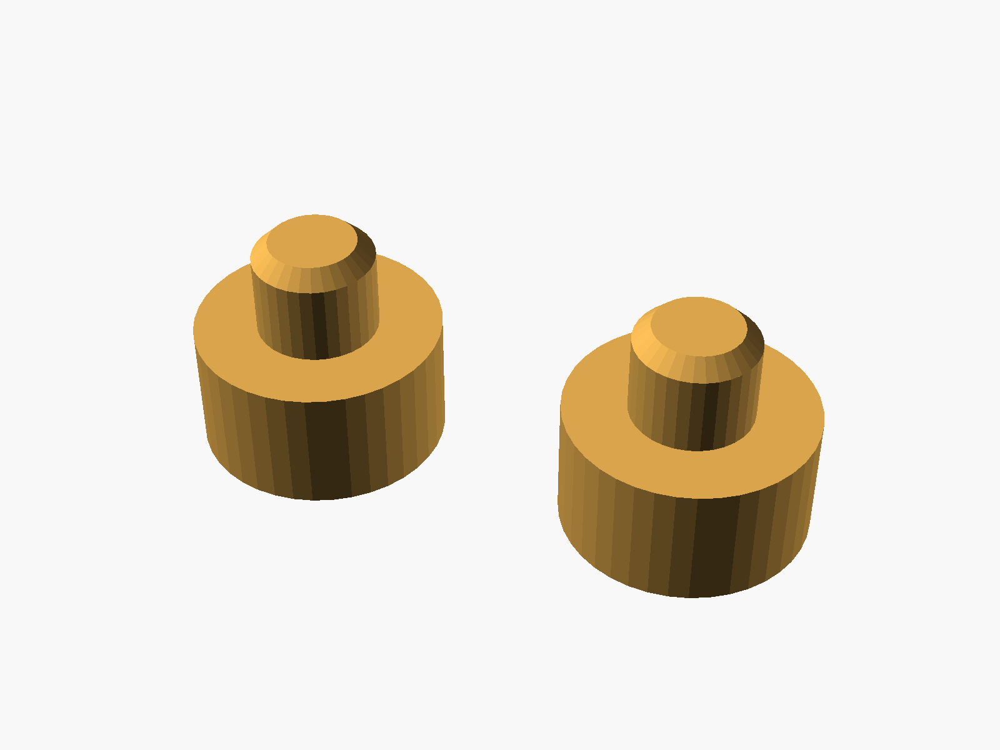
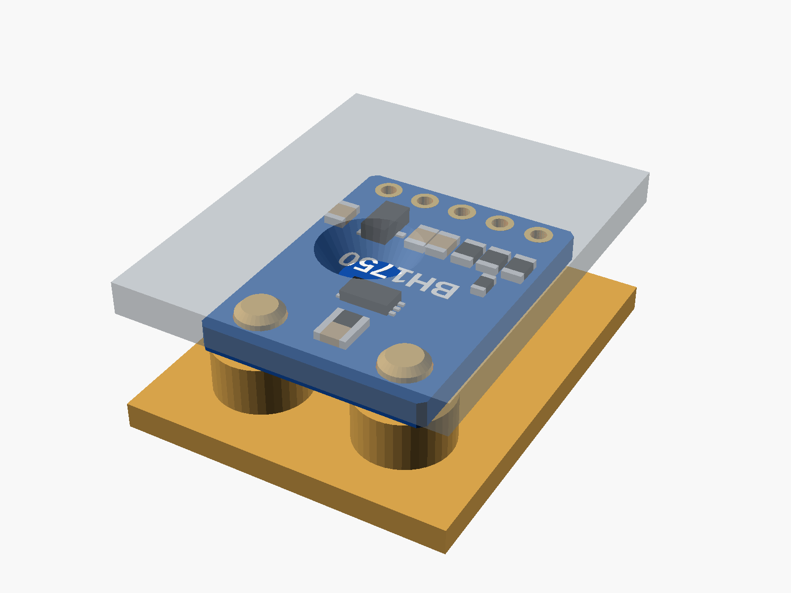

# GY-302 BH1750 light sensor

GY-302 light sensor breakout with a BH1750 (blue, 5 pins: VCC GND SCL SDA ADDR, two mounting holes).



**[View it in 3D](gy302_bh1750.stl)** (turn it with the mouse; GitHub shows it in one colour)

| Underneath | Holder | In its holder / case |
|---|---|---|
|  |  |  |

## Use it

```openscad
use <partbin/modules/gy302_bh1750/gy302_bh1750.scad>
```

| Call | What it gives |
|---|---|
| `gy302_bh1750()` | the board, with its parts |
| `gy302_bh1750(detail = false)` | only what matters for fit (fast) |
| `gy302_bh1750(headers = "down")` | with a pin header soldered on |
| `gy302_bh1750_holder(h = 3)` | posts under its holes, add to the case |
| `gy302_bh1750_window(gap, wall)` | a window over the sensor, subtract from the lid |
| `gy302_bh1750_size()` | [width, length, pcb thickness] |
| `gy302_bh1750_sensor()` | [x, y] of the sensor chip |

Where it sits: parts up, the board centred on x = y = 0, its underside at z = 0, the pin row along the bottom edge (-y), the holes at the top (+y). The BH1750 looks straight up. For the window, the lid's inside face is `gap` mm above the board's top. Opened on its own, this file shows it on its posts under a see-through lid with the window (set show = "board" or "holder").

## Sizes

At the top of [`gy302_bh1750.scad`](gy302_bh1750.scad), in mm: typical, from photos; measure yours and change them.

| Setting | Value | What |
|---|---|---|
| `b_w` | 13.9 | board width (x) |
| `b_l` | 18.5 | board length (y) |
| `b_t` | 1.6 | PCB |
| `hole_d` | 3.0 | mounting holes (no ring) |
| `hole_x` | 4.5 | each hole from the centre (x) |
| `hole_top` | 2.4 | hole centre to the top edge |
| `pin_bot` | 1.27 | pin centre to the bottom edge |
| `chip_top` | 6.5 | BH1750 centre to the top edge |
| `tall_h` | 1.1 | the tallest part (the regulator) |

---

Part of [partbin](../../README.md).
