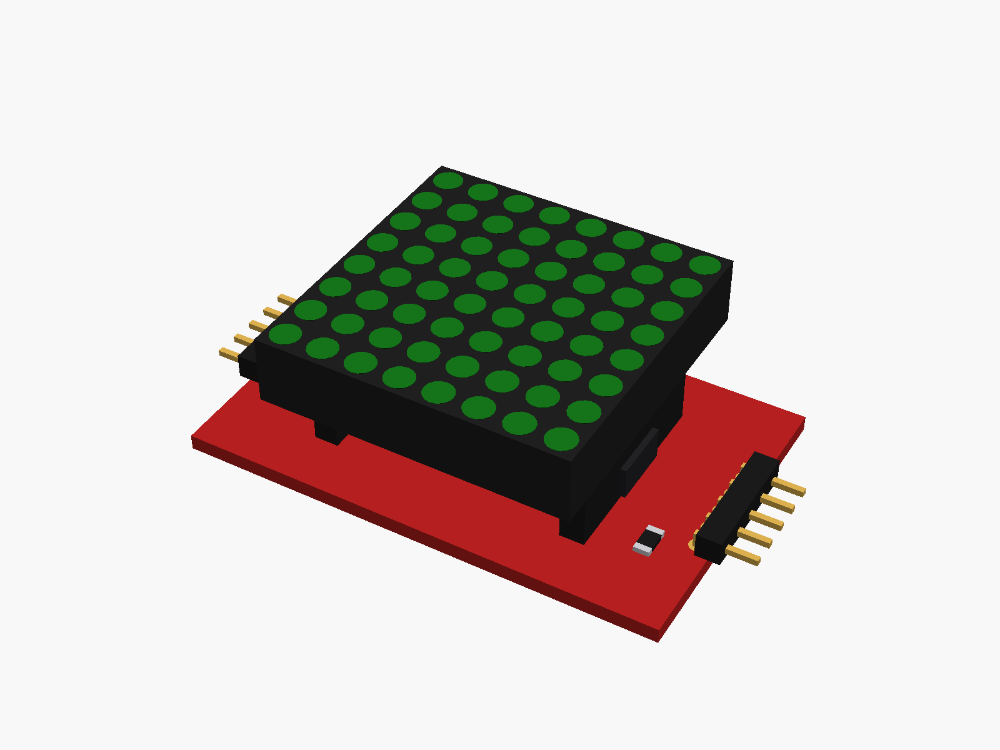
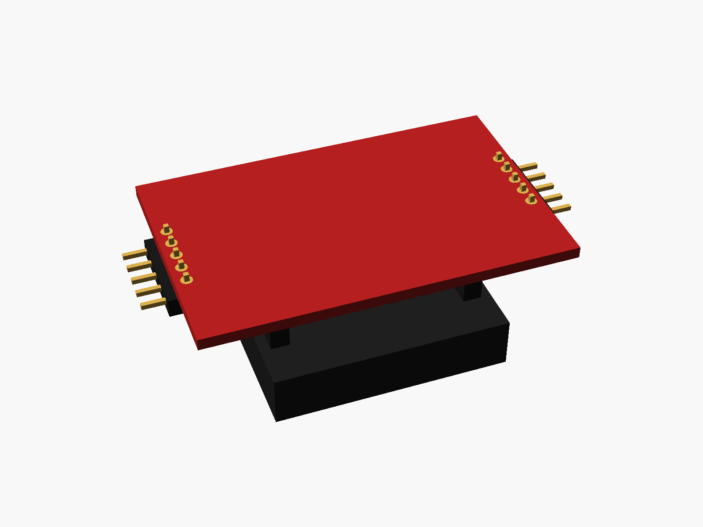
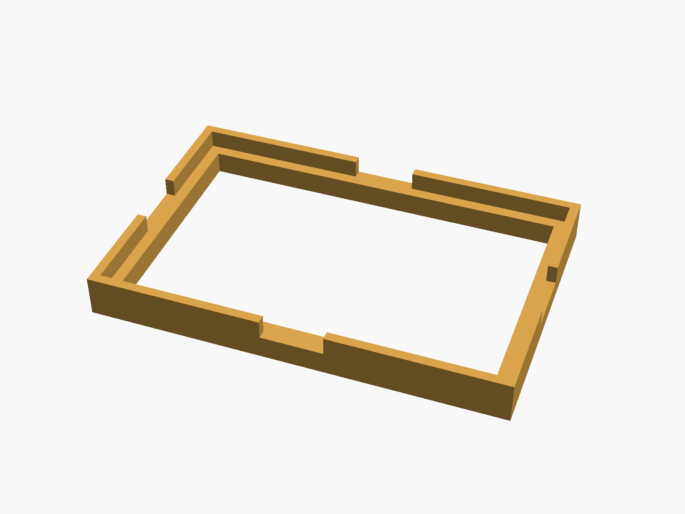
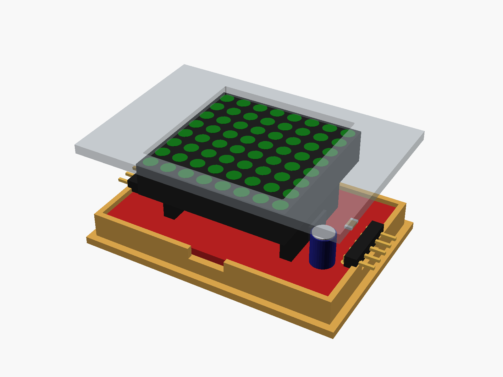

# MAX7219 8x8 LED matrix

MAX7219 single 8 x 8 LED matrix module (the DIP kit: a MAX7219 DIP-24 under the matrix, the matrix plugged into two socket strips, a 5-pin header at each end: IN and OUT).



**[View it in 3D](max7219_8x8.stl)** (turn it with the mouse; GitHub shows it in one colour)

| Underneath | Holder | In its holder / case |
|---|---|---|
|  |  |  |

## Use it

```openscad
use <partbin/modules/max7219_8x8/max7219_8x8.scad>
```

| Call | What it gives |
|---|---|
| `max7219_8x8()` | the module, with its parts |
| `max7219_8x8(leds = "red")` | LED colour: green (default), red, blue, white, yellow |
| `max7219_8x8(detail = false)` | only what matters for fit (fast) |
| `max7219_8x8(headers = "none")` | without the end headers ("angle" = default) |
| `max7219_8x8_holder()` | ledge and low walls around the board |
| `max7219_8x8_window(gap, wall)` | the window in the front, subtract it |
| `max7219_8x8_size()` | [length, height, pcb thickness] |
| `max7219_8x8_height()` | PCB underside to the front of the LEDs |

Where it sits: LEDs up, the board centred on x = y = 0, its underside at z = 0, the long side along x, the IN end at +x. For the window, the front's inside face is `gap` mm above the LEDs.

## Sizes

At the top of [`max7219_8x8.scad`](max7219_8x8.scad), in mm: typical, from photos; measure yours and change them.

| Setting | Value | What |
|---|---|---|
| `b_w` | 50.0 | board length (x) |
| `b_l` | 32.0 | board height (y) |
| `b_t` | 1.6 | PCB |
| `socket_h` | 8.5 | the socket strips the matrix plugs into |
| `matrix_h` | 7.0 | the matrix block |
| `pin_in` | 1.6 | header pads, from the board's end |

---

Part of [partbin](../../README.md).
