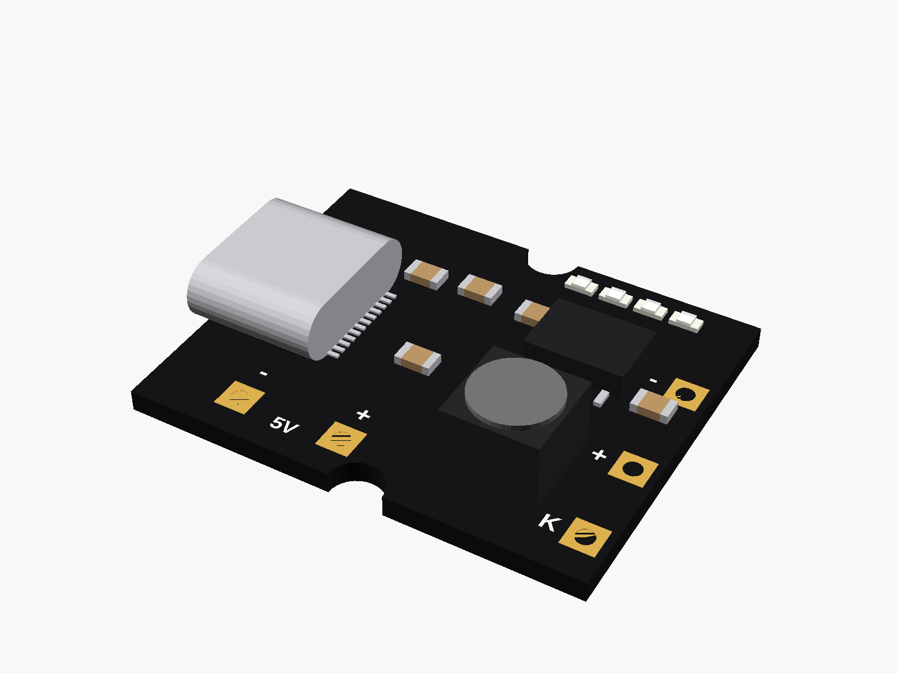
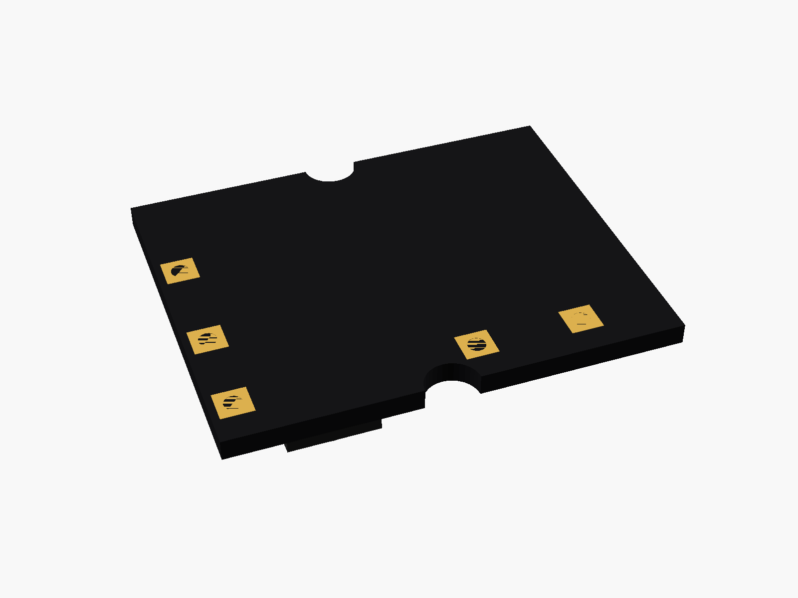
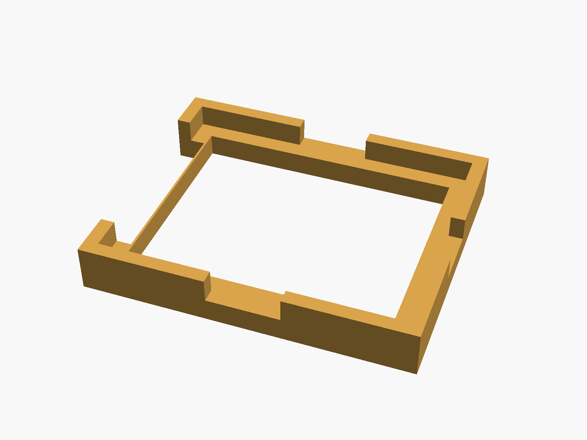
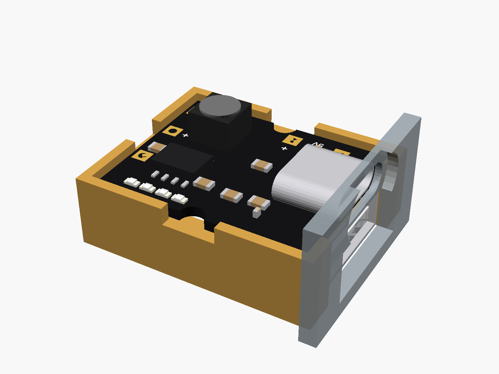

# Type-C 5V 2A power bank board

Type-C 5 V 2 A charge/boost ("power bank") board: black, 25 x 20 mm, USB-C input, a USB-A output that solders on the back, 4 battery LEDs, battery pads and a KEY pad at the far end, 5 V output pads on one side, a half-round notch in each long side. (Sold as "5V2A charge-discharge integrated module" and "Type-C USB 5V 2A boost converter".)



**[View it in 3D](powerbank_5v2a_typec.stl)** (turn it with the mouse; GitHub shows it in one colour)

| Underneath | Holder | In its holder / case |
|---|---|---|
|  |  |  |

## Use it

```openscad
use <partbin/modules/powerbank_5v2a_typec/powerbank_5v2a_typec.scad>
```

| Call | What it gives |
|---|---|
| `powerbank_5v2a_typec()` | the board (USB-A not soldered) |
| `powerbank_5v2a_typec(usb_a = true)` | with the USB-A socket on the back |
| `powerbank_5v2a_typec(detail = false)` | only what matters for fit (fast) |
| `powerbank_5v2a_typec_usb_cutout(wall, gap)` | the USB-C opening, subtract it powerbank_5v2a_typec_usb_a_cutout(wall, gap) the USB-A opening, subtract it |
| `powerbank_5v2a_typec_led_window(gap, wall)` | a slot over the 4 LEDs in the lid |
| `powerbank_5v2a_typec_holder()` | ledge and low walls, open at the USB end |
| `powerbank_5v2a_typec_size()` | [length, width, pcb thickness] |

Where it sits: parts up, the board centred on x = y = 0, its underside at z = 0, the long side along x, the USB end at -x (both sockets point -x).

## Sizes

At the top of [`powerbank_5v2a_typec.scad`](powerbank_5v2a_typec.scad), in mm: from a published drawing or the seller's sizes.

| Setting | Value | What |
|---|---|---|
| `b_l` | 25.0 | board length (x) |
| `b_w` | 20.0 | board width (y) |
| `b_t` | 1.2 | PCB (typical) |
| `c_size` | [8.94, 3.26, 7.35] | USB-C |
| `usb_out` | 0.5 | the sockets stick out past the end |
| `a_size` | [13.1, 5.7, 10.0] | USB-A on the back |

---

Part of [partbin](../../README.md).
