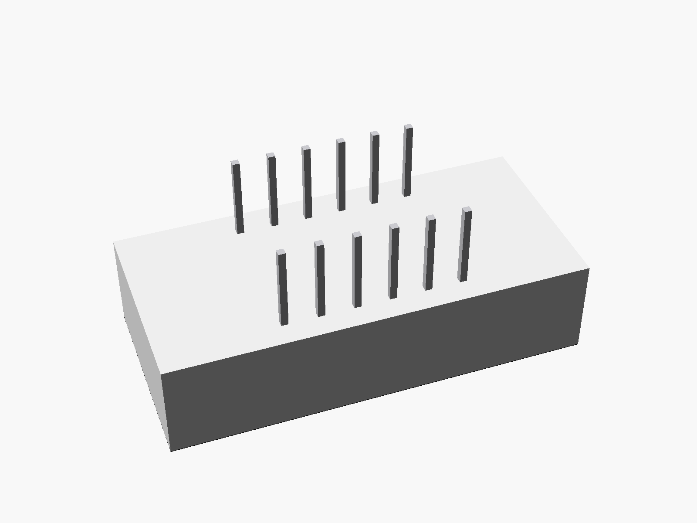
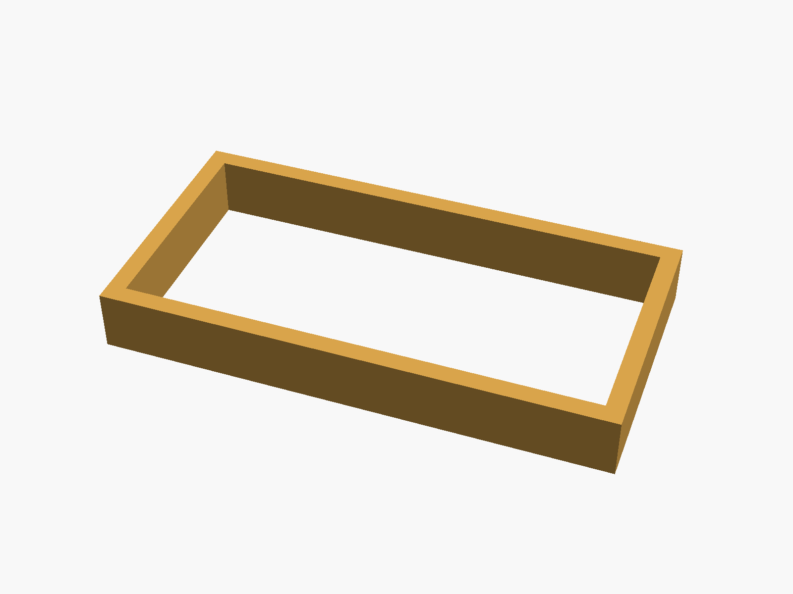

# 4-digit 7-segment display, 0.36"

Bare 4-digit 7-segment LED display, 0.36" (3641-style, common cathode, 12 pins in two rows of 6 underneath). Sold in red, green, blue, white and other colours.


**[View it in 3D](seg7_4digit_036.stl)** (turn it with the mouse; GitHub shows it in one colour)

| Underneath | Holder | In its holder / case |
|---|---|---|
|  |  |  |

## Use it

```openscad
use <partbin/modules/seg7_4digit_036/seg7_4digit_036.scad>
```

| Call | What it gives |
|---|---|
| `seg7_4digit_036()` | the display (red) |
| `seg7_4digit_036(seg = "blue")` | segment colour: red, green, blue, white, yellow |
| `seg7_4digit_036_holder()` | a frame around it, add to the case |
| `seg7_4digit_036_window(gap, wall)` | the opening in the front, subtract it |
| `seg7_4digit_036_size()` | [length, height, body height] |
| `seg7_4digit_036_pin(i)` | [x, y] of pin i (1 ... 12) |

Where it sits: digits up, the body centred on x = y = 0, its underside at z = 0 (the pins go down), the long side along x. Pin 1 is bottom left (-x, -y), counting along the bottom row and back along the top row.

## Sizes

At the top of [`seg7_4digit_036.scad`](seg7_4digit_036.scad), in mm: typical, from photos; measure yours and change them.

| Setting | Value | What |
|---|---|---|
| `size` | [30.1, 14.0] | body |
| `h` | 7.2 | body height |
| `rows` | 10.16 | between the two pin rows |
| `pin_len` | 6.0 | how far the pins stick out below |

---

Part of [partbin](../../README.md).
