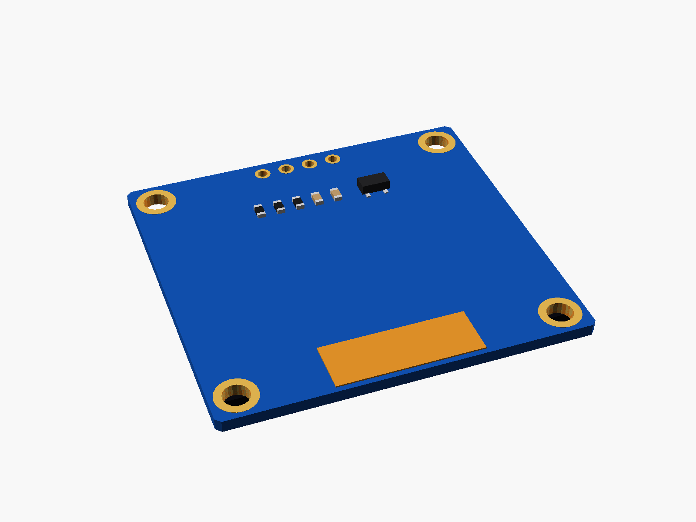
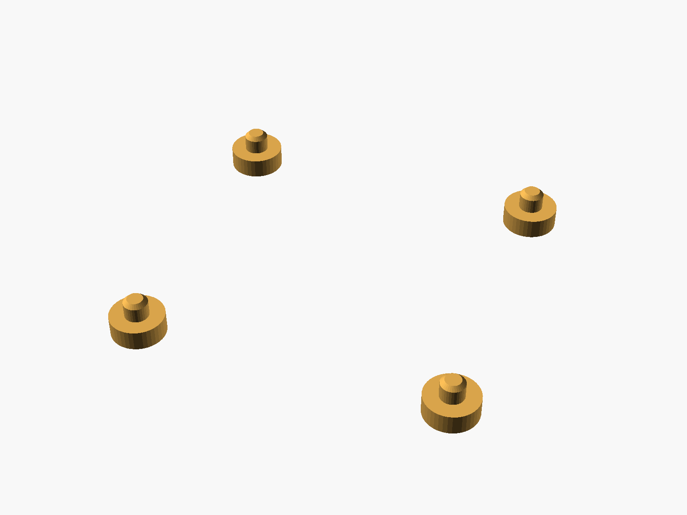
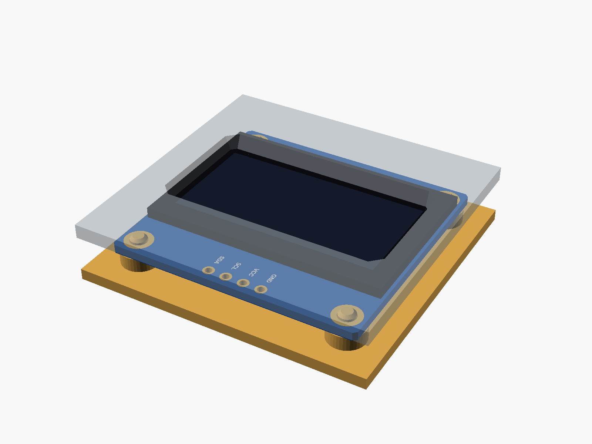

# 1.3" OLED (SH1106)

1.3" OLED, 128 x 64, SH1106 over I2C (4 pins at the top: GND VCC SCL SDA, four corner holes). Drawn after the TENSTAR one (white screen).


**[View it in 3D](sh1106_13.stl)** (turn it with the mouse; GitHub shows it in one colour)

| Underneath | Holder | In its holder / case |
|---|---|---|
|  |  |  |

## Use it

```openscad
use <partbin/modules/sh1106_13/sh1106_13.scad>
```

| Call | What it gives |
|---|---|
| `sh1106_13()` | the board, with its parts |
| `sh1106_13(detail = false)` | only what matters for fit (fast) |
| `sh1106_13(headers = "down")` | with the 4-pin header soldered on |
| `sh1106_13_holder(h = 2)` | posts under its holes, add to the case |
| `sh1106_13_window(gap, wall)` | the screen opening in the front, subtract it |
| `sh1106_13_size()` | [width, height, pcb thickness] |
| `sh1106_13_height()` | PCB underside to the front of the glass |

Where it sits: screen up, the board centred on x = y = 0, its underside at z = 0, the pins at the top (+y). For the window, the front's inside face is `gap` mm above the glass.

## Sizes

At the top of [`sh1106_13.scad`](sh1106_13.scad), in mm: typical, from photos; measure yours and change them.

| Setting | Value | What |
|---|---|---|
| `b_w` | 35.4 | board width (x) |
| `b_l` | 33.5 | board height (y) |
| `b_t` | 1.2 | PCB |
| `hole_in` | 2.5 | hole centre to the two nearest edges |
| `pin_top` | 1.6 | pin centre to the top edge |
| `glass` | [34.5, 23.0] | glass outline |
| `glass_t` | 1.5 | glass and its tape |
| `glass_y` | -2.0 | glass centre (y) |
| `active` | [29.4, 14.7] | the lit area |
| `active_y` | 1.3 | its centre, from the glass centre (the flex is at the bottom) |

---

Part of [partbin](../../README.md).
