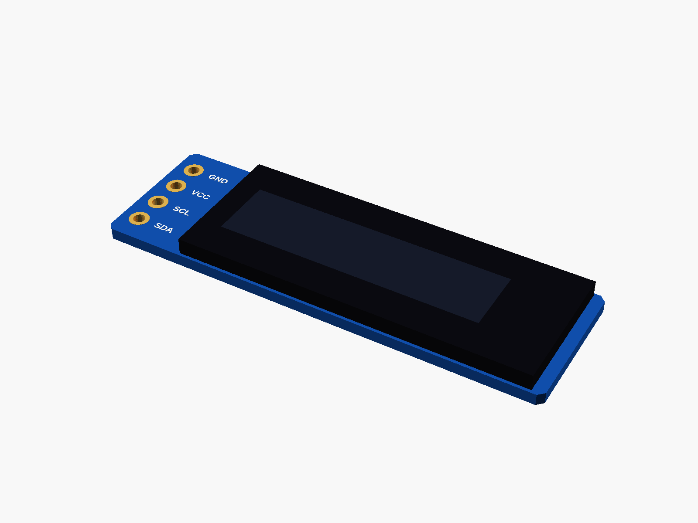
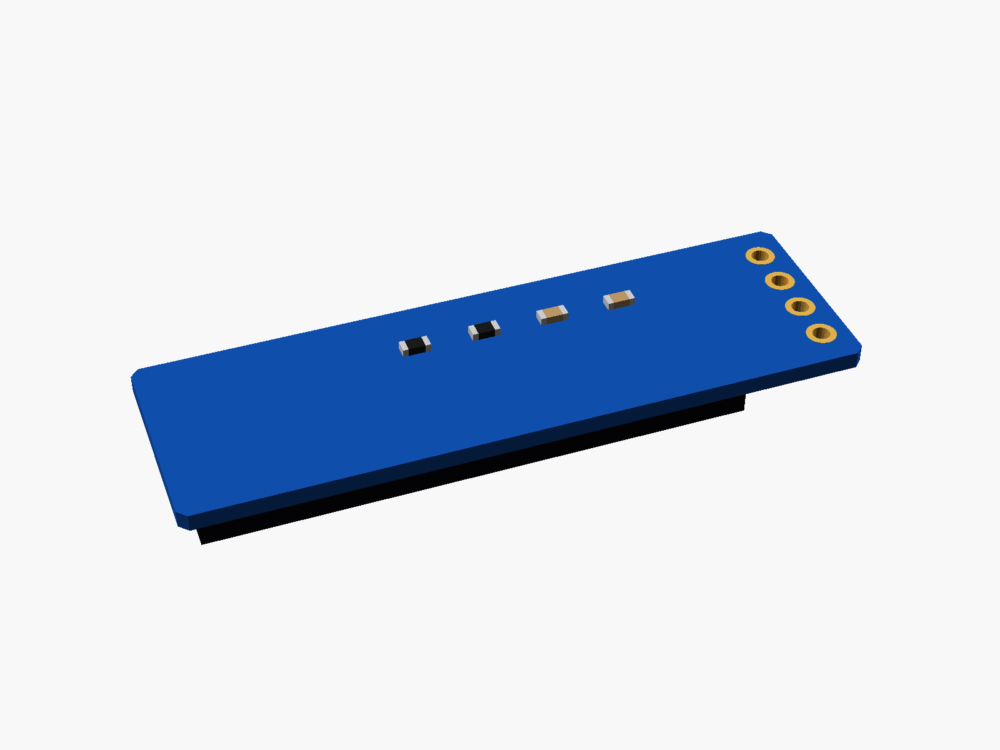
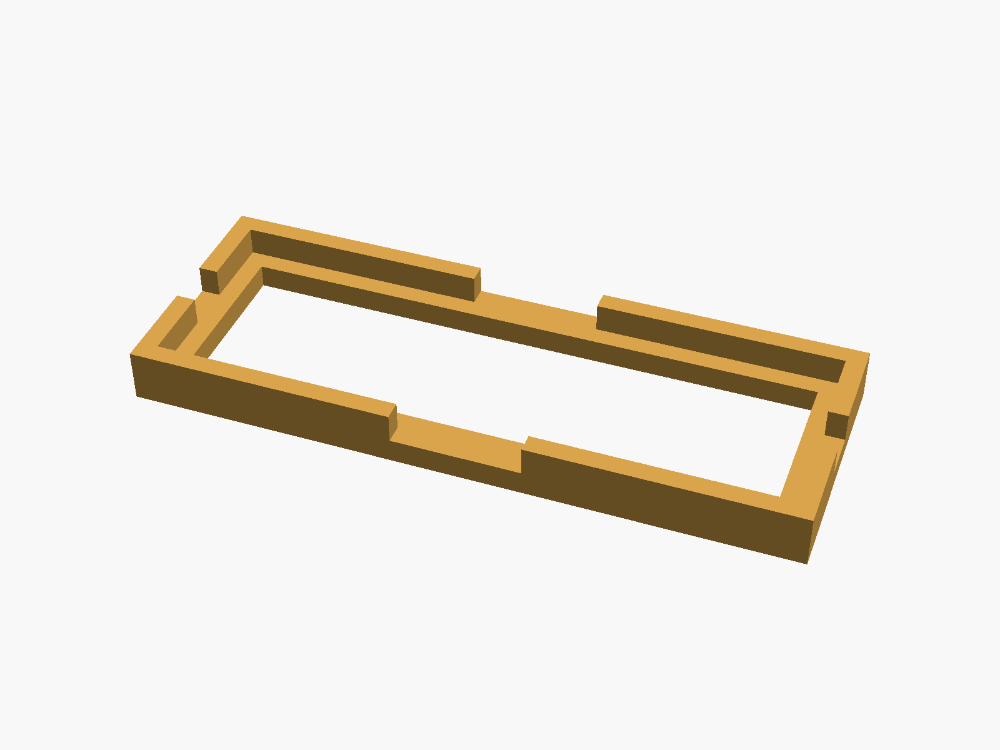
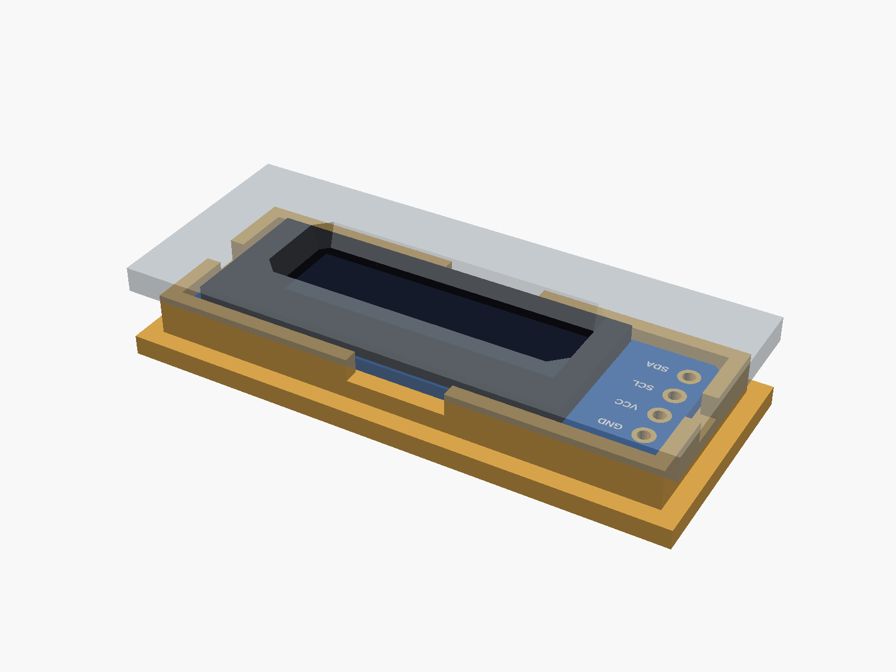

# 0.91" OLED (SSD1306)

0.91" OLED, 128 x 32, SSD1306 over I2C (4 pins at the left end: GND VCC SCL SDA).



**[View it in 3D](ssd1306_091.stl)** (turn it with the mouse; GitHub shows it in one colour)

| Underneath | Holder | In its holder / case |
|---|---|---|
|  |  |  |

## Use it

```openscad
use <partbin/modules/ssd1306_091/ssd1306_091.scad>
```

| Call | What it gives |
|---|---|
| `ssd1306_091()` | the board, with its parts |
| `ssd1306_091(detail = false)` | only what matters for fit (fast) |
| `ssd1306_091(headers = "down")` | with the 4-pin header soldered on |
| `ssd1306_091_holder()` | ledge and low walls around the board |
| `ssd1306_091_window(gap, wall)` | the screen opening in the front, subtract it |
| `ssd1306_091_size()` | [length, height, pcb thickness] |
| `ssd1306_091_height()` | PCB underside to the front of the glass |

Where it sits: screen up, the board centred on x = y = 0, its underside at z = 0, the long side along x, the pins at the left end (-x). For the window, the front's inside face is `gap` mm above the glass.

## Sizes

At the top of [`ssd1306_091.scad`](ssd1306_091.scad), in mm: typical, from photos; measure yours and change them.

| Setting | Value | What |
|---|---|---|
| `b_w` | 38.0 | board length (x) |
| `b_l` | 12.0 | board height (y) |
| `b_t` | 1.0 | PCB |
| `pin_end` | 1.6 | pin centre to the left end |
| `glass` | [30.0, 11.5] | glass outline |
| `glass_t` | 1.4 | glass and its tape (total 2.7 with the PCB) |
| `glass_x` | 3.0 | glass centre (x) |
| `active` | [22.4, 5.6] | the lit area |
| `active_x` | -1.8 | its centre, from the glass centre (the flex is at the right) |

---

Part of [partbin](../../README.md).
