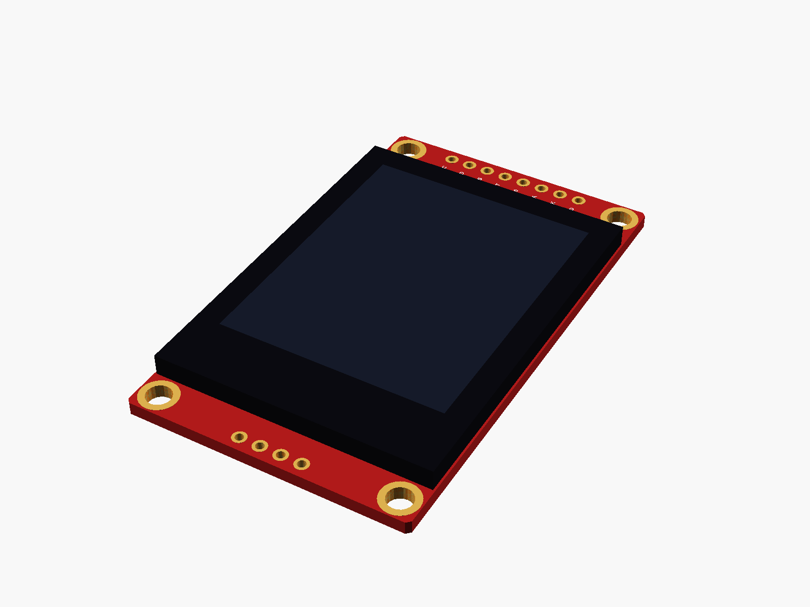
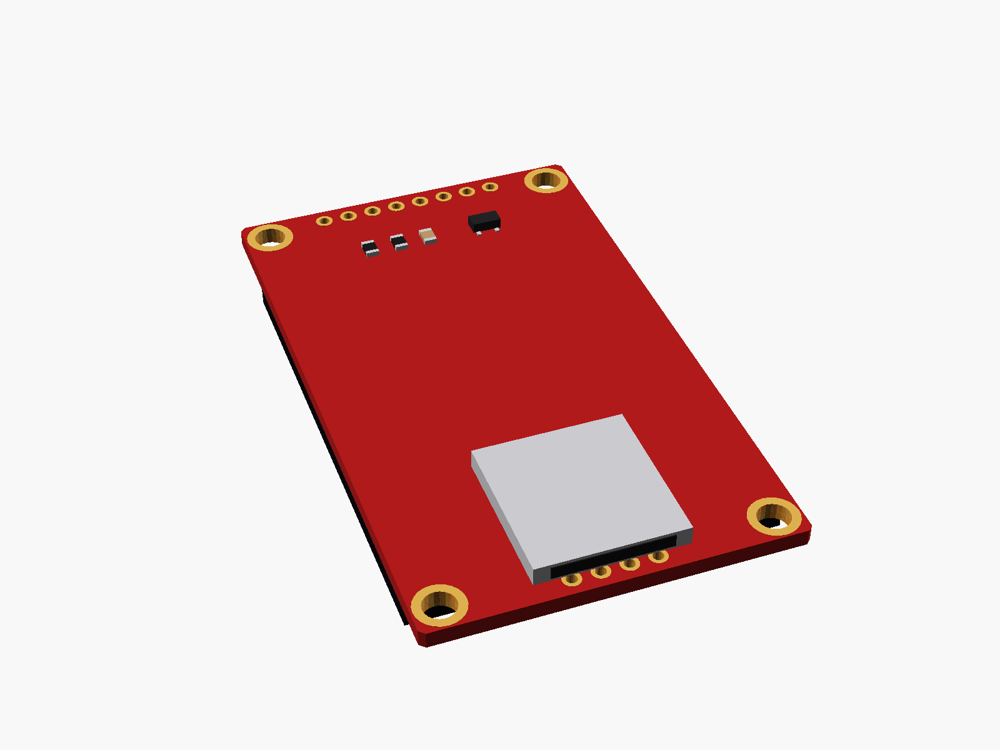
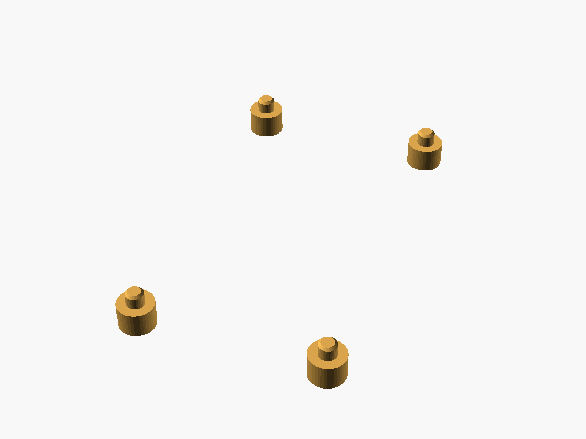
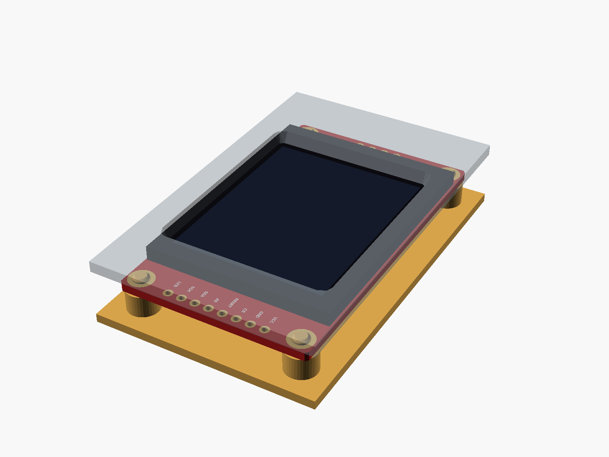

# 1.8" TFT (ST7735)

1.8" TFT, 128 x 160, ST7735 (the red board with a microSD slot on the back, 8 pins at the top: VCC GND CS RESET A0 SDA SCK LED, 4 SD pads at the bottom, four mounting holes).



**[View it in 3D](st7735_18.stl)** (turn it with the mouse; GitHub shows it in one colour)

| Underneath | Holder | In its holder / case |
|---|---|---|
|  |  |  |

## Use it

```openscad
use <partbin/modules/st7735_18/st7735_18.scad>
```

| Call | What it gives |
|---|---|
| `st7735_18()` | the board, with its parts |
| `st7735_18(detail = false)` | only what matters for fit (fast) |
| `st7735_18(headers = "down")` | with the 8-pin header soldered on |
| `st7735_18_holder(h = 4)` | posts under its holes, add to the case |
| `st7735_18_window(gap, wall)` | the screen opening in the front, subtract it |
| `st7735_18_sd_cutout(wall)` | a slot in the bottom wall for the microSD card |
| `st7735_18_size()` | [width, length, pcb thickness] |
| `st7735_18_height()` | PCB underside to the front of the glass |

Where it sits: screen up, the board centred on x = y = 0, its underside at z = 0, the pins at the top (+y). For the window, the front's inside face is `gap` mm above the glass.

## Sizes

At the top of [`st7735_18.scad`](st7735_18.scad), in mm: typical, from photos; measure yours and change them.

| Setting | Value | What |
|---|---|---|
| `b_w` | 34.5 | board width (x) |
| `b_l` | 58.0 | board length (y) |
| `b_t` | 1.6 | PCB |
| `hole_in` | 2.5 | hole centre to the two nearest edges |
| `pin_top` | 1.6 | pin centre to the top edge |
| `glass` | [34.0, 45.8] | glass outline |
| `glass_t` | 2.6 | glass and its tape |
| `glass_y` | -1.0 | glass centre (y) |
| `active` | [28.0, 35.0] | the lit area |
| `active_y` | 2.3 | its centre, from the glass centre (the flex cable is at the bottom) |
| `sd_h` | 1.8 | microSD socket on the back |

---

Part of [partbin](../../README.md).
