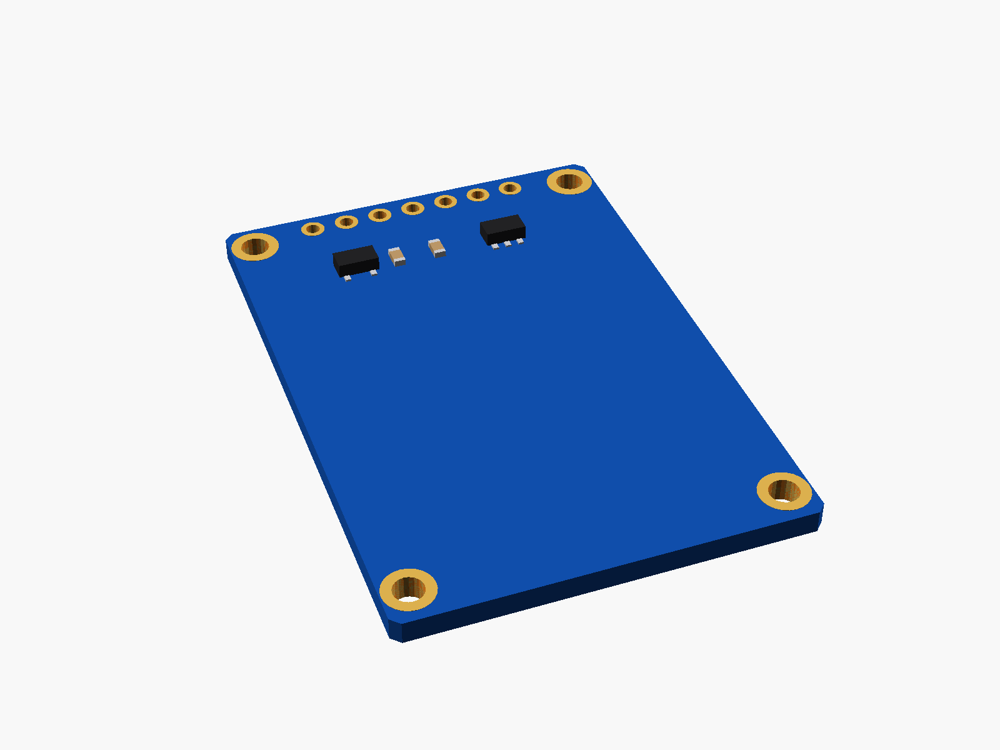
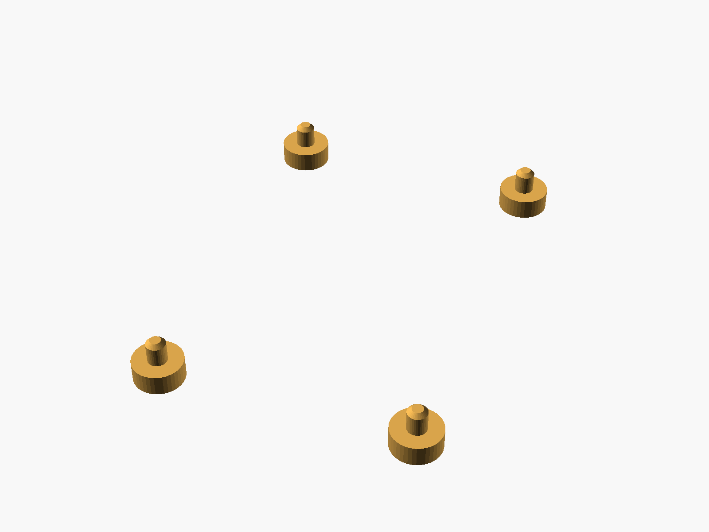
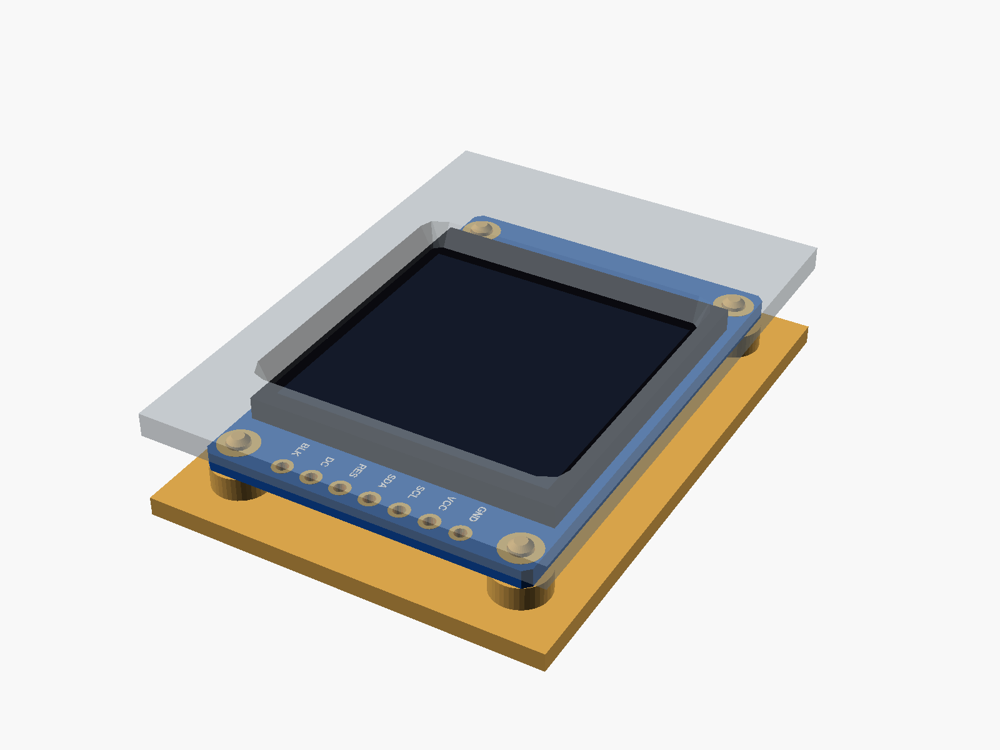

# 1.3" IPS TFT (ST7789)

1.3" IPS TFT, 240 x 240, ST7789 (7 pins at the top: GND VCC SCL SDA RES DC BLK, no CS pin, four corner holes; the "GMT130" board).


**[View it in 3D](st7789_13.stl)** (turn it with the mouse; GitHub shows it in one colour)

| Underneath | Holder | In its holder / case |
|---|---|---|
|  |  |  |

## Use it

```openscad
use <partbin/modules/st7789_13/st7789_13.scad>
```

| Call | What it gives |
|---|---|
| `st7789_13()` | the board, with its parts |
| `st7789_13(detail = false)` | only what matters for fit (fast) |
| `st7789_13(headers = "down")` | with the 7-pin header soldered on |
| `st7789_13_holder(h = 2)` | posts under its holes, add to the case |
| `st7789_13_window(gap, wall)` | the screen opening in the front, subtract it |
| `st7789_13_size()` | [width, length, pcb thickness] |
| `st7789_13_height()` | PCB underside to the front of the glass |

Where it sits: screen up, the board centred on x = y = 0, its underside at z = 0, the pins at the top (+y). For the window, the front's inside face is `gap` mm above the glass.

## Sizes

At the top of [`st7789_13.scad`](st7789_13.scad), in mm: typical, from photos; measure yours and change them.

| Setting | Value | What |
|---|---|---|
| `b_w` | 27.8 | board width (x) |
| `b_l` | 40.3 | board length (y) |
| `hole_x` | 1.8 | hole centre to the side edges |
| `hole_top` | 2.1 | top holes, centre to the top edge |
| `hole_bot` | 2.4 | bottom holes, centre to the bottom edge |
| `b_t` | 1.6 | PCB |
| `pin_top` | 1.4 | pin centre to the top edge |
| `glass` | [26.2, 29.2] | glass outline |
| `glass_t` | 1.9 | glass and its tape |
| `glass_y` | 0.4 | glass centre (y) |
| `active` | [23.4, 23.4] | the lit area (240 x 240) |
| `active_y` | 1.4 | its centre, from the glass centre (the flex cable is at the bottom) |

---

Part of [partbin](../../README.md).
