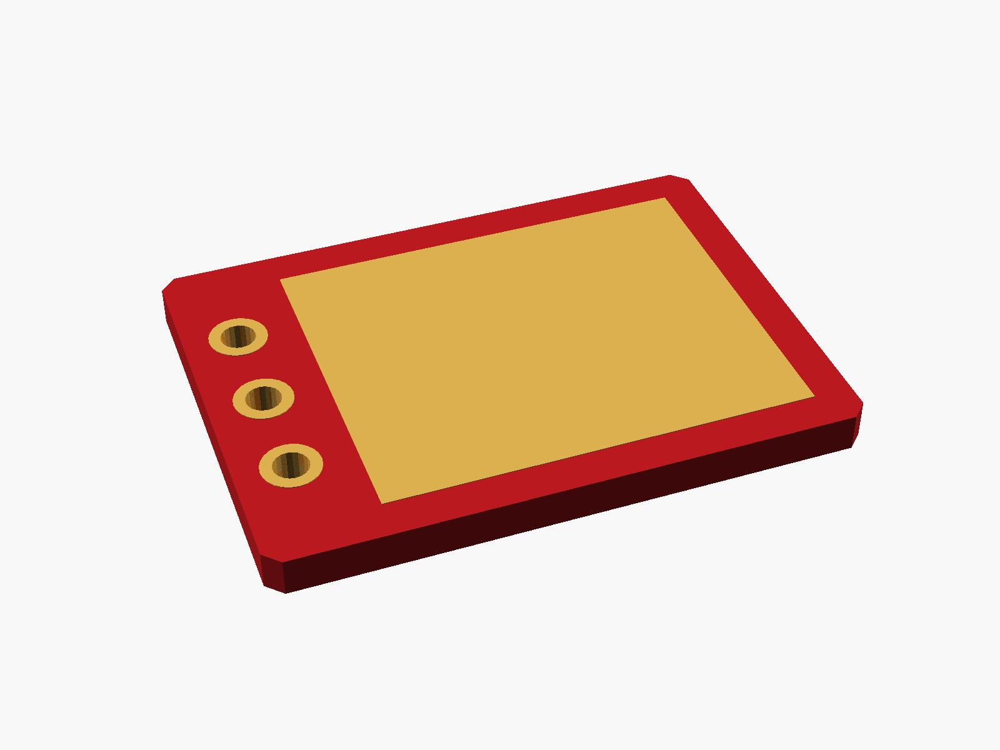
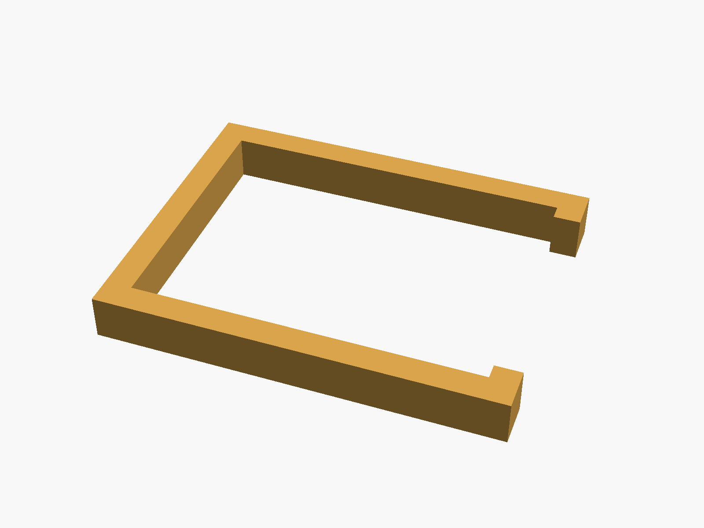
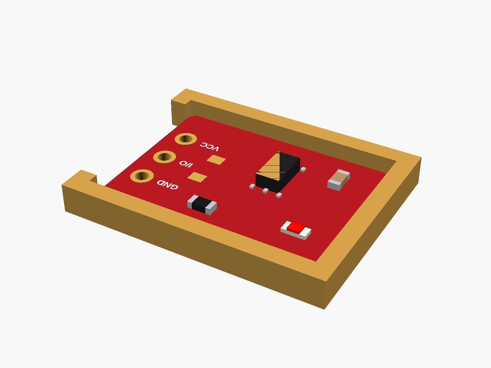

# TTP223 touch button

TTP223 capacitive touch button module (small red board, 3 pins: GND I/O VCC; the touch pad is the whole underside; A/B jumpers set the mode).


**[View it in 3D](ttp223_touch.stl)** (turn it with the mouse; GitHub shows it in one colour)

| Underneath | Holder | In its holder / case |
|---|---|---|
|  |  |  |

## Use it

```openscad
use <partbin/modules/ttp223_touch/ttp223_touch.scad>
```

| Call | What it gives |
|---|---|
| `ttp223_touch()` | the module, with its parts |
| `ttp223_touch(headers = "down")` | with the 3-pin header soldered on |
| `ttp223_touch_holder()` | a pocket that holds it pad-down against a wall |
| `ttp223_touch_size()` | [length, width, pcb thickness] |

Where it sits: parts up, the board centred on x = y = 0, its underside at z = 0, the pins at the right end (+x). It senses through plastic: glue or press its underside against the inside of a wall up to ~3 mm thick.

## Sizes

At the top of [`ttp223_touch.scad`](ttp223_touch.scad), in mm: typical, from photos; measure yours and change them.

| Setting | Value | What |
|---|---|---|
| `b_l` | 15.0 | length (x) |
| `b_w` | 11.0 | width (y) |

---

Part of [partbin](../../README.md).
