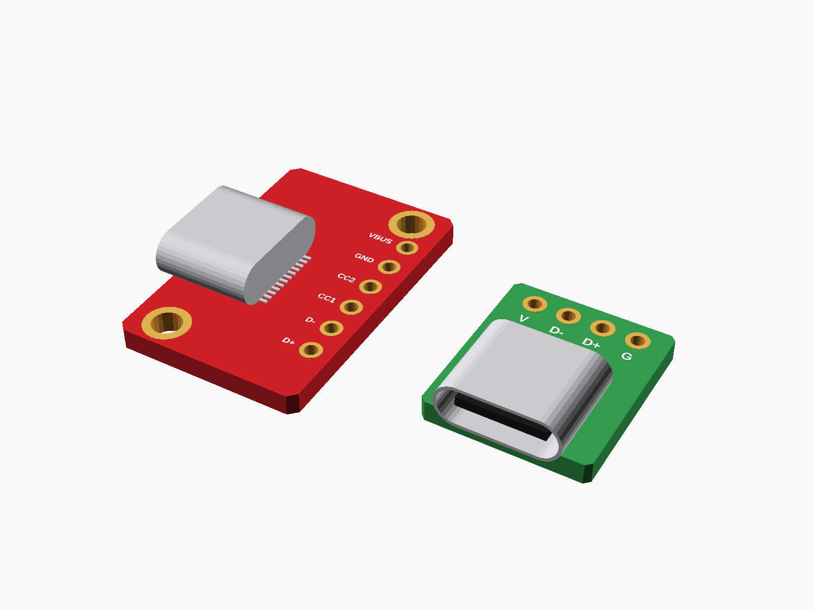

# USB-C breakout boards

USB-C female breakout boards:



**[View it in 3D](usbc_breakouts.stl)** (turn it with the mouse; GitHub shows it in one colour)

## Use it

```openscad
use <partbin/modules/usbc_breakouts/usbc_breakouts.scad>
```

| Call | What it gives |
|---|---|
| `usbc_breakout_red()` | red, 14.2 x 21.8 mm, 6 pins (VBUS GND CC2 CC1 D- D+), 2 holes |
| `usbc_breakout_green()` | green 16-pin test board, 12 x 13.8 mm, 4 pins (V D- D+ G) |

and for each: &lt;name&gt;_usb_cutout(wall, gap), &lt;name&gt;_holder(h), &lt;name&gt;_size().

Where they sit: parts up, the board centred on x = y = 0, its underside at z = 0. Red: socket on the left long edge pointing -x, pins along the right. Green: socket at the bottom edge pointing -y, pins along the top. Sizes from the listings' photos.

---

Part of [partbin](../../README.md).
