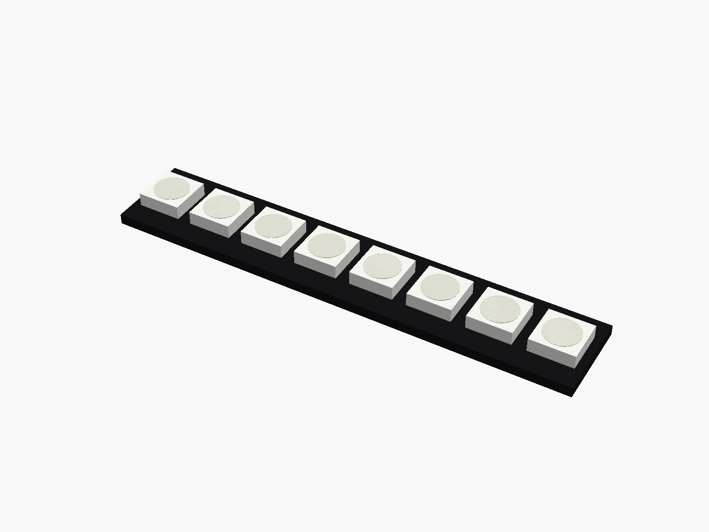
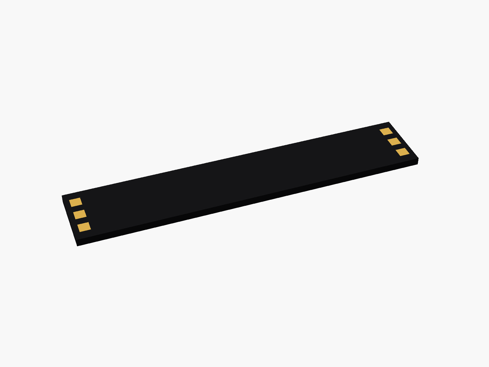
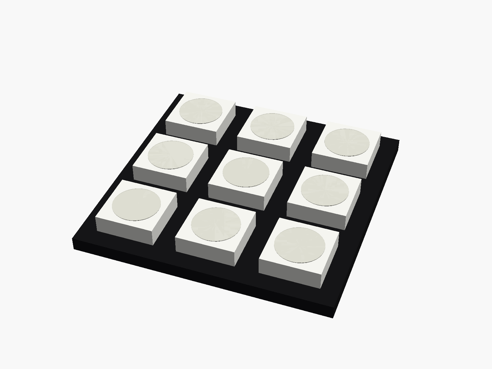

# WS2812B LED boards

WS2812B (5050) LED boards: the 8-LED bar (black or white) and the 3 x 3 square panel ("9 bits"). Pads on the back: 5V, GND and DIN at the input, 5V, GND and DOUT at the output.



**[View it in 3D](ws2812_boards.stl)** (turn it with the mouse; GitHub shows it in one colour)

| Underneath | Holder | In its holder / case |
|---|---|---|
|  |  |  |

## Use it

```openscad
use <partbin/modules/ws2812_boards/ws2812_boards.scad>
```

| Call | What it gives |
|---|---|
| `ws2812_bar8()` | the 8-LED bar (black) |
| `ws2812_bar8(pcb = "white")` |  |
| `ws2812_square9()` | the 3 x 3 panel |
| `ws2812_bar8_window(gap, wall)` | one opening per LED in a lid / diffuser |
| `ws2812_square9_window(gap, wall)` |  |
| `ws2812_bar8_size(), ws2812_square9_size()` |  |

Where they sit: LEDs up, the board centred on x = y = 0, its underside at z = 0; the bar's long side along x, DIN at the left end.

## Sizes

At the top of [`ws2812_boards.scad`](ws2812_boards.scad), in mm: typical, from photos; measure yours and change them.

| Setting | Value | What |
|---|---|---|
| `bar` | [53.0, 10.0] | 8-LED bar |
| `bar_p` | 6.6 | LED spacing on the bar |
| `sq` | [22.0, 22.0] | 3 x 3 panel |

---

Part of [partbin](../../README.md).
