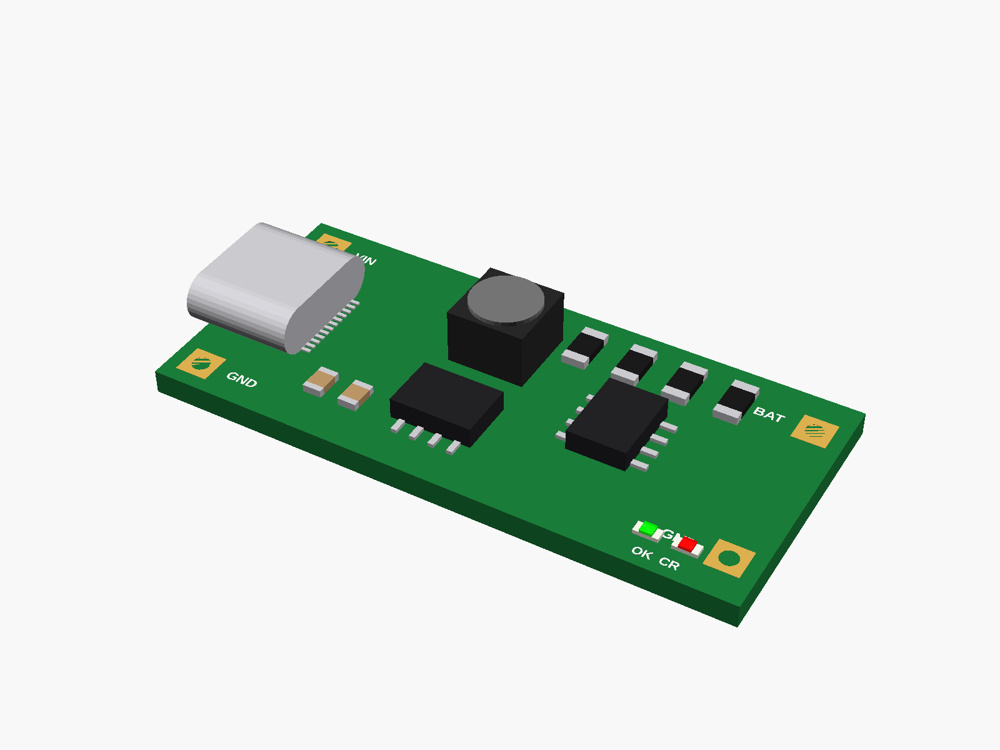
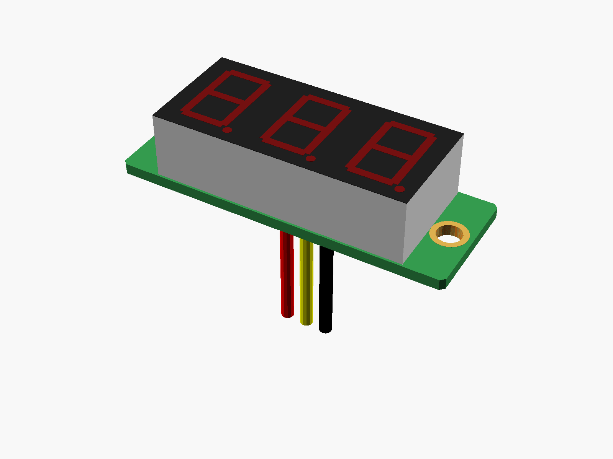

# Power

Chargers, power bank boards, DC-DC converters and a voltmeter.

✓ measured · ◐ from a drawing or the listing · ○ typical, from photos

| | Module | Picture |
|---|---|---|
| ○ | [Mini 5V 3A boost board](boost_mini_5v3a/) |  |
| ○ | [ZK-SJVA-4X buck-boost with LCD](buckboost_lcd_zksjva/) |  |
| ◐ | [2S Type-C boost charger](charger_2s_typec/) |  |
| ◐ | [Mini charger + 5V boost](charger_mini_typec_boost/) |  |
| ○ | [DC-DC converter boards](converters/) |  |
| ○ | [IP5306 charge/discharge board (MH-CD42)](ip5306_mhcd42/) (not one I have) |  |
| ◐ | [Type-C 5V 2A power bank board](powerbank_5v2a_typec/) |  |
| ○ | [TP4056 charger](tp4056/) |  |
| ○ | [XY-UP USB step-up/down](usb_stepupdown_xyup/) |  |
| ○ | [0.28" voltmeter](voltmeter_028/) |  |

---

Part of [partbin](../README.md).
