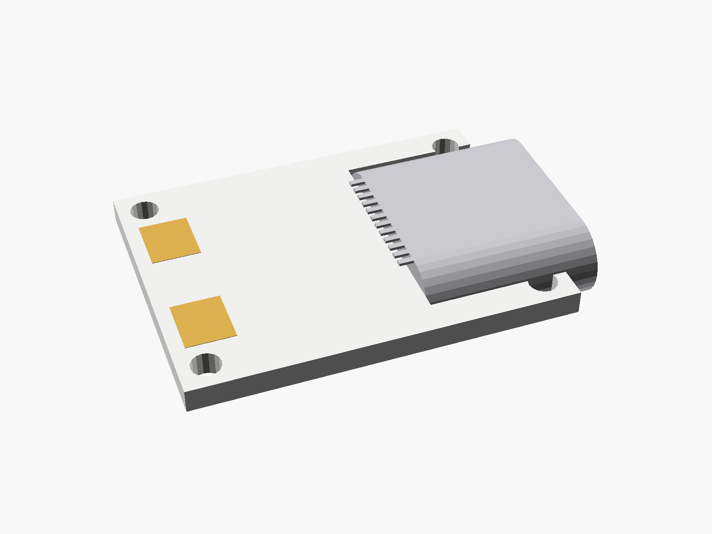
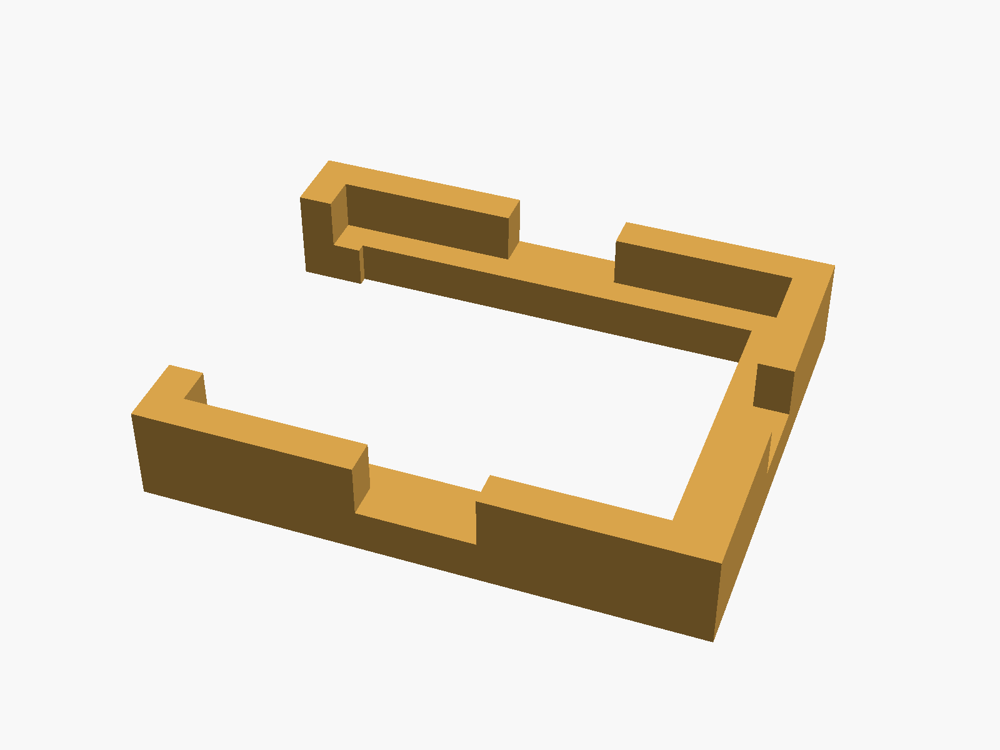
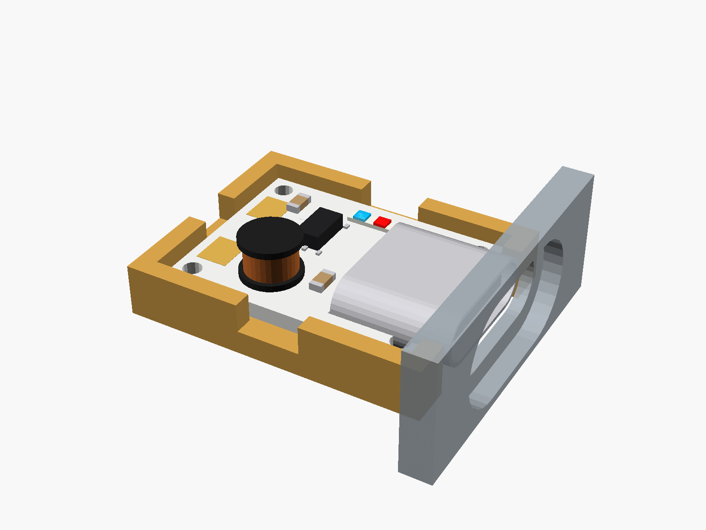

# Mini charger + 5V boost

Mini Li-ion charger + 5 V boost with protection (white, 15.8 x 12 mm). One USB-C socket does both: it charges the cell and gives 5 V out. B- and B+ pads at the far end; two small LEDs.


**[View it in 3D](charger_mini_typec_boost.stl)** (turn it with the mouse; GitHub shows it in one colour)

| Underneath | Holder | In its holder / case |
|---|---|---|
|  |  |  |

## Use it

```openscad
use <partbin/power/charger_mini_typec_boost/charger_mini_typec_boost.scad>
```

| Call | What it gives |
|---|---|
| `charger_mini_typec_boost()` | the board, with its parts |
| `charger_mini_typec_boost(detail = false)` | only what matters for fit (fast) charger_mini_typec_boost_usb_cutout(wall, gap) the USB-C opening, subtract it |
| `charger_mini_typec_boost_holder()` | ledge and low walls, open at the USB end |
| `charger_mini_typec_boost_size()` | [length, width, pcb thickness] |

Where it sits: parts up, the board centred on x = y = 0, its underside at z = 0, the long side along x, the USB socket at the left end pointing -x. The socket is mid-mount: it sits in a notch, half below the board.

## Sizes

At the top of [`charger_mini_typec_boost.scad`](charger_mini_typec_boost.scad), in mm: from a published drawing or the seller's sizes.

| Setting | Value | What |
|---|---|---|
| `b_l` | 15.8 | board length (x), with the socket's notch |
| `b_w` | 12.0 | board width (y) |
| `b_t` | 1.0 | PCB |
| `hole_d` | 1.2 | four small corner holes |
| `c_size` | [8.94, 3.26, 7.35] | USB-C |
| `usb_out` | 1.6 | the socket sticks out past the board's end |
| `usb_z` | -0.8 | socket bottom, below the board's underside (mid-mount) |

---

Part of [partbin](../../README.md), in [Power](../README.md).
