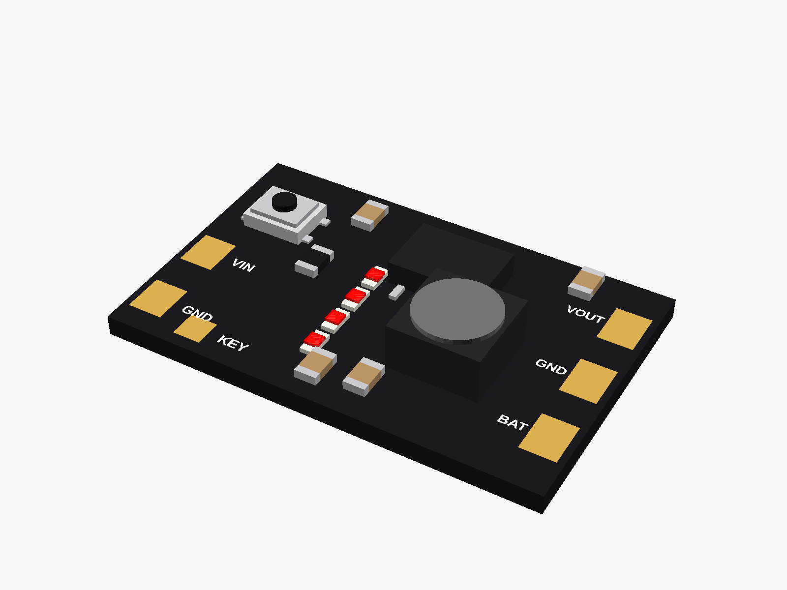
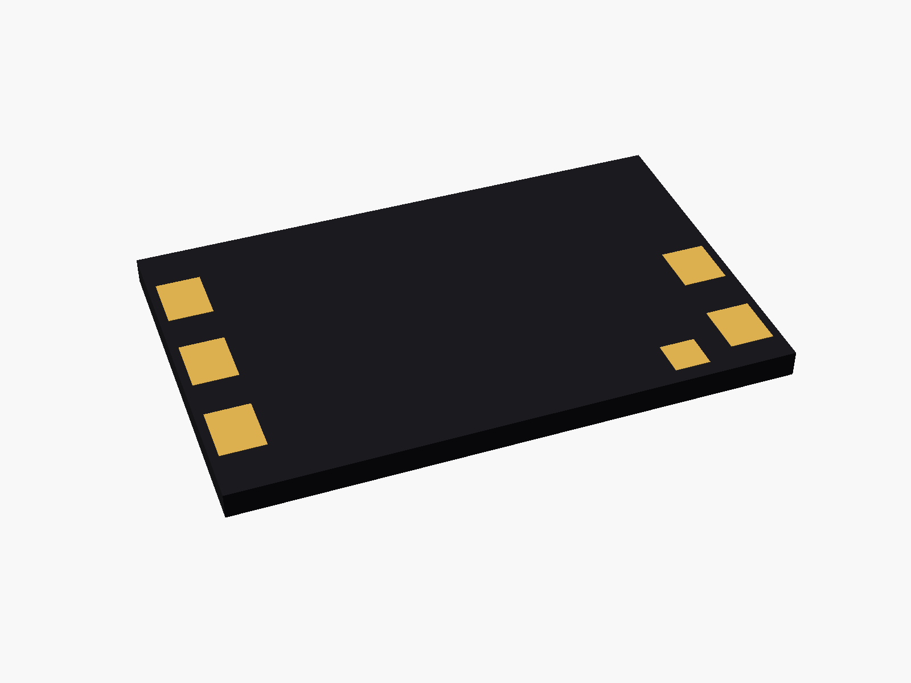
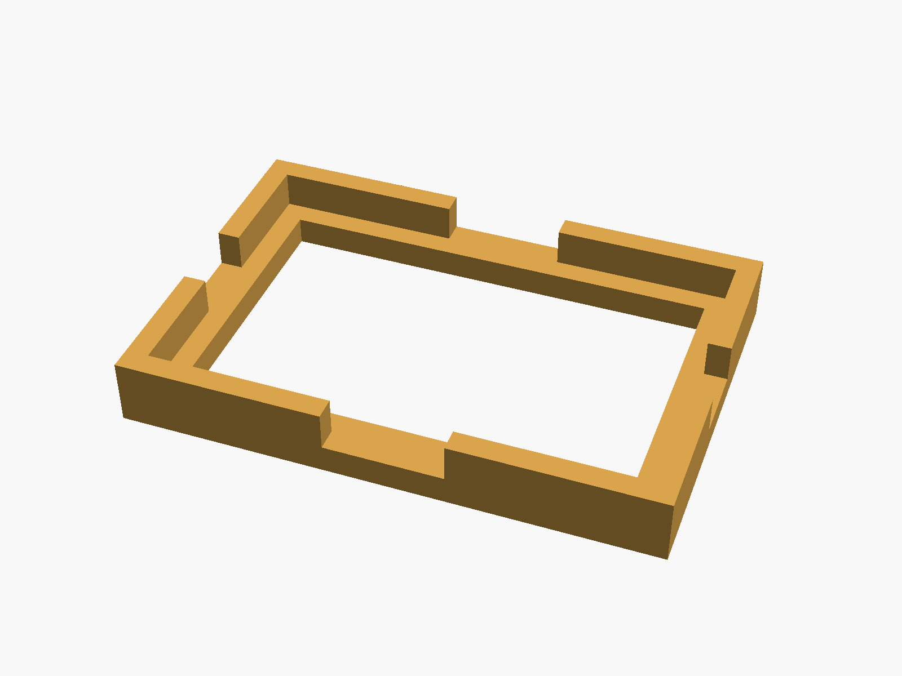
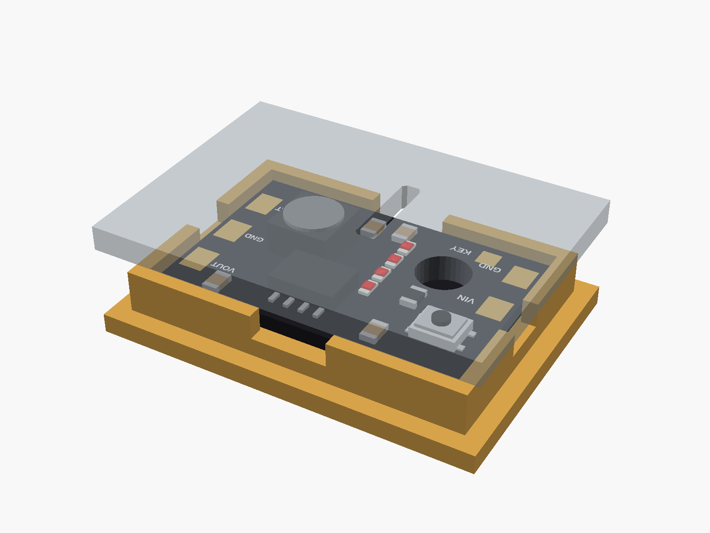

# IP5306 charge/discharge board (MH-CD42)

IP5306 charge/discharge board, "MH-CD42" (5 V 2.1 A boost + 2.1 A Li-ion charger, button, 4 battery LEDs). Pads only, no USB socket: VIN and GND at one end, BAT, GND and VOUT at the other, KEY by the button.



**[View it in 3D](ip5306_mhcd42.stl)** (turn it with the mouse; GitHub shows it in one colour)

| Underneath | Holder | In its holder / case |
|---|---|---|
|  |  |  |

## Use it

```openscad
use <partbin/power/ip5306_mhcd42/ip5306_mhcd42.scad>
```

| Call | What it gives |
|---|---|
| `ip5306_mhcd42()` | the board, with its parts |
| `ip5306_mhcd42(detail = false)` | only what matters for fit (fast) |
| `ip5306_mhcd42_holder()` | ledge and low walls, add to the case |
| `ip5306_mhcd42_button_cutout(gap, wall)` | a hole over the button in the lid |
| `ip5306_mhcd42_led_window(gap, wall)` | a slot over the 4 LEDs in the lid |
| `ip5306_mhcd42_size()` | [length, width, pcb thickness] |

Where it sits: parts up, the board centred on x = y = 0, its underside at z = 0, the long side along x, the button at the left end. The inductor is the tallest part (~3 mm). Remember the IP5306 turns its output off below ~50 mA of load.

## Sizes

At the top of [`ip5306_mhcd42.scad`](ip5306_mhcd42.scad), in mm: typical, from photos; measure yours and change them.

| Setting | Value | What |
|---|---|---|
| `b_l` | 25.0 | board length (x) |
| `b_w` | 16.0 | board width (y) |
| `b_t` | 1.2 | PCB |
| `button` | [-9.0, 3.5] | button centre |
| `button_h` | 1.5 | button height above the board (with its cap) |
| `leds_x` | -2.0 | the 4 LEDs, in a row along y, at this x |
| `tall_h` | 3.0 | the inductor |

---

Part of [partbin](../../README.md), in [Power](../README.md).
