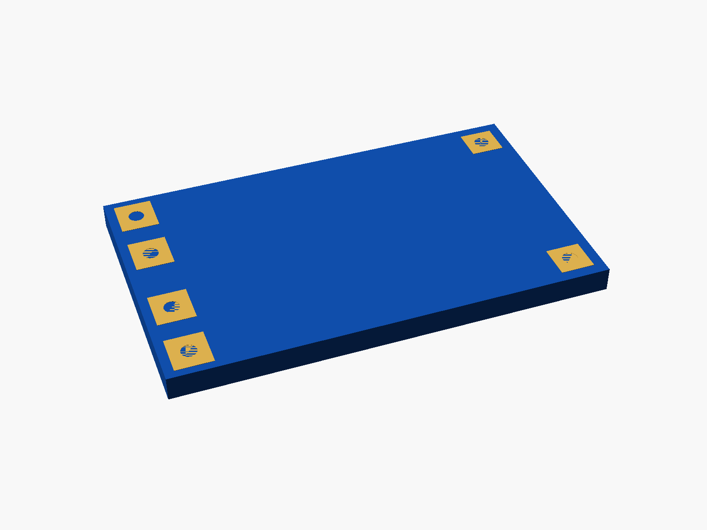
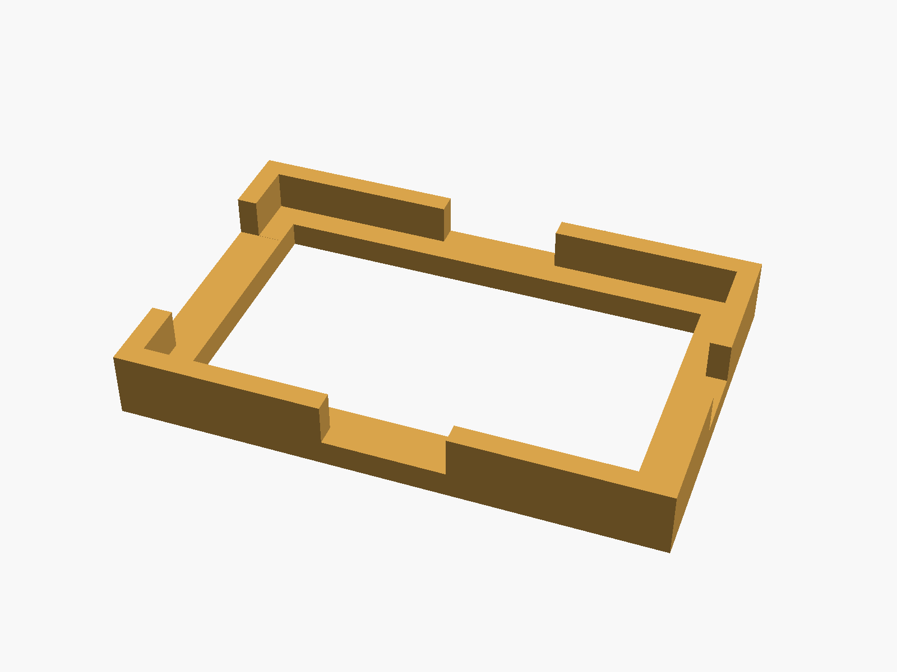
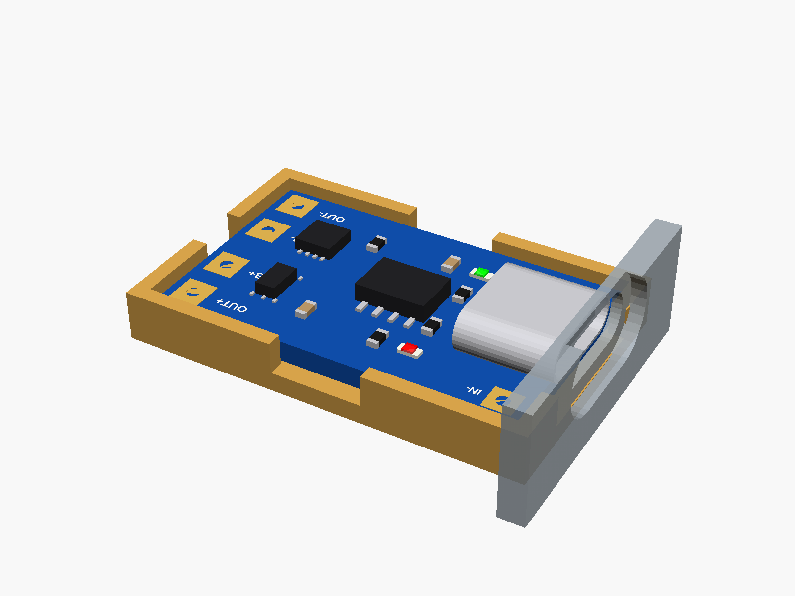
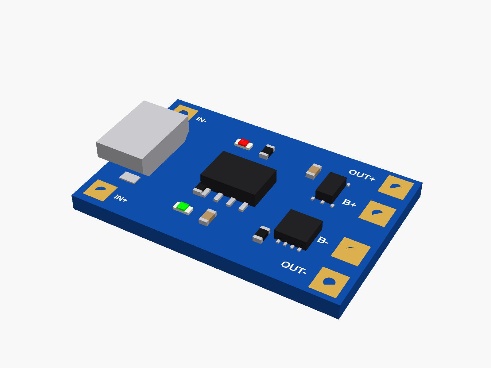

# TP4056 charger

TP4056 1 A Li-ion charger board, with USB-C or micro-USB, with or without the protection chips (DW01 + FS8205). Pads: IN+ IN- beside the USB socket, B+ B- (battery) and OUT+ OUT- (protected output) at the far end.


**[View it in 3D](tp4056.stl)** (turn it with the mouse; GitHub shows it in one colour)

| Underneath | Holder | In its holder / case | Micro |
|---|---|---|---|
|  |  |  |  |

## Use it

```openscad
use <partbin/power/tp4056/tp4056.scad>
```

| Call | What it gives |
|---|---|
| `tp4056()` | USB-C, with protection |
| `tp4056(usb = "micro")` | the micro-USB board |
| `tp4056(protection = false)` | only B+ B- at the far end |
| `tp4056(detail = false)` | only what matters for fit (fast) |
| `tp4056_usb_cutout(usb, wall, gap)` | the USB opening, subtract from the wall |
| `tp4056_holder(usb)` | ledge and low walls, add to the case |
| `tp4056_size(usb)` | [length, width, pcb thickness] |
| `tp4056_usb_front(usb)` | x of the USB socket's face (negative) |

Where it sits: parts up, the board centred on x = y = 0, its underside at z = 0, the long side along x, the USB socket at the left end pointing -x. The red LED is on while charging, the other (green or blue) when full.

## Sizes

At the top of [`tp4056.scad`](tp4056.scad), in mm: typical, from photos; measure yours and change them.

| Setting | Value | What |
|---|---|---|
| `c_len` | 28.0 | board length with USB-C (x) |
| `m_len` | 26.0 | with micro-USB |
| `b_w` | 17.0 | board width (y) |
| `b_t` | 1.6 | PCB |
| `c_size` | [8.94, 3.26, 7.35] | USB-C socket: width, height, depth |
| `m_size` | [7.5, 2.5, 5.0] | micro-USB |
| `usb_out` | 0.6 | how far the socket sticks out past the board's end |
| `pad_in` | 1.8 | pad centres from the board's end and side edges |

---

Part of [partbin](../../README.md), in [Power](../README.md).
