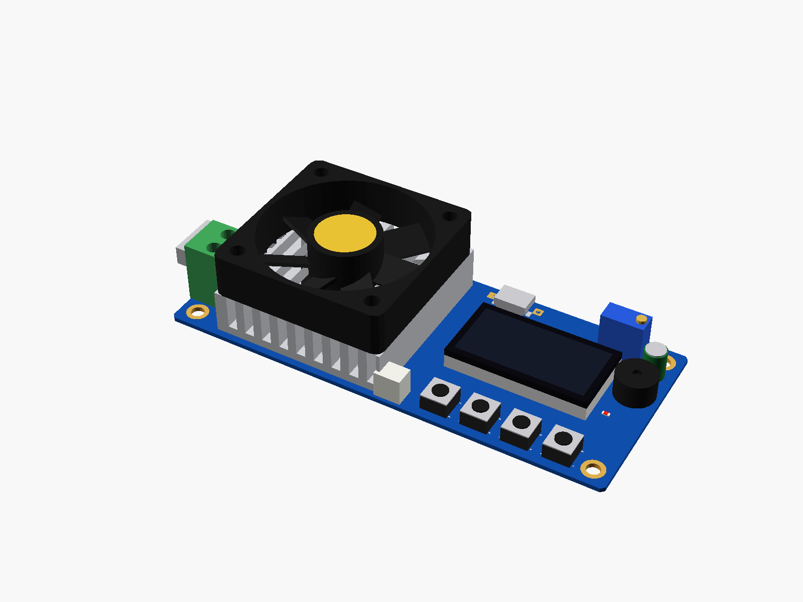
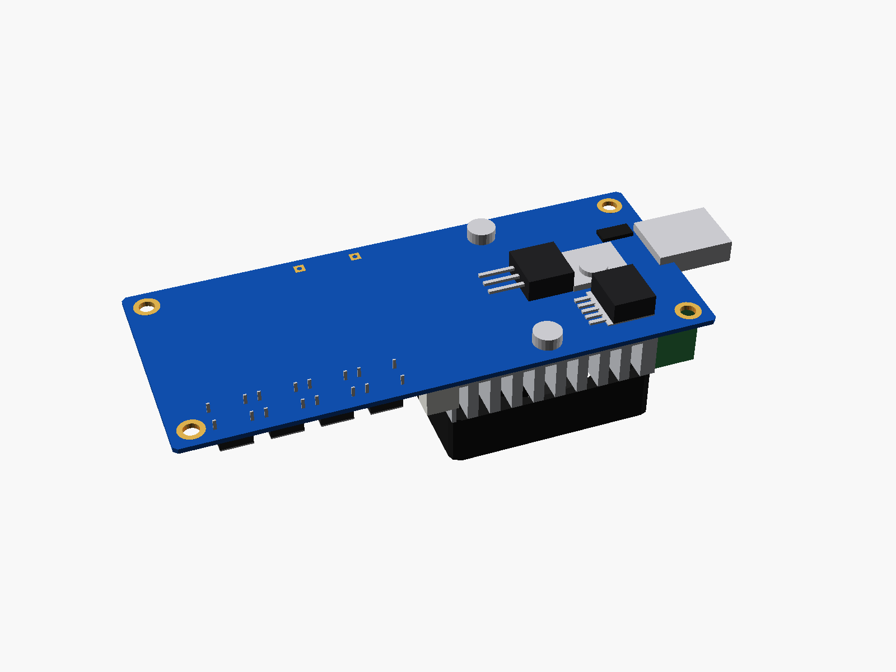
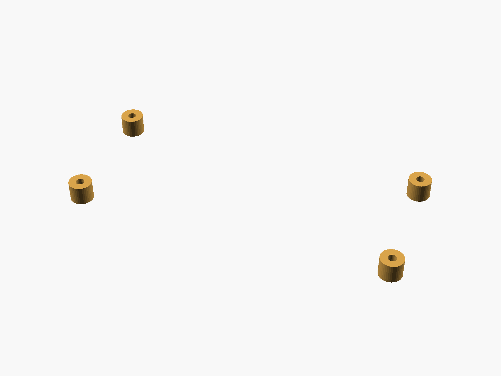
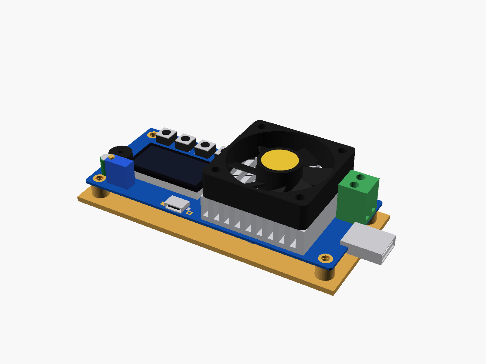

# ZK-FX35 electronic load / battery tester

ZK-FX35 electronic load / battery capacity tester (1.5-25 V, 5 A, 35 W). The load goes in through the green screw terminal or the USB-A plug at one end; the MOSFET lies under the board, screwed through it to the heat sink with its 40 mm fan on top. The board itself runs from 5 V on the micro-USB (or the 5V+ / 5V- pads beside it). LCD, four buttons (- + SELECT ON/SET), the I-ADJ multi-turn trimmer, a buzzer and the RUN LED at the other end.



**[View it in 3D](zk_fx35.stl)** (turn it with the mouse; GitHub shows it in one colour)

| Underneath | Holder | In its holder / case |
|---|---|---|
|  |  |  |

## Use it

```openscad
use <partbin/power/zk_fx35/zk_fx35.scad>
```

| Call | What it gives |
|---|---|
| `zk_fx35()` | the module, with its parts |
| `zk_fx35(detail = false)` | only what matters for fit (fast) |
| `zk_fx35_holder(h = 5.8)` | posts under its four holes, for M3 screws |
| `zk_fx35_usb_a_cutout(gap, wall)` | the slot for the USB-A plug in the end wall |
| `zk_fx35_size()` | [length, width, pcb thickness] |
| `zk_fx35_holes()` | the four hole centres |
| `zk_fx35_at(u, v)` | [x, y] of a point u mm from the USB end, v mm from the button side |
| `zk_fx35_usb_a_front()` | x of the plug's tip (negative) |

Where it sits: parts up, the board centred on x = y = 0, its underside at z = 0, the long side along x, the USB-A plug at the left end pointing -x, the buttons along the -y side. It came on 5.8 mm nylon standoffs, so the parts under it fit in 5.8 mm. Board, holes, fan, LCD, buttons, terminal, USB-A and trimmer measured; the small parts placed from photos.

## Sizes

At the top of [`zk_fx35.scad`](zk_fx35.scad), in mm: measured with calipers.

| Setting | Value | What |
|---|---|---|
| `b_len` | 101.1 | board length (x), without the USB-A plug |
| `b_w` | 43.1 | board width (y) |
| `b_t` | 1.0 | PCB (thin: it bends when the buttons are pressed) |
| `hole_d` | 3.0 | mounting holes, M3 |
| `hole_in` | 4.0 | hole centres from both edges |
| `stand_h` | 5.8 | the nylon standoffs it came on |
| `fan` | 40.0 | fan, square |
| `fan_u` | 11.0 | fan's edge from the USB end |
| `fan_top` | 20.0 | top of the fan above the board |
| `sink_h` | 10.0 | heat sink under the fan (from photos) |
| `lcd` | [32.0, 17.2] | LCD glass, along x and y |
| `lcd_u` | 58.2 | its edge from the USB end |
| `lcd_v` | 15.3 | its edge from the button side |
| `lcd_top` | 4.8 | top of the glass above the board |
| `btn_v` | 5.0 | button centres from the button side |
| `btn_u` | 63.0 | first button (-) from the USB end |
| `btn_p` | 9.0 | button pitch |
| `btn_h` | 3.7 | top of the buttons above the board |
| `term` | [10.7, 10.5, 14.4] | screw terminal: along x, along y, height |
| `term_v` | 7.0 | its edge from the button side |
| `term_out` | 0.2 | how far it sticks out past the USB end |
| `usba_v` | 18.1 | USB-A plug's edge from the button side (12 wide) |
| `usba_out` | 12.1 | how far it sticks out past the board |
| `usba_h` | 4.5 | its thickness; the board runs through its middle |
| `pot_u` | 83.6 | I-ADJ 3296 trimmer: body from u = 83.6 to 93.1 |
| `pot_v` | 37.6 | its centre from the button side (from photos) |
| `pot_h` | 10.0 | typical 3296 height |

---

Part of [partbin](../../README.md), in [Power](../README.md).
