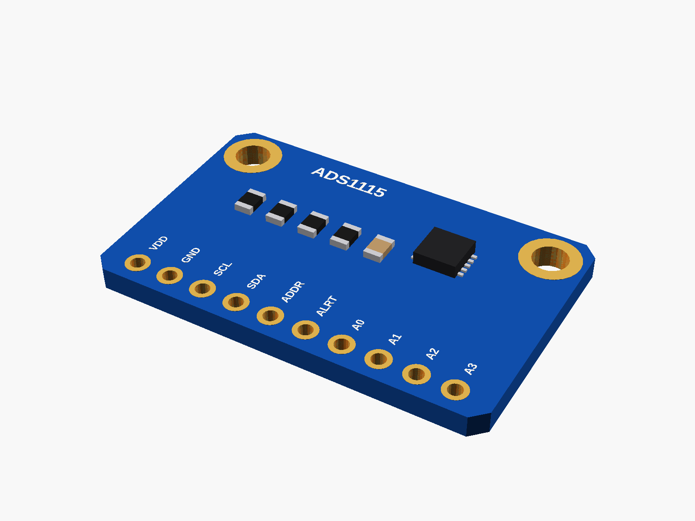

# Sensors

Small I2C sensor boards: climate, light, current, ADC, distance, hall.

✓ measured · ◐ from a drawing or the listing · ○ typical, from photos

| | Module | Picture |
|---|---|---|
| ○ | [ADS1115 ADC](ads1115/) |  |
| ○ | [GY-302 BH1750 light sensor](gy302_bh1750/) |  |
| ○ | [GY-BME280 / BMP280](gy_bme280/) |  |
| ○ | [INA226 current monitor (CJMCU-226)](ina226_cjmcu226/) |  |
| ○ | [KY-024 hall sensor](ky024_hall/) |  |
| ◐ | [VEML7700 light sensor](veml7700/) |  |
| ○ | [VL53L0X distance sensor (GY-530)](vl53l0x_gy530/) |  |

---

Part of [partbin](../README.md).
