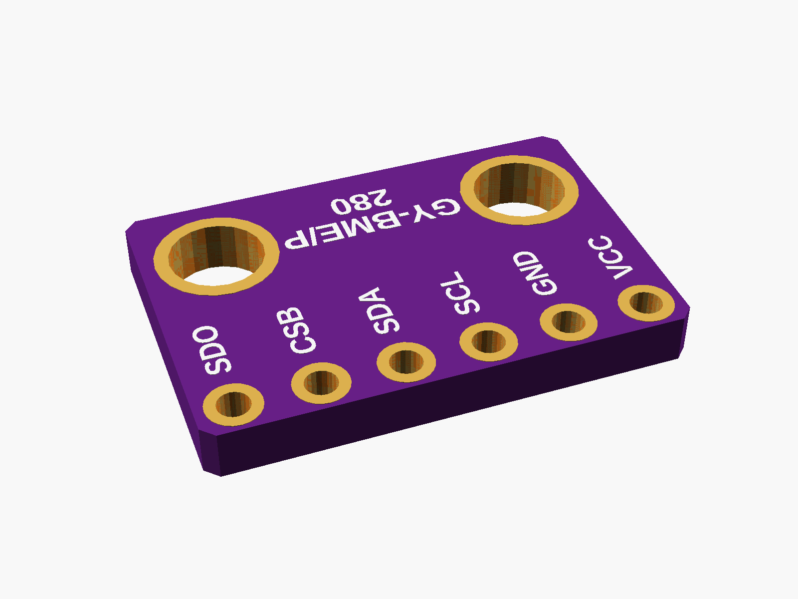
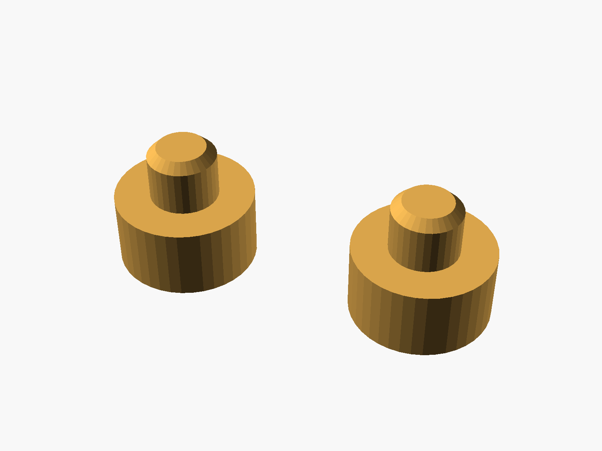
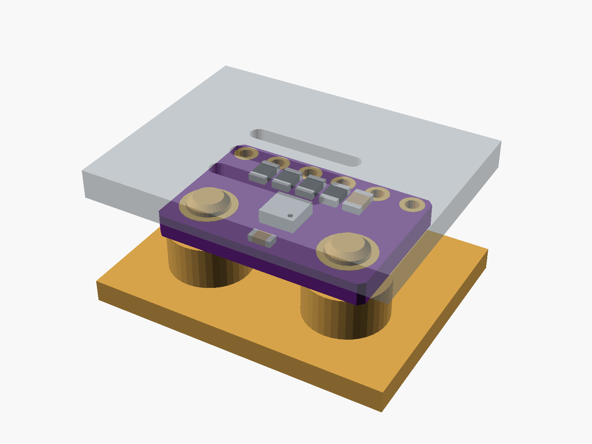

# GY-BME280 / BMP280

GY-BME280 / GY-BMP280 breakout (purple, 6 pins: VCC GND SCL SDA CSB SDO, two mounting holes). The same board is sold with a BME280 (temperature, humidity, pressure) or a BMP280 (no humidity).


**[View it in 3D](gy_bme280.stl)** (turn it with the mouse; GitHub shows it in one colour)

| Underneath | Holder | In its holder / case |
|---|---|---|
|  |  |  |

## Use it

```openscad
use <partbin/sensors/gy_bme280/gy_bme280.scad>
```

| Call | What it gives |
|---|---|
| `gy_bme280()` | the board, with its parts |
| `gy_bme280(detail = false)` | only what matters for fit (fast) |
| `gy_bme280(headers = "down")` | with a pin header soldered on |
| `gy_bme280_holder(h = 3)` | posts under its holes, add to the case |
| `gy_bme280_vents(gap, wall)` | air slots over the sensor, subtract from the lid |
| `gy_bme280_size()` | [width, length, pcb thickness] |
| `gy_bme280_sensor()` | [x, y] of the sensor chip |

Where it sits: parts up, the board centred on x = y = 0, its underside at z = 0, the pin row along the bottom edge (-y), the holes at the top (+y). For the vents, the lid's inside face is `gap` mm above the board's top.

The sensor measures the air around it: keep it away from warm parts and give it vents. Opened on its own, this file shows it on its posts under a see-through lid with the vents (set show = "board" or "holder").

## Sizes

At the top of [`gy_bme280.scad`](gy_bme280.scad), in mm: typical, from photos; measure yours and change them.

| Setting | Value | What |
|---|---|---|
| `b_w` | 15.0 | board width (x) |
| `b_l` | 10.2 | board length (y) |
| `b_t` | 1.6 | PCB |
| `hole_d` | 3.0 | mounting holes |
| `ring_d` | 3.9 | their gold ring |
| `hole_x` | 5.1 | each hole from the centre (x) |
| `hole_top` | 2.6 | hole centre to the top edge |
| `pin_bot` | 1.0 | pin centre to the bottom edge |
| `chip_top` | 3.8 | sensor chip centre to the top edge |
| `chip_h` | 0.93 | sensor chip height (the tallest part) |

---

Part of [partbin](../../README.md), in [Sensors](../README.md).
