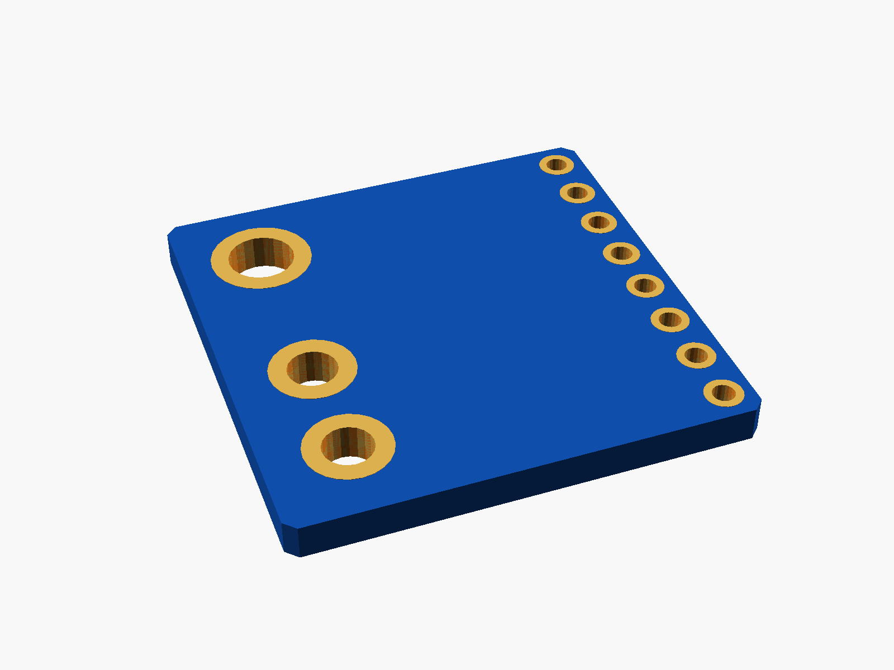
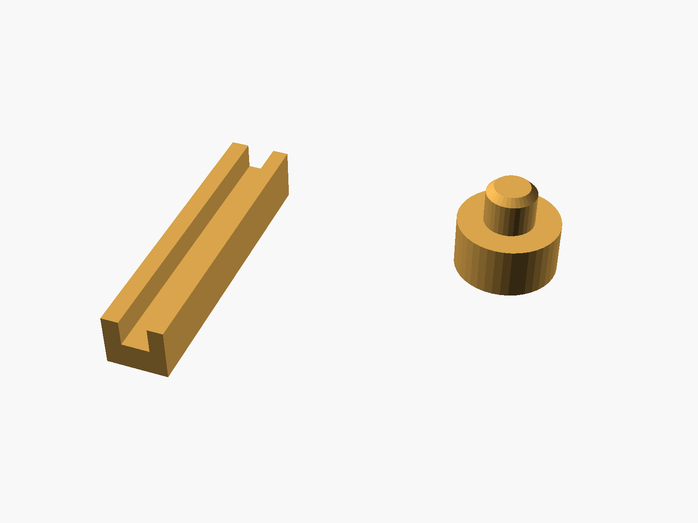
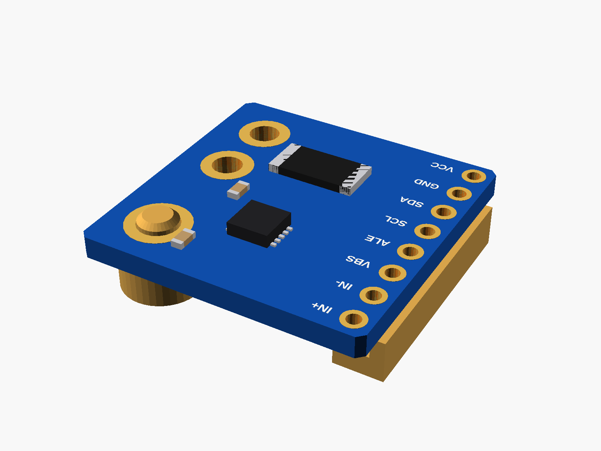

# INA226 current monitor (CJMCU-226)

CJMCU-226 INA226 current/power monitor (blue, 8 pins down one side: VCC GND SDA SCL ALE VBS IN- IN+; two big holes for the IN- / IN+ wires next to the 0.1 ohm shunt; one mounting hole).


**[View it in 3D](ina226_cjmcu226.stl)** (turn it with the mouse; GitHub shows it in one colour)

| Underneath | Holder | In its holder / case |
|---|---|---|
|  |  |  |

## Use it

```openscad
use <partbin/sensors/ina226_cjmcu226/ina226_cjmcu226.scad>
```

| Call | What it gives |
|---|---|
| `ina226_cjmcu226()` | the board, with its parts |
| `ina226_cjmcu226(headers = "down")` | with the 8-pin header soldered on |
| `ina226_cjmcu226_holder(h = 3)` | a post under its mounting hole + a ledge |
| `ina226_cjmcu226_size()` | [width, length, pcb thickness] |

Where it sits: parts up, the board centred on x = y = 0, its underside at z = 0, the pin row along the left edge (-x), VCC at the bottom.

## Sizes

At the top of [`ina226_cjmcu226.scad`](ina226_cjmcu226.scad), in mm: typical, from photos; measure yours and change them.

| Setting | Value | What |
|---|---|---|
| `b_w` | 20.5 | board (x) |
| `b_l` | 20.5 | board (y) |
| `big_d` | 2.2 | IN- / IN+ wire holes |

---

Part of [partbin](../../README.md), in [Sensors](../README.md).
