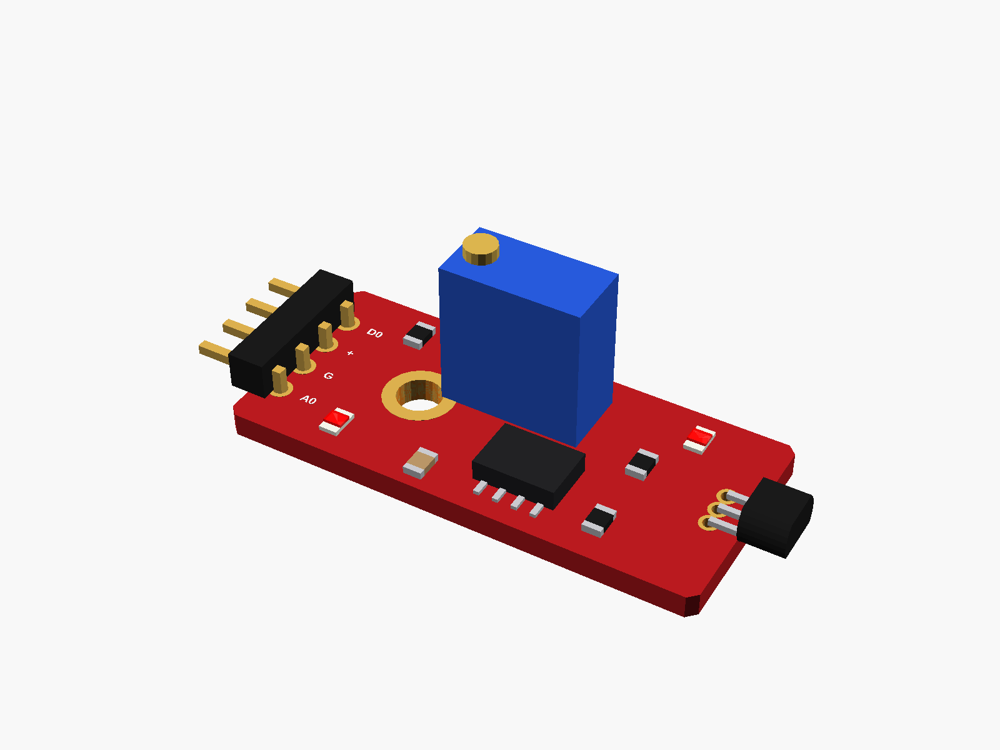
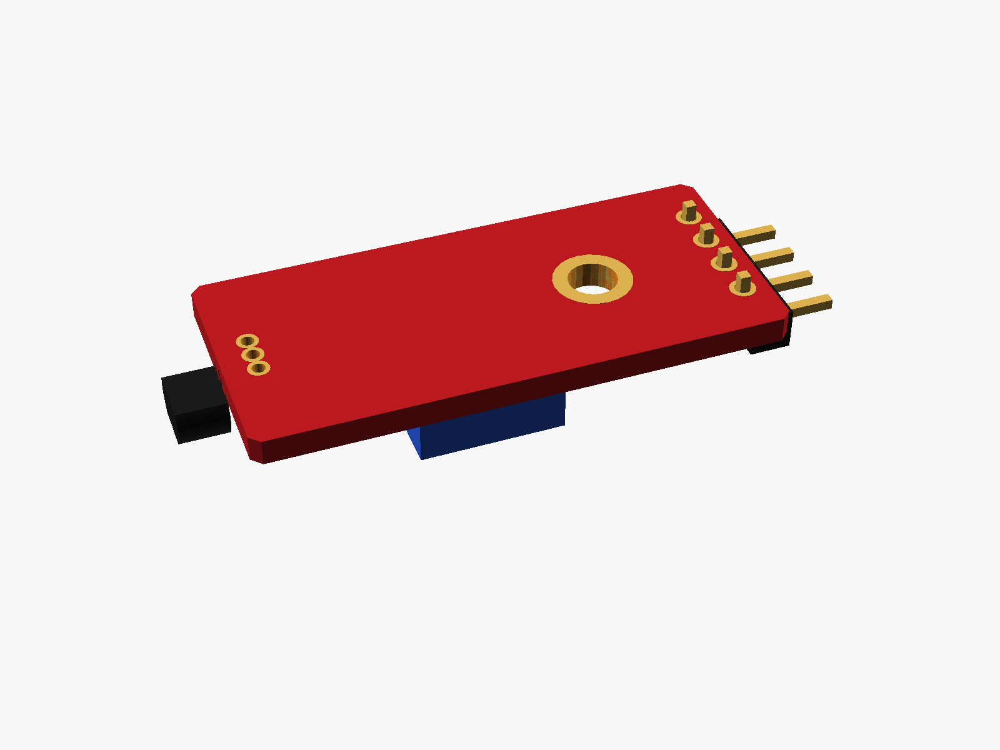
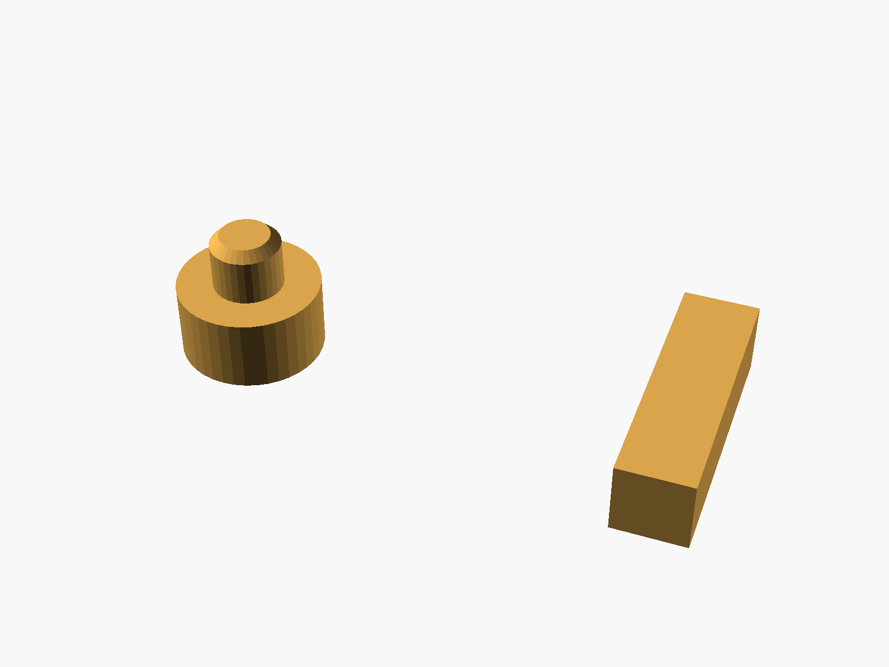
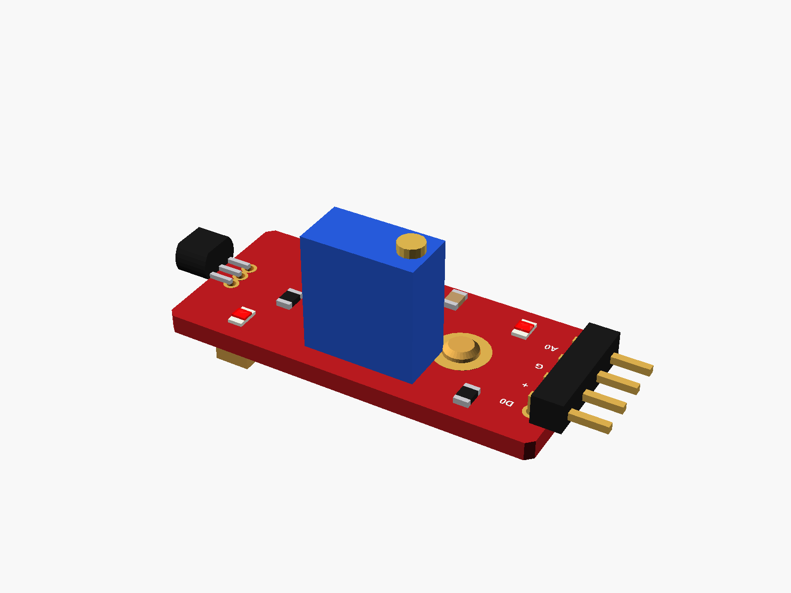

# KY-024 hall sensor

KY-024 linear hall sensor module (red, 4-pin right-angle header: A0 G + D0, a 49E hall sensor on bent legs at the far end, a blue 3296 trimmer, an LM393, two LEDs, one mounting hole).



**[View it in 3D](ky024_hall.stl)** (turn it with the mouse; GitHub shows it in one colour)

| Underneath | Holder | In its holder / case |
|---|---|---|
|  |  |  |

## Use it

```openscad
use <partbin/sensors/ky024_hall/ky024_hall.scad>
```

| Call | What it gives |
|---|---|
| `ky024_hall()` | the module, with its parts |
| `ky024_hall(sensor = "up")` | the hall sensor standing up instead of bent over |
| `ky024_hall(headers = "none")` | without the header ("angle" = default) |
| `ky024_hall_holder(h = 3)` | a post under its hole + a ledge |
| `ky024_hall_size()` | [length, width, pcb thickness] |

Where it sits: parts up, the board centred on x = y = 0, its underside at z = 0, the long side along x, the header at the left end (pins point -x), the hall sensor at the right end.

## Sizes

At the top of [`ky024_hall.scad`](ky024_hall.scad), in mm: typical, from photos; measure yours and change them.

| Setting | Value | What |
|---|---|---|
| `b_l` | 32.0 | board length (x) |
| `b_w` | 14.5 | board width (y) |

---

Part of [partbin](../../README.md), in [Sensors](../README.md).
