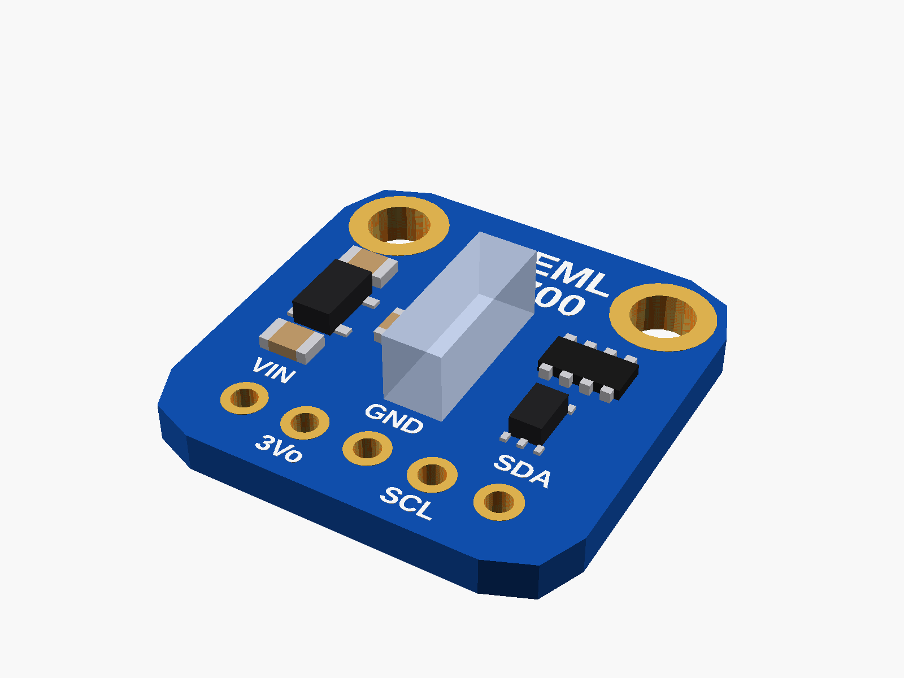
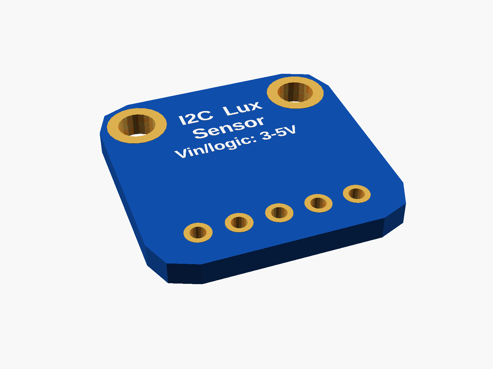
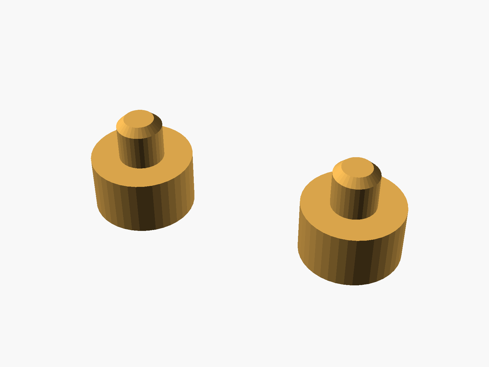
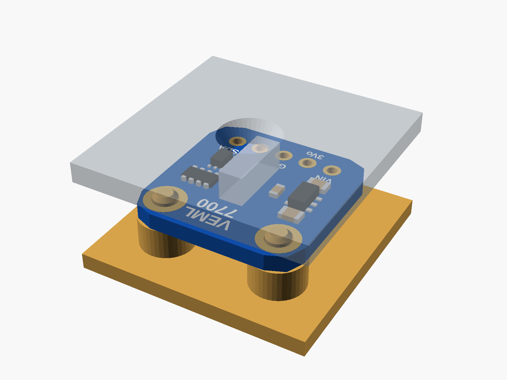

# VEML7700 light sensor

VEML7700 light sensor breakout, Adafruit #4162 layout (blue, 5 pins: VIN 3Vo GND SCL SDA, two mounting holes). Most clones copy it exactly.



**[View it in 3D](veml7700.stl)** (turn it with the mouse; GitHub shows it in one colour)

| Underneath | Holder | In its holder / case |
|---|---|---|
|  |  |  |

## Use it

```openscad
use <partbin/sensors/veml7700/veml7700.scad>
```

| Call | What it gives |
|---|---|
| `veml7700()` | the board, with its parts |
| `veml7700(detail = false)` | only what matters for fit (fast) |
| `veml7700(headers = "down")` | with a pin header soldered on |
| `veml7700_holder(h = 3)` | posts under its holes, add to the case |
| `veml7700_window(gap, wall)` | a window over the sensor, subtract from the lid |
| `veml7700_size()` | [width, length, pcb thickness] |
| `veml7700_sensor()` | [x, y] of the sensor |

Where it sits: parts up, the board centred on x = y = 0, its underside at z = 0, the pin row along the bottom edge (-y), the holes at the top (+y). The VEML7700 looks straight up and is the tallest part (3 mm). For the window, the lid's inside face is `gap` mm above the board's top. Opened on its own, this file shows it on its posts under a see-through lid with the window (set show = "board" or "holder").

## Sizes

At the top of [`veml7700.scad`](veml7700.scad), in mm: from a published drawing or the seller's sizes.

| Setting | Value | What |
|---|---|---|
| `b_w` | 16.51 | board width (x), 0.65" |
| `b_l` | 16.51 | board length (y) |
| `b_t` | 1.6 | PCB (typical; measure yours) |
| `corner` | 2.54 | corner radius |
| `hole_d` | 2.5 | mounting holes, plated |
| `hole_in` | 2.54 | hole centre to the top and the side edges |
| `pin_bot` | 2.54 | pin centre to the bottom edge |
| `chip` | [0.381, 0] | VEML7700 centre |
| `chip_h` | 3.0 | VEML7700 height (the tallest part) |

---

Part of [partbin](../../README.md), in [Sensors](../README.md).
