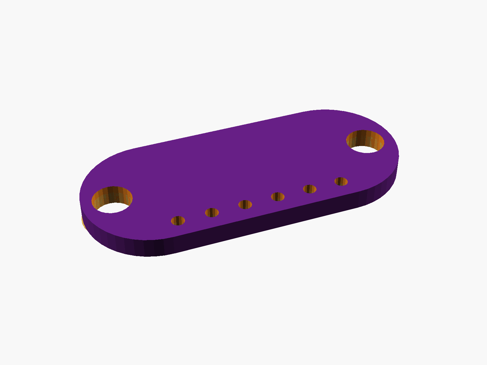
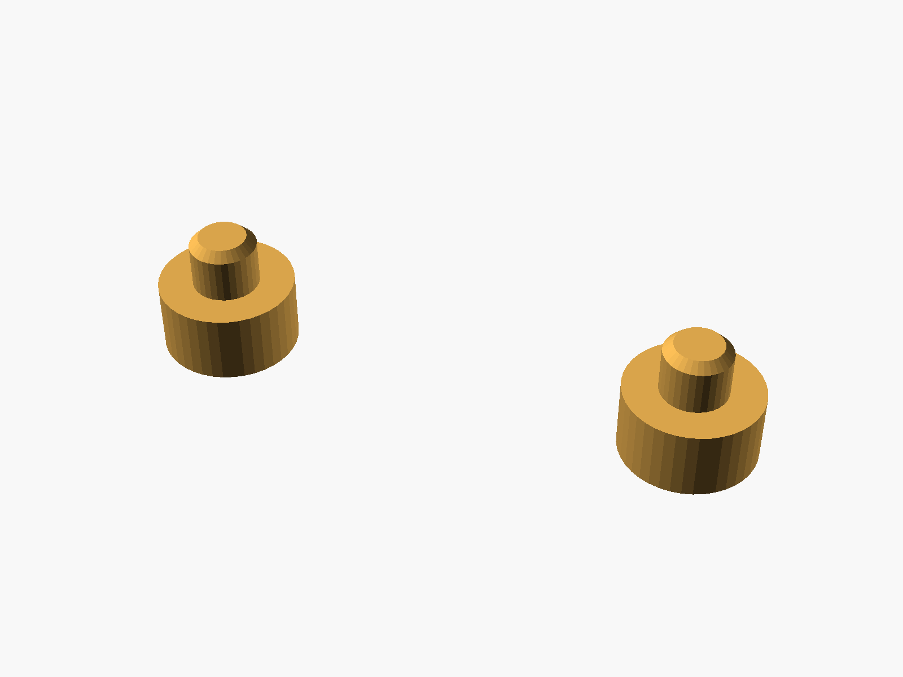
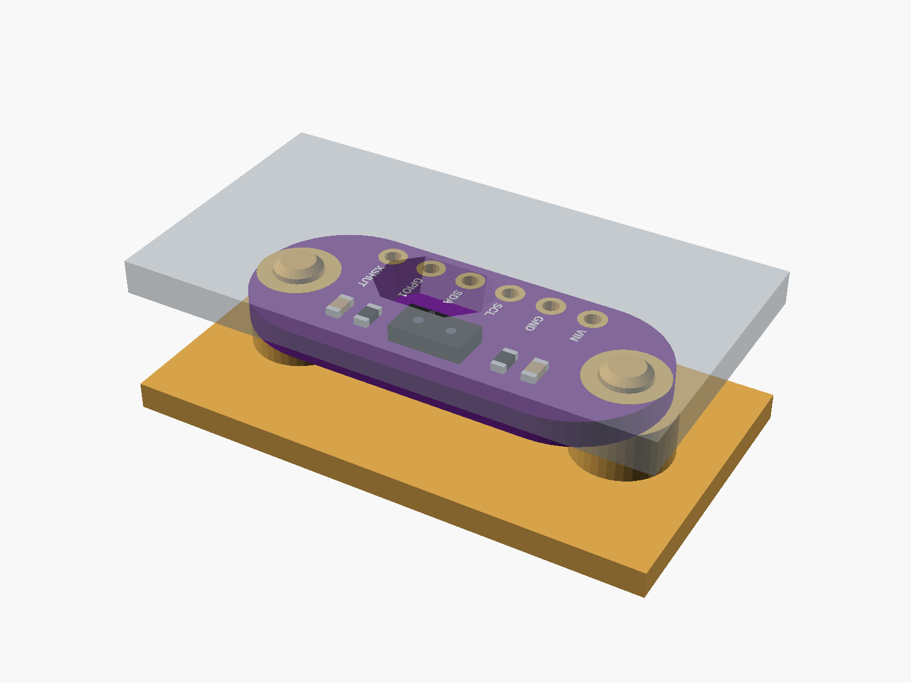

# VL53L0X distance sensor (GY-530)

VL53L0X time-of-flight distance sensor, GY-530 / "VL53L0/1XV2" (purple, 6 pins: VIN GND SCL SDA GPIO1 XSHUT, a hole in each rounded end).


**[View it in 3D](vl53l0x_gy530.stl)** (turn it with the mouse; GitHub shows it in one colour)

| Underneath | Holder | In its holder / case |
|---|---|---|
|  |  |  |

## Use it

```openscad
use <partbin/sensors/vl53l0x_gy530/vl53l0x_gy530.scad>
```

| Call | What it gives |
|---|---|
| `vl53l0x_gy530()` | the board, with its parts |
| `vl53l0x_gy530(headers = "down")` | with the 6-pin header soldered on |
| `vl53l0x_gy530_holder(h = 3)` | posts under its two holes |
| `vl53l0x_gy530_window(gap, wall)` | an opening over the sensor in the lid |
| `vl53l0x_gy530_size()` | [length, width, pcb thickness] |

Where it sits: parts up, the board centred on x = y = 0, its underside at z = 0, the long side along x, the pins along the bottom edge (-y). The sensor looks up; a cover in front of it should be IR-clear or have a hole.

## Sizes

At the top of [`vl53l0x_gy530.scad`](vl53l0x_gy530.scad), in mm: typical, from photos; measure yours and change them.

| Setting | Value | What |
|---|---|---|
| `b_w` | 25.0 | length (x), with the rounded ends |
| `b_l` | 10.7 | width (y) |
| `hole_x` | 10.2 | each hole from the centre |
| `chip` | [0, 2.2] | sensor centre |
| `chip_s` | [4.4, 2.4, 1.0] | VL53L0X package |

---

Part of [partbin](../../README.md), in [Sensors](../README.md).
